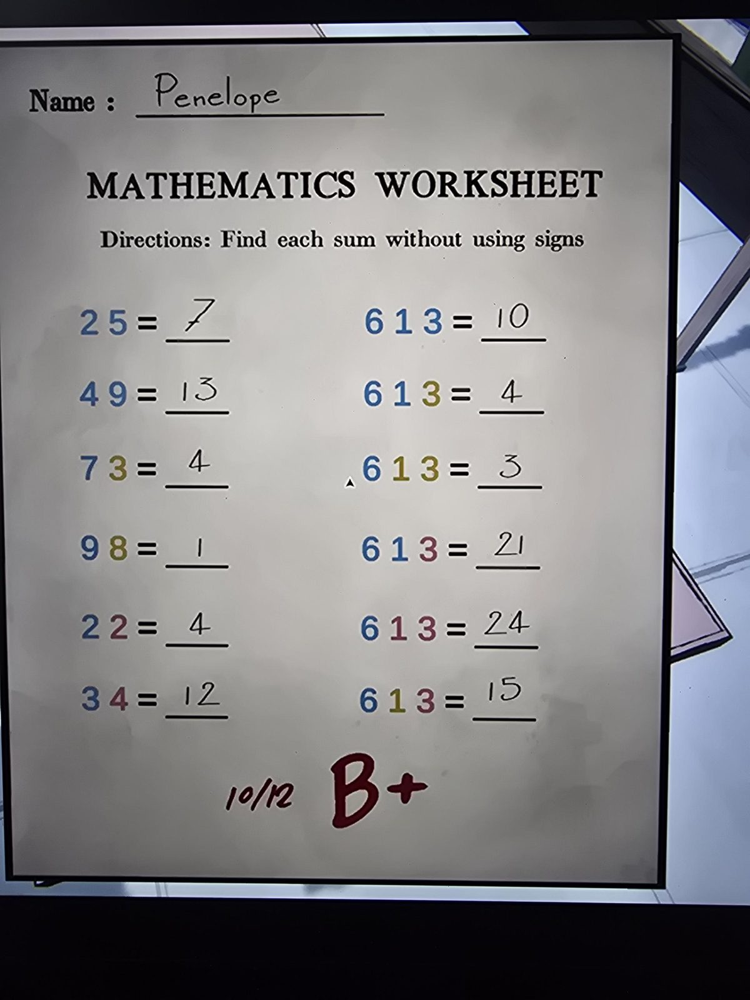
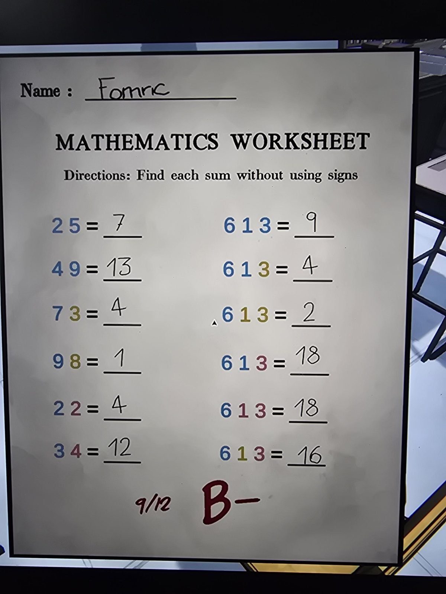
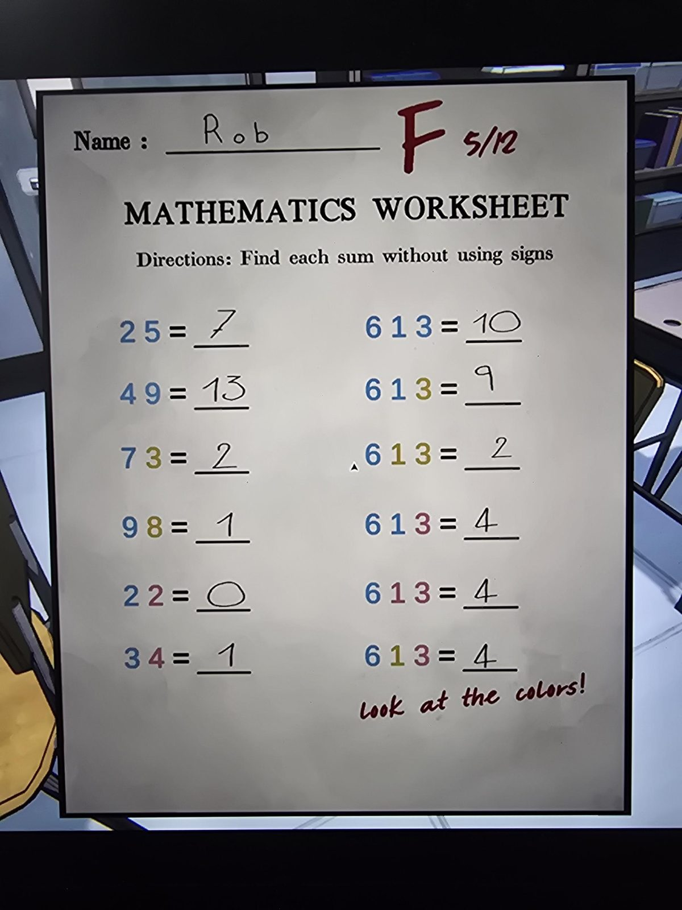
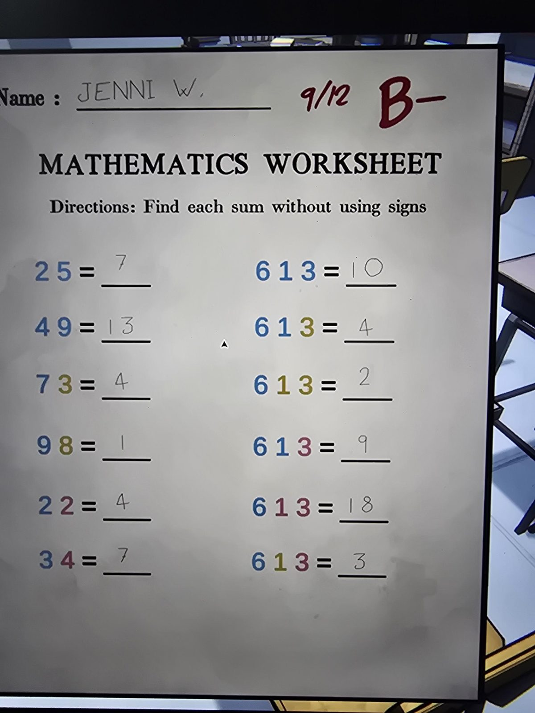

MATHEMATICS WORKSHEET
Directions: Find each sum without using signs

Four worksheets (Name / answers / mark):

Penelope: 25=7, 49=13, 73=4, 98=1, 22=4, 34=12 | 613=10, 613=4, 613=3, 613=21, 613=24, 613=15 — 10/12 B+
Fomric: 25=7, 49=13, 73=4, 98=1, 22=4, 34=12 | 613=9, 613=4, 613=2, 613=18, 613=18, 613=16 — 9/12 B−
Rob: 25=7, 49=13, 73=2, 98=1, 22=0, 34=1 | 613=10, 613=9, 613=2, 613=4, 613=4, 613=4 — F 5/12; "look at the colors!"
JENNI W.: 25=7, 49=13, 73=4, 98=1, 22=4, 34=7 | 613=10, 613=4, 613=2, 613=9, 613=18, 613=3 — 9/12 B−

## Photos / Фото

