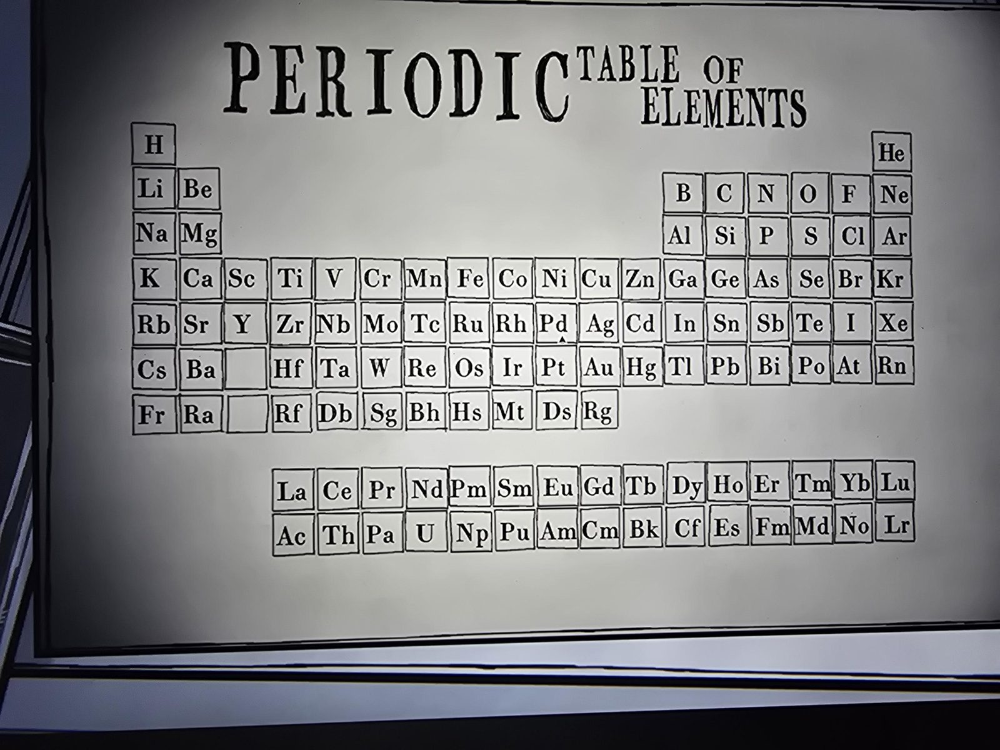

# Grade 3: периодическая таблица
Classroom, **3-й класс**. Таблица элементов на стене: нужна, чтобы подбирать символы для [листов Science](../grade-3-science-worksheets/ru.md).

Особенности: в 6-й и 7-й строках под Sc/Y — **пустые клетки**; 7-я строка заканчивается на **Rg** (дальше элементов нет); лантаноиды (La–Lu) и актиноиды (Ac–Lr) вынесены в две отдельные строки внизу. Транскрипция — в [en.md](en.md).

## Photos / Фото

