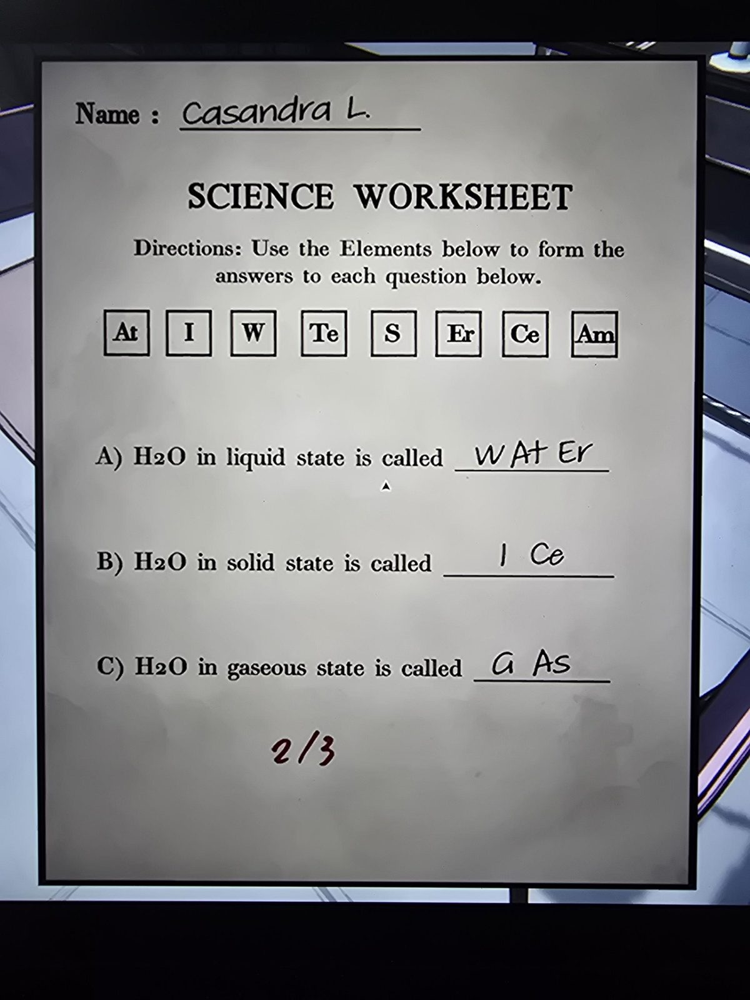
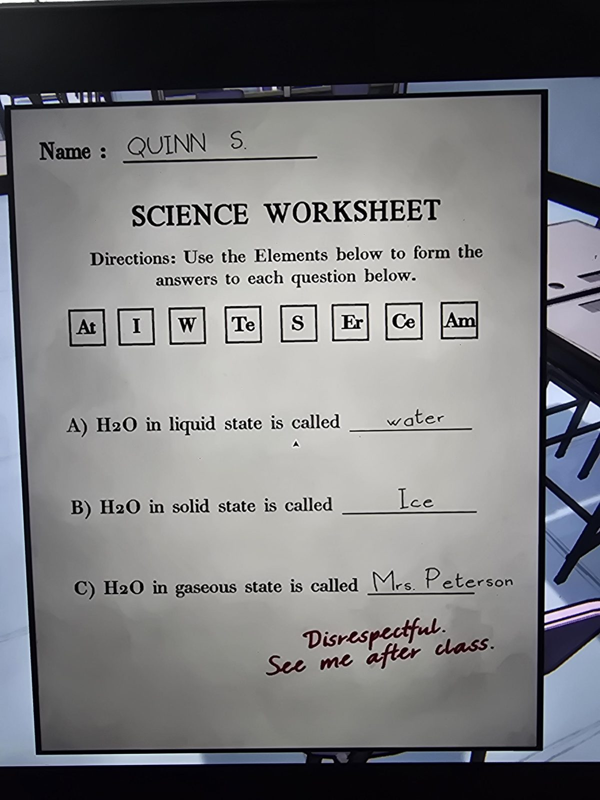
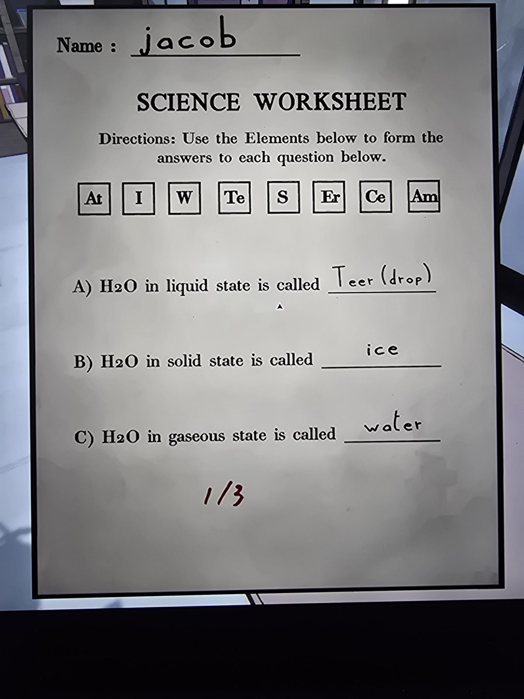

# Grade 3: «Science Worksheet»
Classroom, **3-й класс**. Задание: «Используй элементы ниже, чтобы составить ответы на каждый вопрос». Набор плиток: **At, I, W, Te, S, Er, Ce, Am**. Вопросы: как называется H₂O в **жидком** (A), **твёрдом** (B) и **газообразном** (C) состоянии. Ответ составляется из символов элементов ([таблица Менделеева](../grade-3-periodic-table/ru.md)).

| Ученик | A (жидкое) | B (твёрдое) | C (газ) | Оценка |
|---|---|---|---|---|
| Casandra L. | WAtEr | ICe | GAs | 2/3 |
| Quinn S. | water | Ice | Mrs. Peterson | приписка: «Disrespectful. See me after class.» («Непочтительно. Зайди ко мне после урока.») |
| jacob | Teer (drop) | ice | water | 1/3 |

## Решение (выведено по оценкам, в игре не проверялось)
- A **Water** = W + At + Er; B **Ice** = I + Ce; C **Steam** = S + Te + Am.
- Касандра ошиблась в C: «GAs» (G — не элемент, и «gas» не название состояния H₂O). У Джейкоба верно только B: «Teer (drop)» = Te + Er, а «water» он вписал в C.
- Все 8 плиток используются ровно по одному разу (3 + 2 + 3).

## Photos / Фото

