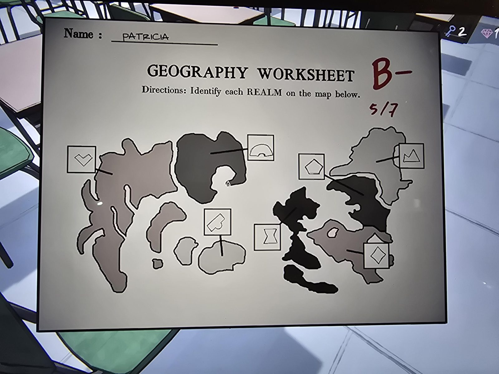
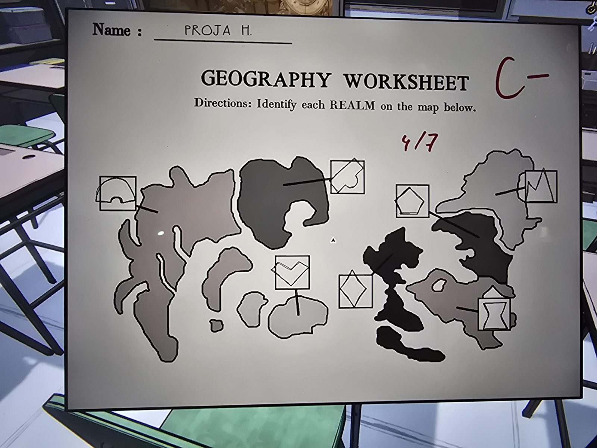
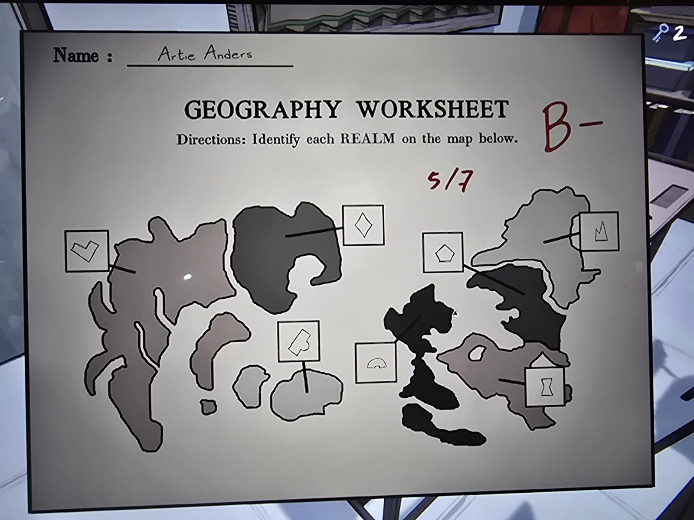
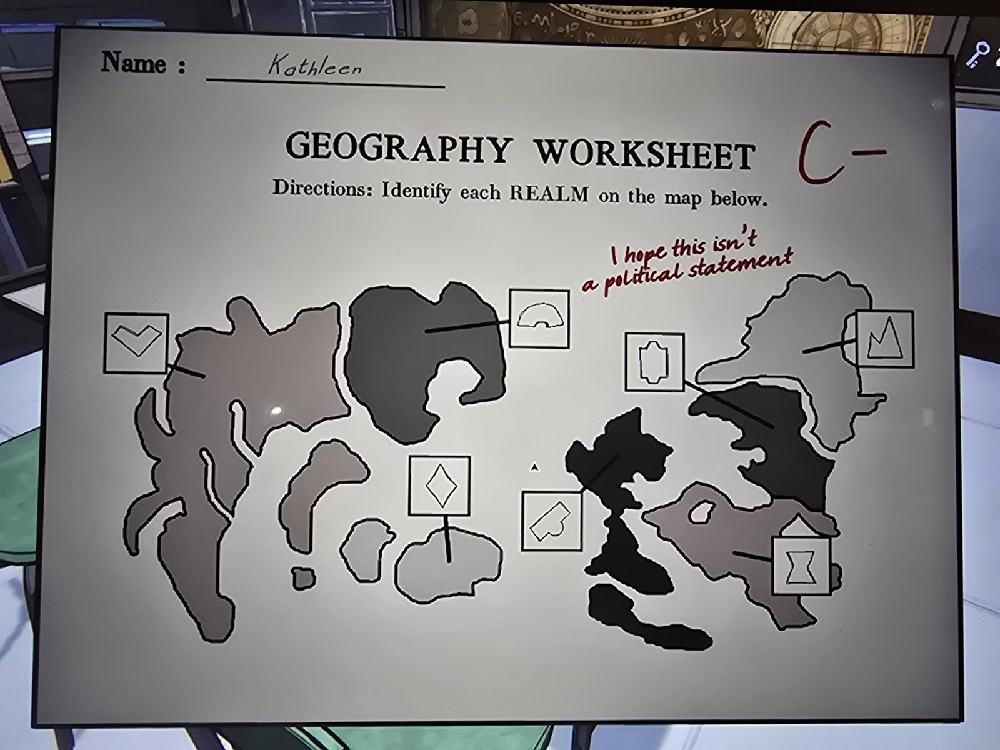

GEOGRAPHY WORKSHEET
Directions: Identify each REALM on the map below.

(A black-and-white map of 7 regions; each region is joined by a line to a box with a sigil core symbol drawn by the student.)

PATRICIA — B−, 5/7
PROJA H. — C−, 4/7
Artie Anders — B−, 5/7
Kathleen — C−; note: "I hope this isn't a political statement"

## Photos / Фото

