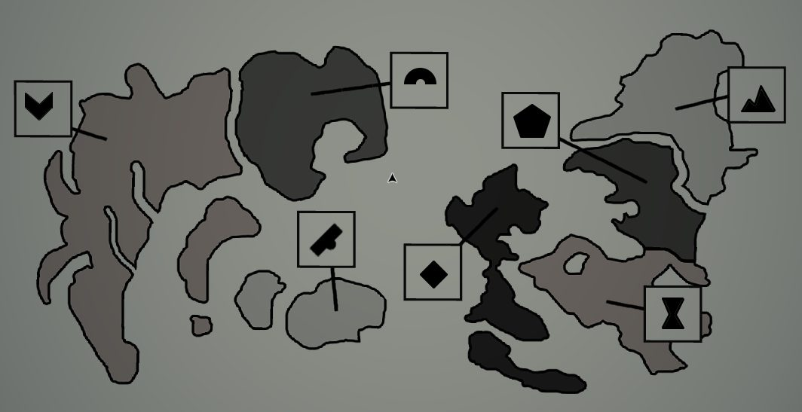

# Grade 4: «Geography Worksheet»
Classroom, **4-й класс**. Задание: «**Определи каждое КОРОЛЕВСТВО (REALM) на карте ниже**». Чёрно-белая карта из 7 областей; ученики соединяют каждую область линией с рамкой, в которую нарисовали **ядро печати** королевства ([книга о печатях](../../../the-precipice/docs/realm-sigils-book/ru.md)). Те же знаки (горы, полукруг и др.) стоят на коробках [Mora Jai](../../../../puzzles/mora-jai/README.md).

Нумерация областей (моя): 1 — большая западная; 2 — тёмная вверху в центре; 3 — светлый остров внизу в центре; 4 — светлая верхняя правая; 5 — тёмная в центре справа; 6 — чёрная посередине; 7 — светлая нижняя правая (с озером).

| Область | Patricia (B−, 5/7) | Proja H. (C−, 4/7) | Artie Anders (B−, 5/7) | Kathleen (C−, 4/7) | Правильный ответ |
|---|---|---|---|---|---|
| 1 | галочка | полукруг | галочка | галочка | **галочка** (Corarica) |
| 2 | полукруг | прямоугольник с вырезами | ромб | полукруг | **полукруг** |
| 3 | прямоугольник с вырезами | галочка | прямоугольник с вырезами | ромб | **прямоугольник с вырезами** |
| 4 | горы | горы | горы | горы | **горы** (Arch Aries) |
| 5 | пятиугольник | пятиугольник | пятиугольник | вытянутая фигура с выступами (знак Orinda Aries) | **пятиугольник** (Fenn Aries) |
| 6 | песочные часы | ромб | полукруг | прямоугольник с вырезами | **ромб** |
| 7 | ромб | песочные часы | песочные часы | песочные часы | **песочные часы** (Eraja) |

«Прямоугольник с вырезами» — знак, который в репозитории называется «прямоугольник с кругом» (Mora Jai).

У Kathleen оценка **C−**, дробь не видна (по ответам выходит 4/7); приписка учителя: **«I hope this isn't a political statement»** («Надеюсь, это не политическое заявление»).

## Решение
Правильные ответы дал игрок (карта: [05.jpg](05.jpg)): 1 — галочка, 2 — полукруг, 3 — прямоугольник с вырезами, 4 — горы, 5 — пятиугольник, 6 — ромб, 7 — песочные часы.

**Проверка по оценкам:** Patricia 5/7, Proja H. 4/7, Artie Anders 5/7, Kathleen 4/7 (C−) — все совпадают с оценками на листах.

**Orinda Aries и Fenn Aries — одна и та же земля в разные эпохи.** На глобусах написана 3-я эра, поэтому там нет пятиугольника (Fenn Aries). Сейчас 6-я эра, поэтому на листах нет Orinda Aries (вытянутой фигуры с выступами); об этом же говорит «История Ориндии». Поэтому Kathleen в области 5 нарисовала знак Orinda Aries вместо пятиугольника, а учитель приписал: **«I hope this isn't a political statement»**: так она напомнила, что раньше эта земля была Orinda, а не Fenn.

**Названия по расположению на глобусах** ([Ettsphere](../grade-4-map-ettsphere/ru.md), [Orrsphere](../grade-4-map-orrsphere/ru.md)); это мой вывод, игрок их не называл: 1 — Corarica; 2 — Mora Jai (северо-восток Orrsphere); 3 — Verra (южные острова Orrsphere); 4 — Arch Aries; 5 — Orinda Aries / Fenn Aries; 6 — Nuance (и Farther Nuance); 7 — Eraja. Знаки Corarica, Orinda Aries, Fenn Aries, Eraja и Arch Aries известны из [книги](../../../the-precipice/docs/realm-sigils-book/ru.md), [Inner Sanctum 1](../../../the-underpass/inner-sanctum-1/solutions.md) и [2](../../../the-underpass/inner-sanctum-2/solutions.md), цвет Arch Aries — из [Grade 1](../grade-1-color-worksheets/ru.md).

## Photos / Фото

