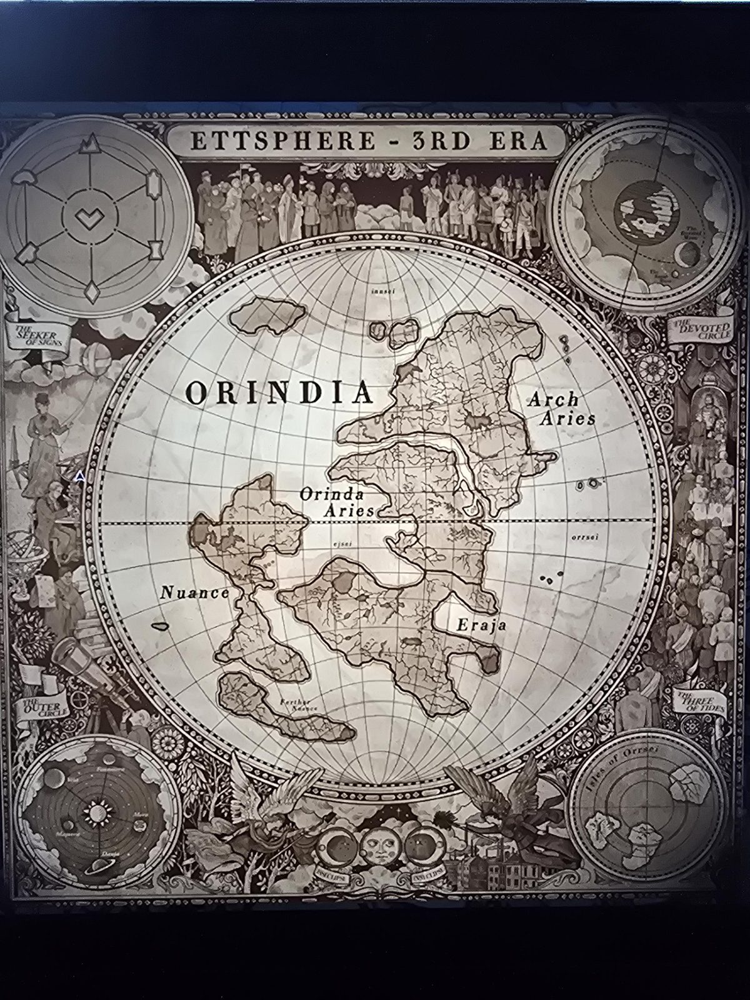

# Grade 4: карта «Ettsphere — 3rd Era»
Classroom, **4-й класс** (география). Карта восточного полушария эпохи 3rd Era: континент **ORINDIA**, подписаны королевства **Arch Aries** (северо-восток), **Orinda Aries** (центр), **Nuance** и **Farther Nuance** (запад/юго-запад), **Eraja** (юго-восток); меридианные подписи innsei / ejsei / orrsei; врезка «Isles of Orrsei».

- В левом верхнем углу — **шестиугольник с шестью знаками королевств** вокруг «галочки» в центре (те же ядра печатей, что в [книге о печатях](../../../the-precipice/docs/realm-sigils-book/ru.md)). Знаки на углах: горы, полукруг, и др.
- Баннеры по краям: *The Seeker of Signs*, *The Devoted Circle*, *The Outer Circle*, *The Three of Tides*.
- Парная карта: [Orrsphere](../grade-4-map-orrsphere/ru.md). Контекст: [доска Geography](../grade-4-geography-board/ru.md), [листы](../grade-4-geography-worksheets/ru.md).
- Надписи мелкие, часть прочитана приблизительно.

## Photos / Фото

