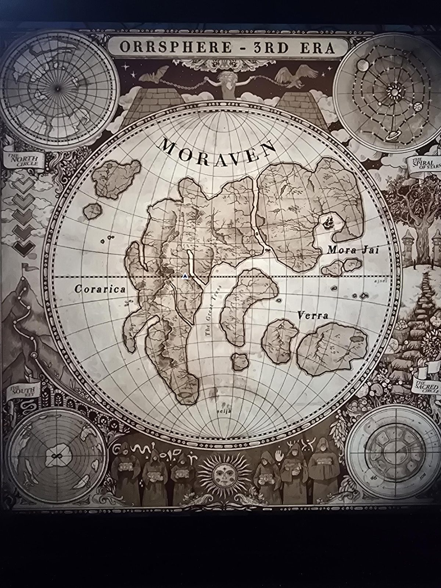

# Grade 4: карта «Orrsphere — 3rd Era»
Classroom, **4-й класс**. Карта западного полушария: континент **MORAVEN**, королевства **Mora Jai** (северо-восток), **Corarica** (запад, большая суша), **Verra** (юго-восток); пролив **The Great Tress** (прочитано приблизительно); подписи ajsei / seija.

- Слева — столбик из **пяти «галочек»** от светлой к тёмной (ср. знак Corarica: «галочка»); справа внизу круглая врезка с числами **46** и **1938** (мелко, прочитано приблизительно).
- Внизу — восемь фигур в капюшонах со знаками (ср. символы рун/писем), солнце с лицом.
- Баннеры: *The North Circle*, *The Spiral of Stars*, *The Sacred Circle*, *The South Key*.
- Парная карта: [Ettsphere](../grade-4-map-ettsphere/ru.md).

## Photos / Фото

