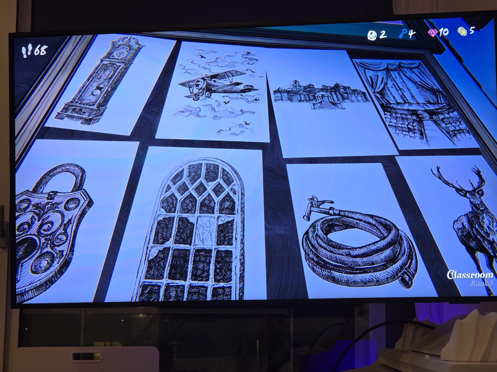
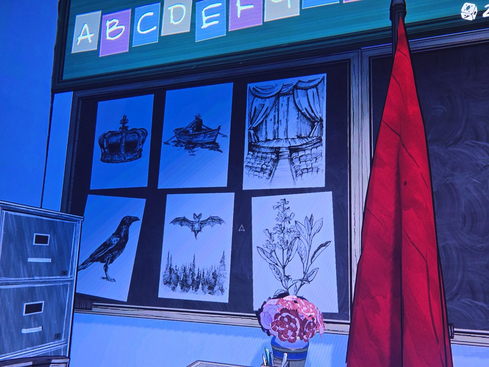

# Grade 5: boards with pictures

*(No text except the alphabet strip.)*

**Board 1** (screen shows "Classroom, Rank 5"): eight engravings: a grandfather clock, a biplane among clouds and birds, a large building with steps, a stage with curtains and seats, a padlock, a broken arched window, a garden hose with a tap, a stag.

**Board 2:** six engravings: a crown, a rowing boat, a stage with curtains and seats, a raven, a bat above a forest, a flowering plant. Above the board: a strip of colored tiles with letters A B C D E F G …

## Photos / Фото

