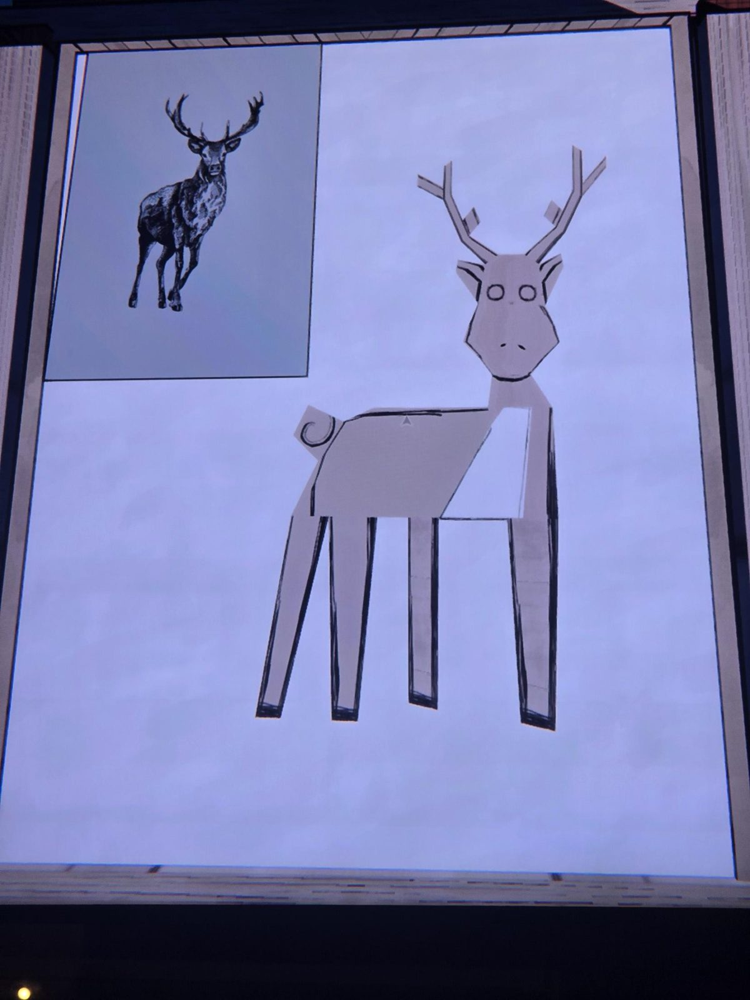
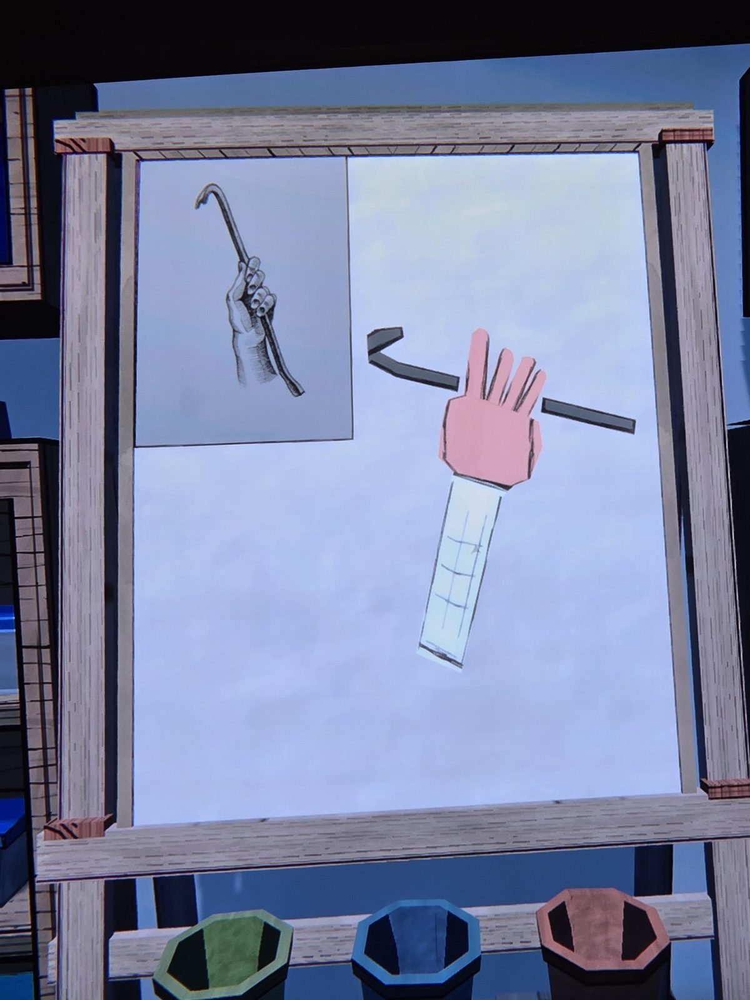
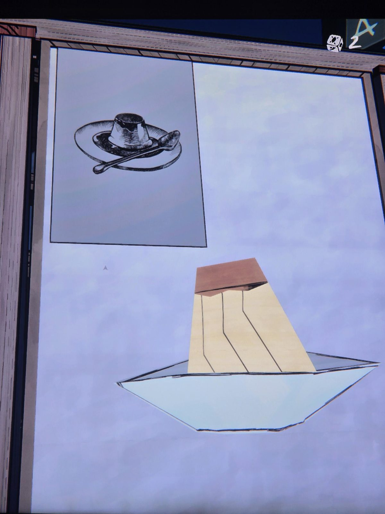
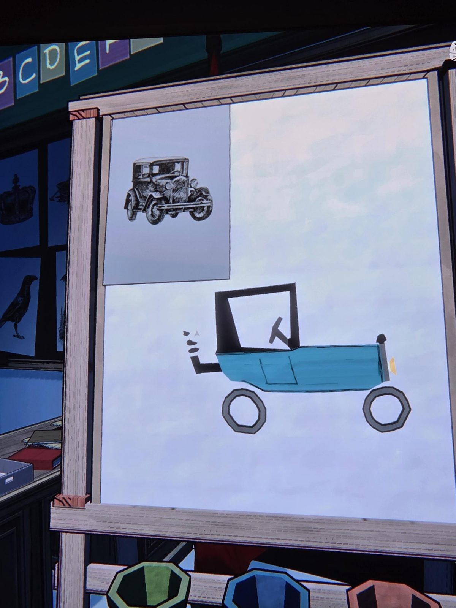
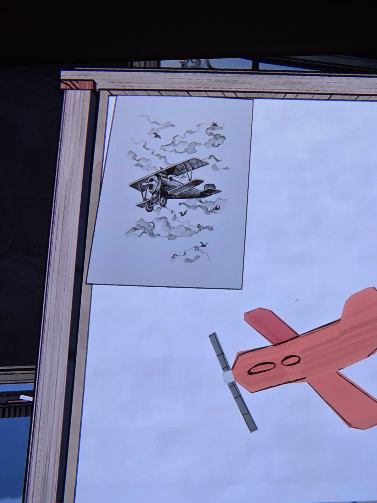
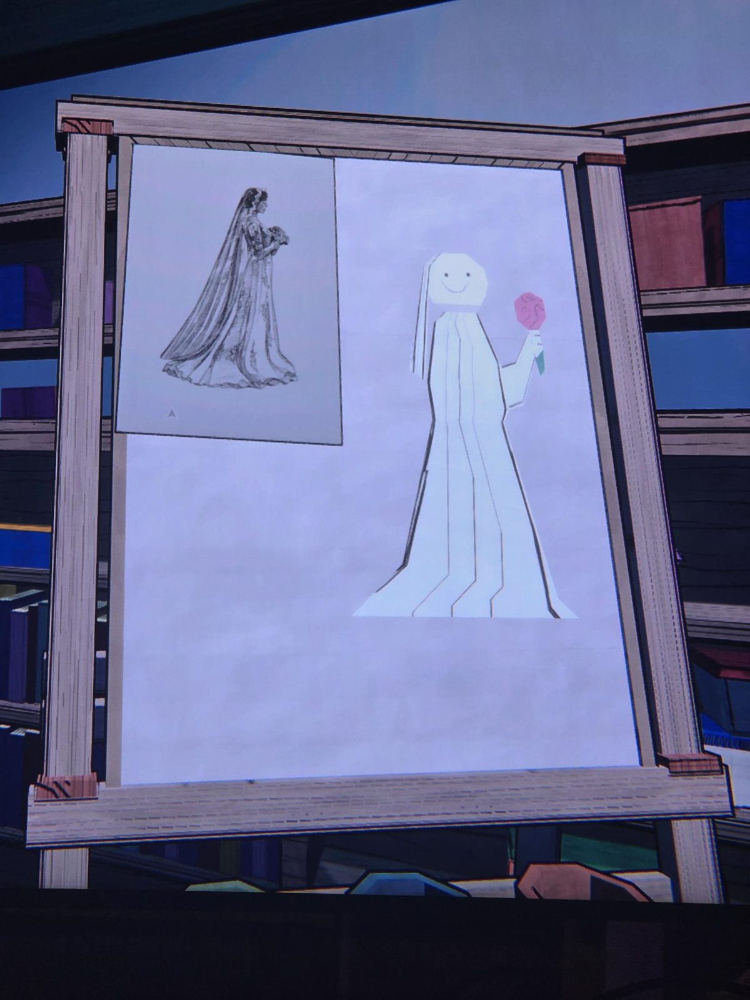

# Grade 5: easel drawings

*(No text. Six easels. On each: a reference engraving in the top-left corner and a simple blocky drawing of it.)*
1. Stag with antlers; drawn: a boxy deer with antlers and a curled tail.
2. A hand gripping a crowbar; drawn: a pink hand holding a crowbar, a white sleeve below.
3. A pudding (flan) on a plate with a spoon; drawn: a pudding on a plate.
4. An old car (Model T type); drawn: a blue open car with a black roof frame and a crank in front.
5. A biplane among clouds and birds; drawn: a red plane with a propeller.
6. A bride in a veil with a bouquet; drawn: a smiling figure in a white dress and veil with a pink bouquet.

## Photos / Фото

