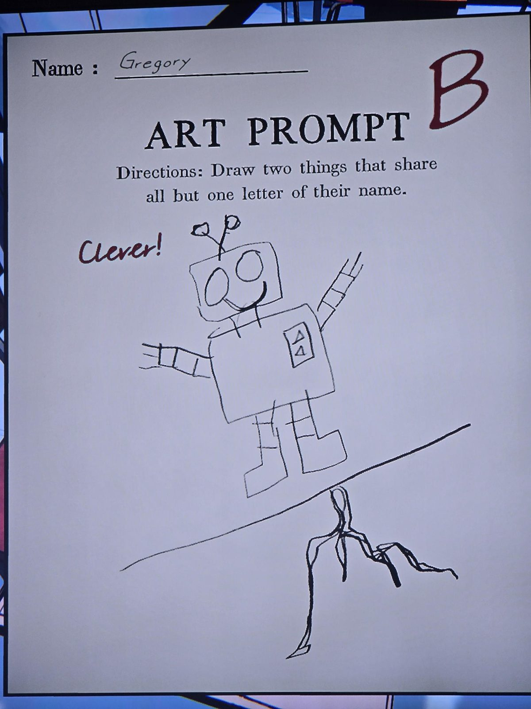
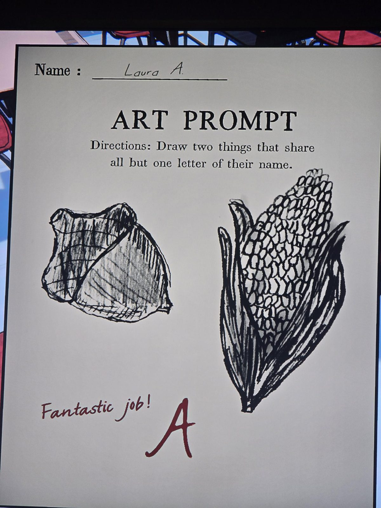
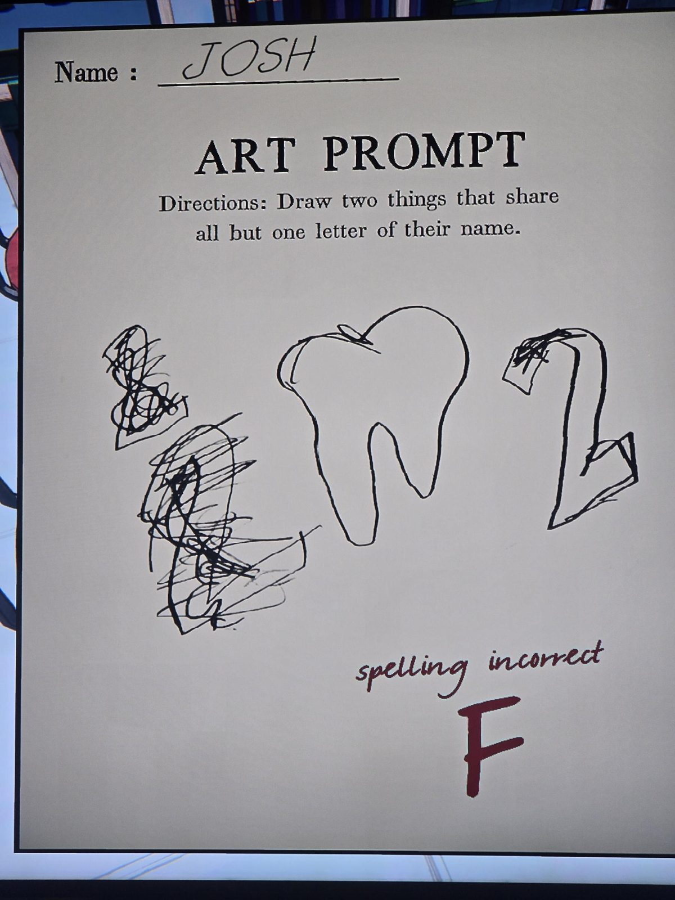

# Grade 5: листы «Art Prompt»
Classroom, **5-й класс** (Art). Задание: «**Нарисуй две вещи, названия которых отличаются ровно одной буквой**» («share all but one letter of their name»).

| Ученик | Рисунок | Оценка и приписка |
|---|---|---|
| Gregory | робот на линии и корень дерева под ней | **B**, «Clever!» («Умно!») |
| Laura A. | жёлудь и початок кукурузы | **A**, «Fantastic job!» («Отличная работа!») |
| Josh | две закорючки слева, зуб посередине, изогнутая фигура справа | **F**, «spelling incorrect» («написание неверно») |

## Заметка
- Пары слов у Gregory и Laura (по рисункам, догадка): **robot / root**, **acorn / corn**.

## Photos / Фото
01 — Gregory; 02 — Laura A.; 03 — Josh.

