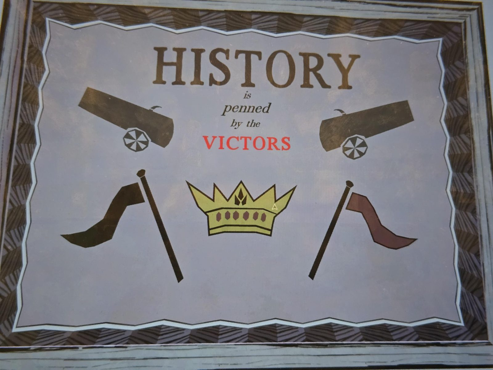

# Grade 6: плакат «History is penned by the Victors»
Classroom, **6-й класс**. Плакат: «**История** пишется **победителями**» (слово VICTORS красным). Две пушки сверху, внизу чёрный флаг слева, тёмно-красный справа, между ними золотая корона. Связан с [тестом](../grade-6-history-worksheets/ru.md) и [слайдами](../grade-6-history-slides/ru.md): победили красные (Fenn Aries), чёрный флаг после войны запрещён.

## Photos / Фото

