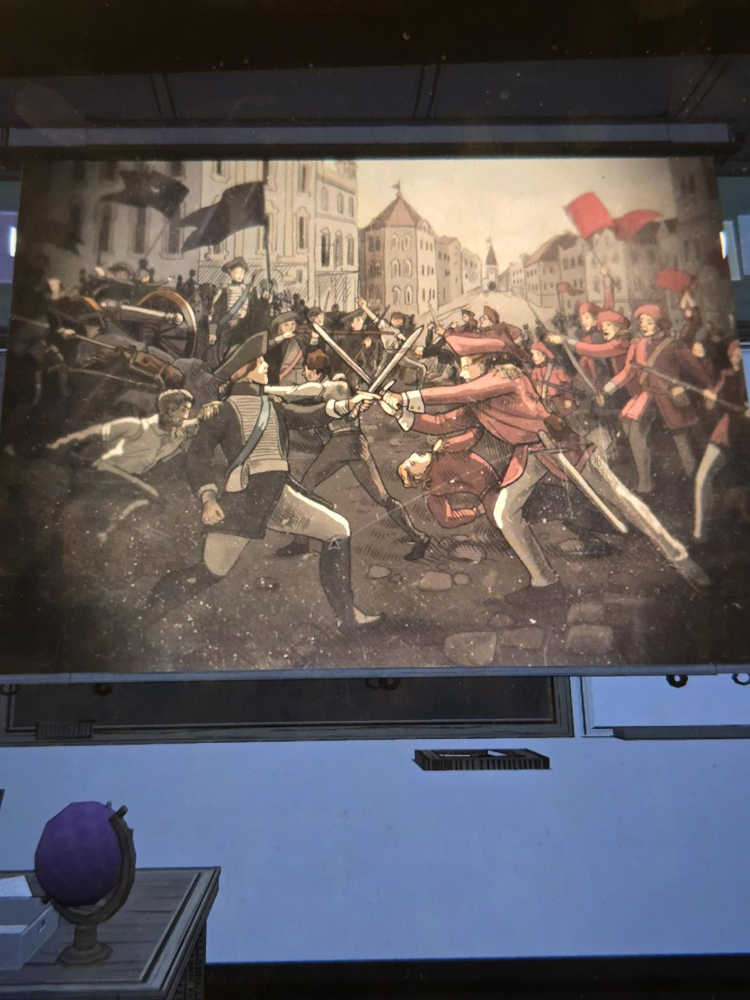
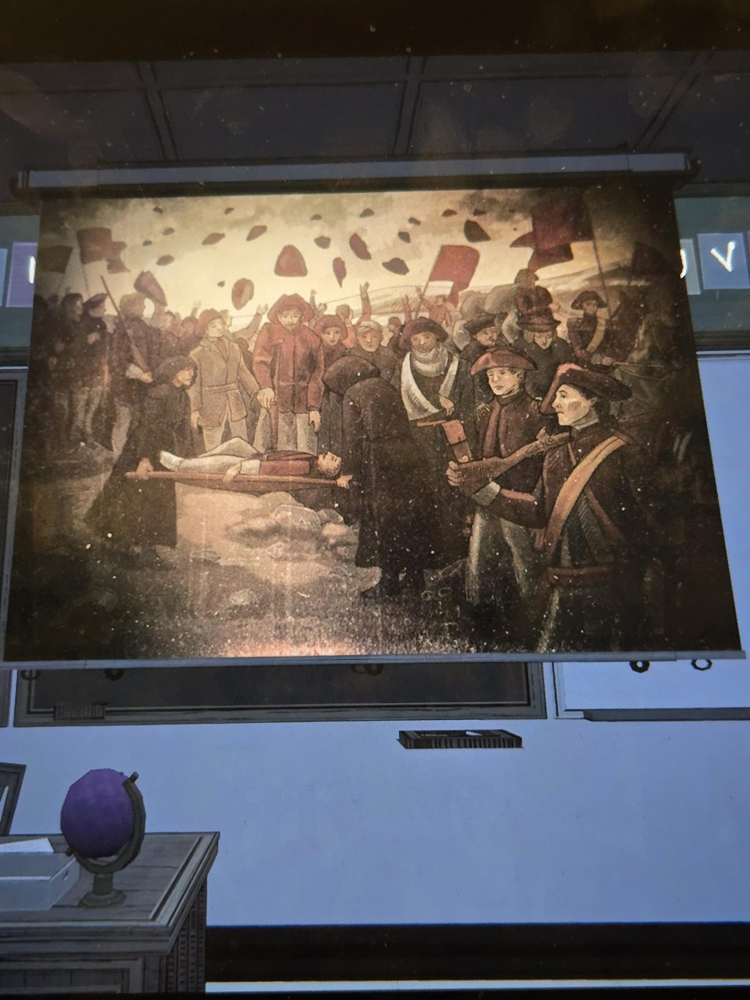
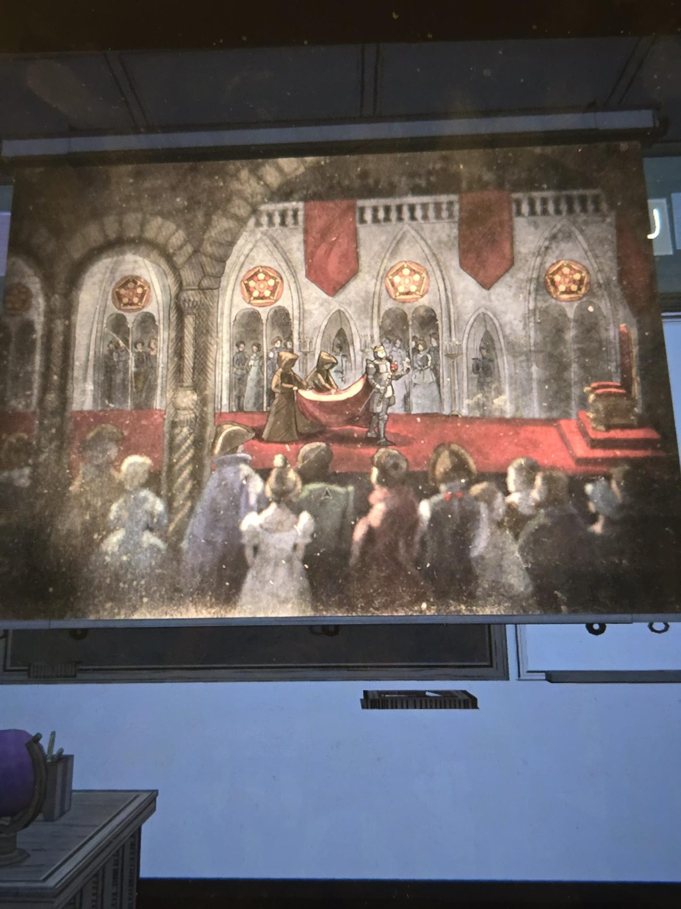
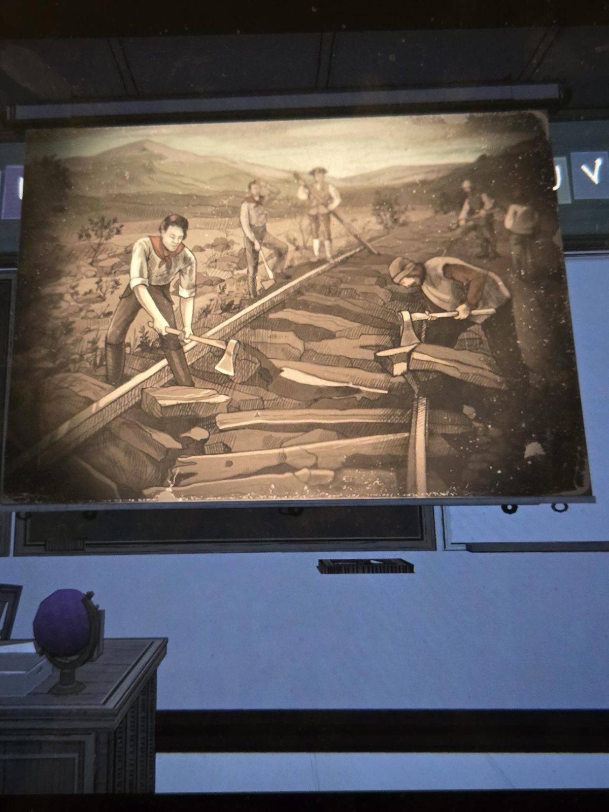

# Grade 6: слайды History (проектор)
Classroom, **6-й класс**. Экран над доской показывает четыре картинки без подписей (их нужно листать). Это иллюстрации к [тесту](../grade-6-history-worksheets/ru.md): война Пятой эры между Fenn Aries и Orinda Aries.

1. **Уличный бой:** слева солдаты в тёмно-синих мундирах с **чёрными флагами** и пушкой, справа солдаты в **красных** мундирах и шапках с красными флагами; два офицера скрестили шпаги.
2. **Победа и похороны:** носилки с телом несут фигуры в капюшонах, вокруг солдаты в красных шапках, толпа подбрасывает красные шапки, красные флаги.
3. **Коронация:** в зале на красном помосте фигура в доспехах принимает красный плащ от двух фигур в капюшонах; справа трон; окна-розетки в форме **пятиугольника**, красные знамёна, перед помостом толпа.
4. **Разбор железной дороги:** рабочие топорами и кирками разбирают рельсы и шпалы на открытой местности (сепия).

Красный (Fenn Aries) и чёрный (Orinda Aries) совпадают с цветами знамён в [таблице королевств](../../../../puzzles/realms/README.md).

## Photos / Фото

