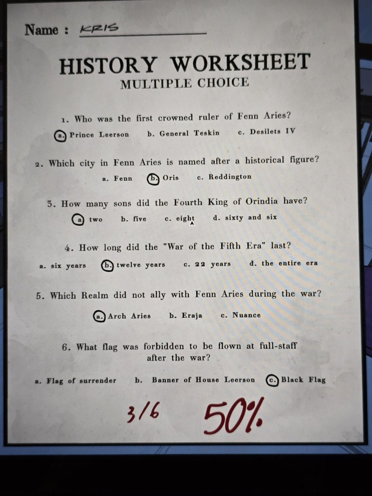
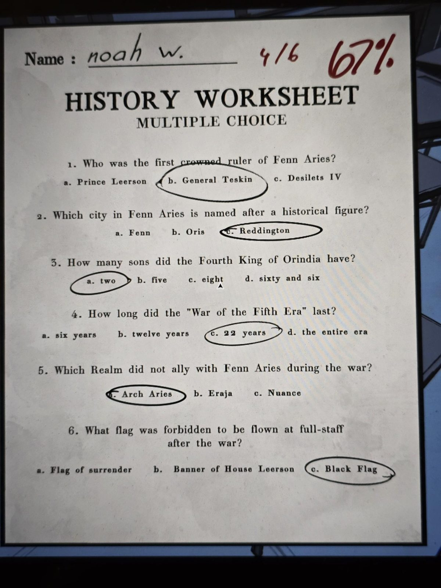
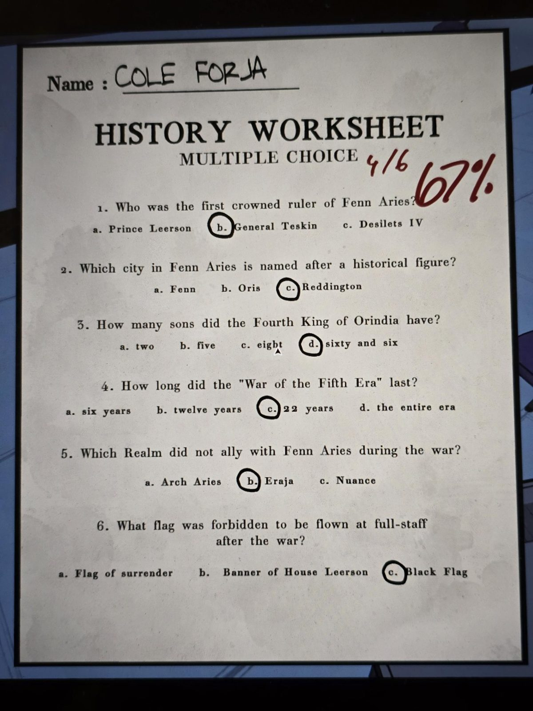
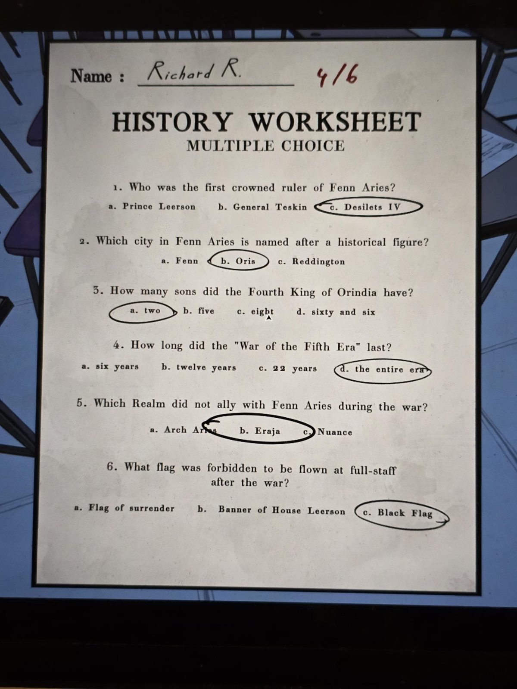

# Grade 6: «History Worksheet» (тест с выбором ответа)
Classroom, **6-й класс** (History). Четыре проверенные работы, ответы обведены, оценка красным. Текст — в [en.md](en.md).

**Вопросы:**
1. Кто был первым коронованным правителем Fenn Aries? (принц Леерсон / генерал Тескин / Десилетс IV)
2. Какой город Fenn Aries назван в честь исторической личности? (Fenn / Oris / Reddington)
3. Сколько сыновей было у Четвёртого короля Ориндии? (два / пять / восемь / шестьдесят шесть)
4. Сколько длилась «Война Пятой эры»? (шесть лет / двенадцать / 22 года / вся эра)
5. Какое королевство не стало союзником Fenn Aries в войне? (Arch Aries / Eraja / Nuance)
6. Какой флаг запретили поднимать на половину флагштока после войны? (флаг капитуляции / знамя Дома Леерсонов / чёрный флаг)

| Ученик | 1 | 2 | 3 | 4 | 5 | 6 | Оценка |
|---|---|---|---|---|---|---|---|
| Kris | a | b | a | b | a | c | 3/6, 50% |
| Noah W. | b | c | a | c | a | c | 4/6, 67% |
| Cole Forja | b | c | d | c | b | c | 4/6, 67% |
| Richard R. | c | b | a | d | b | c | 4/6 (процент не указан) |

## Правильные ответы
Дал игрок: **1 — a (принц Леерсон), 2 — c (Reddington), 3 — a (два), 4 — c (22 года), 5 — b (Eraja), 6 — c (чёрный флаг).**

С [Историей Ориндии](../../../library/books/the-history-of-orindia-first-edition/ru.md) сходятся вопросы 1 (Леерсон из Фенна объявил себя монархом), 3 (четвёртый король разделил владения на три части для трёх детей, в том числе единственной дочери), 4 (22 года), 5 (Arch Aries и Nuance присоединились к Леерсону; Eraja нет), 6 (чёрные флаги сожгли). По вопросу 2 книга называет Орис (город назван по первому королю) и упоминает горы Реддингтона, прямого ответа там нет.

**Проверка по оценкам:** Kris 3/6, Noah W. 4/6, Cole Forja 4/6 — совпадают. **Richard R.: по ключу выходит 3/6 (верны 3, 5, 6), на листе 4/6 — не совпадает.** Прежний ключ, выведенный по оценкам (1 — b, 2 — b), подходил всем четырём, но с ответами игрока и книгой не согласуется.

## Photos / Фото
01 — Kris; 02 — Noah W.; 03 — Cole Forja; 04 — Richard R.

