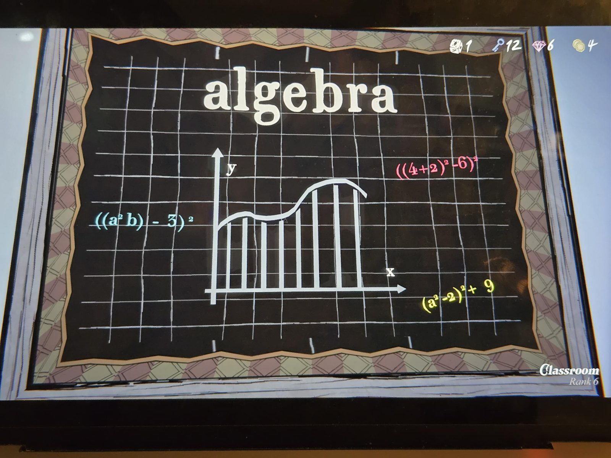

algebra

(Chalkboard with a grid. In the centre: axes y and x with a curve over eight vertical bars. Three coloured expressions:)
((a² b) − 3)²   (light blue)
((4+2)² − 6)²   (pink)
(a² − 2)² + 9   (yellow)

## Photos / Фото

