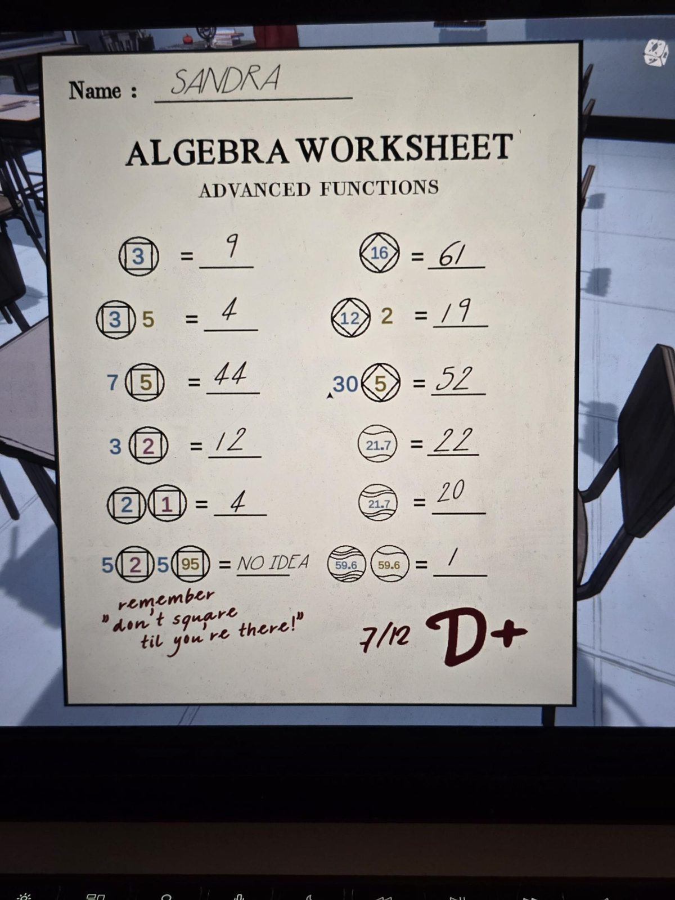
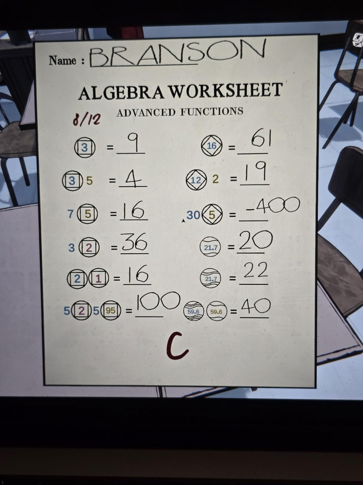
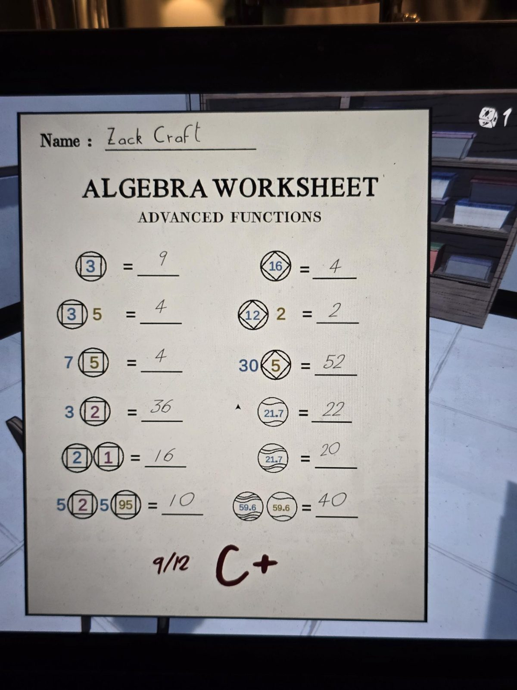

# Algebra Worksheet: Advanced Functions (three graded sheets)

Each sheet, left column / right column (symbols are drawn: a number in a square inside a circle; a number in a diamond inside a circle; a number in a circle with one wavy line; a number in a circle with three wavy lines; digits are coloured blue / olive / purple):
Left: (3 in square) = ; (3 in square) 5 = ; 7 (5 in square) = ; 3 (2 in square) = ; (2 in square)(1 in square) = ; 5 (2 in square) 5 (95 in square) =
Right: (16 in diamond) = ; (12 in diamond) 2 = ; 30 (5 in diamond) = ; (21.7, one wavy line) = ; (21.7, three wavy lines) = ; (59.6, three wavy lines)(59.6, one wavy line) =

**Sheet 1.** Name: SANDRA. Left: 9, 4, 44, 12, 4, "NO IDEA". Right: 61, 19, 52, 22, 20, 1. Teacher (red handwriting): remember "don't square til you're there!" — 7/12 D+

**Sheet 2.** Name: BRANSON. 8/12 (red). Left: 9, 4, 16, 36, 16, 100. Right: 61, 19, −400, 20, 22, 40. Grade: C

**Sheet 3.** Name: Zack Craft. Left: 9, 4, 4, 36, 16, 10. Right: 4, 2, 52, 22, 20, 40. 9/12 C+

## Photos / Фото
01 — Sandra; 02 — Branson; 03 — Zack Craft.

