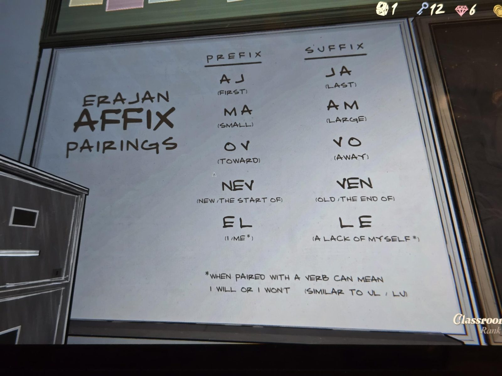

ERAJAN AFFIX PAIRINGS

PREFIX / SUFFIX
AJ (FIRST) / JA (LAST)
MA (SMALL) / AM (LARGE)
OV (TOWARD) / VO (AWAY)
NEV (NEW / THE START OF) / VEN (OLD / THE END OF)
EL (I / ME*) / LE (A LACK OF MYSELF*)

*WHEN PAIRED WITH A VERB CAN MEAN I WILL OR I WON'T (SIMILAR TO UL / LU)

## Photos / Фото

