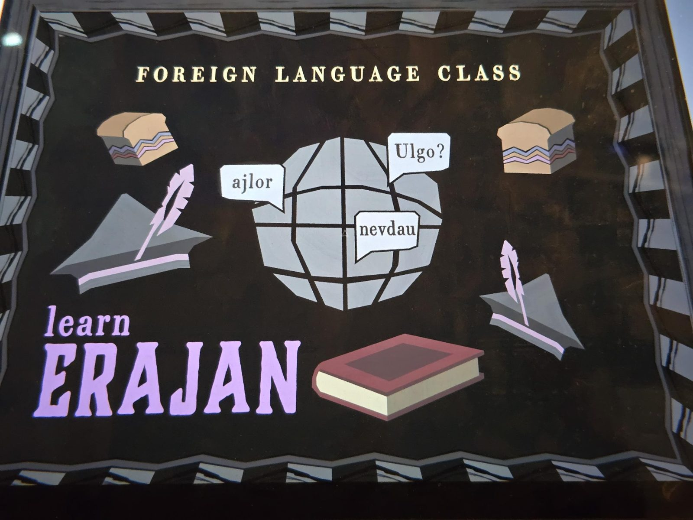

FOREIGN LANGUAGE CLASS

learn ERAJAN

(Illustration: a globe with three speech bubbles: "ajlor", "Ulgo?", "nevdau"; two loaves of layered bread, two quills in ink stands, a red book.)

## Photos / Фото

