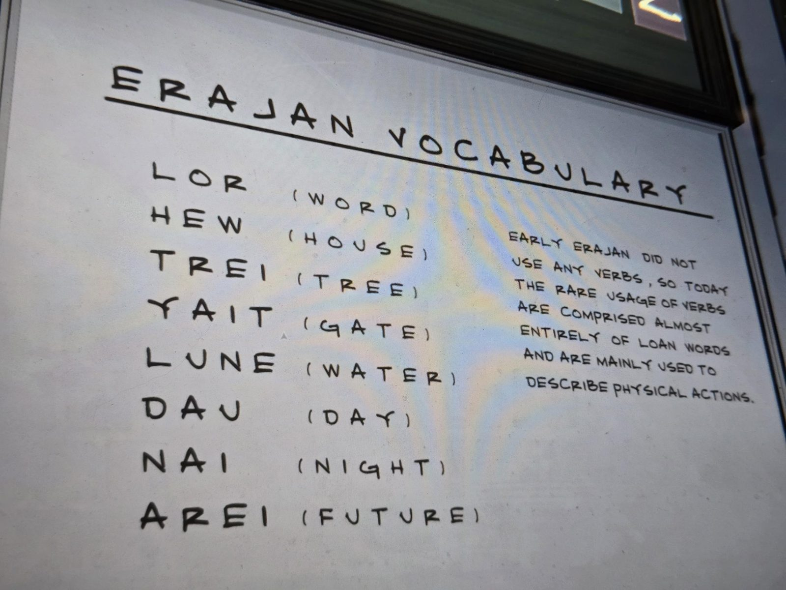

ERAJAN VOCABULARY

LOR (WORD)
HEW (HOUSE)
TREI (TREE)
YAIT (GATE)
LUNE (WATER)
DAU (DAY)
NAI (NIGHT)
AREI (FUTURE)

Early Erajan did not use any verbs, so today the rare usage of verbs are comprised almost entirely of loan words and are mainly used to describe physical actions.

## Photos / Фото

