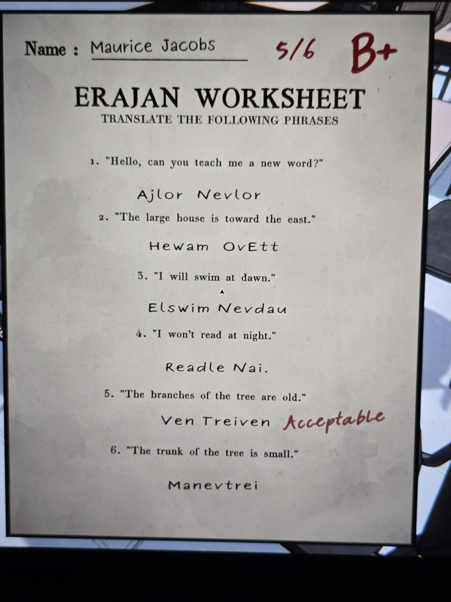
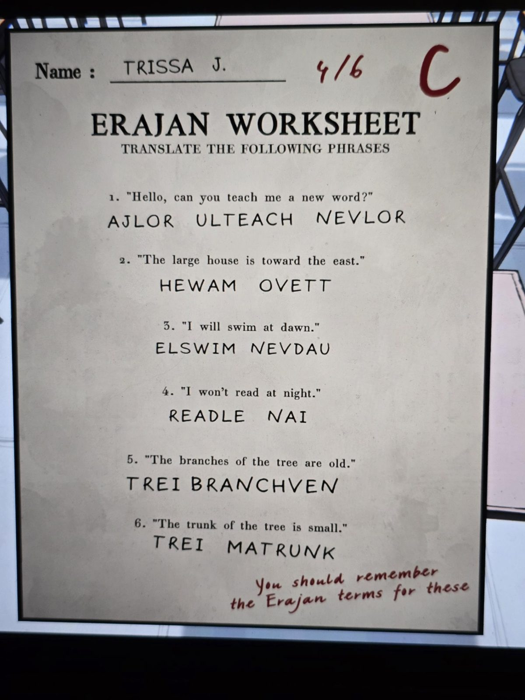
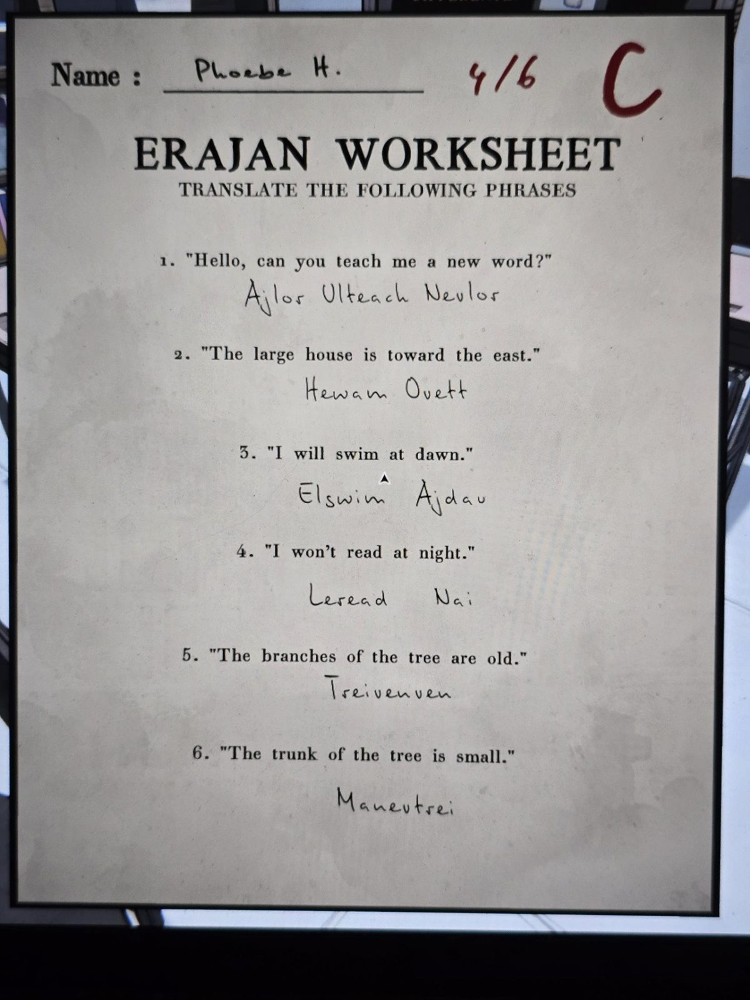

# Grade 8: «Erajan Worksheet» (перевод фраз на эраджанский)
Classroom, **8-й класс**. Три проверенные работы; оценки красным. Текст — в [en.md](en.md).

**Фразы:** 1. «Привет, можешь научить меня новому слову?» 2. «Большой дом — к востоку.» 3. «Я буду плавать на рассвете.» 4. «Я не буду читать ночью.» 5. «Ветви дерева стары.» 6. «Ствол дерева мал.»

| № | Maurice Jacobs (5/6, B+) | Trissa J. (4/6, C) | Phoebe H. (4/6, C) |
|---|---|---|---|
| 1 | Ajlor Nevlor | Ajlor Ulteach Nevlor | Ajlor Ulteach Nevlor |
| 2 | Hewam Ovett | Hewam Ovett | Hewam Ovett |
| 3 | Elswim Nevdau | Elswim Nevdau | Elswim Ajdau |
| 4 | Readle Nai | Readle Nai | Leread Nai |
| 5 | Ven Treiven («Acceptable») | Trei Branchven | Treivenven |
| 6 | Manevtrei | Trei Matrunk | Manevtrei |

Подсказка учителя на листе Trissa: «You should remember the Erajan terms for these» («нужно помнить эраджанские слова для этих»).

## Правильные ответы
Выведено по оценкам (5, 4 и 4 из 6; это моё решение, не подтверждение из игры). Единственный набор, дающий эти оценки (в 5-м у Maurice «Acceptable» засчитан):
1. **Ajlor Ulteach Nevlor** (у Maurice нет «Ulteach»);
2. **Hewam Ovett**;
3. **Elswim Nevdau** (у Phoebe «Ajdau» неверно);
4. **Readle Nai** (у Phoebe «Leread» неверно);
5. **Treivenven** («Ven Treiven» принято как допустимый вариант; Trissa написала английское «branch»);
6. **Manevtrei** (Trissa написала английское «trunk»).

Из слов: [LOR слово, TREI дерево, DAU день, NAI ночь](../grade-8-erajan-vocabulary/ru.md); по этим ответам «nev» = новый (nevdau = «новый день», рассвет, как в реплике на [доске](../grade-8-erajan-board/ru.md)), «ul» = ты (ulteach, «Ulgo?»), «el» = я (elswim). Это моя расшифровка.

## Photos / Фото
01 — Maurice Jacobs; 02 — Trissa J.; 03 — Phoebe H.

