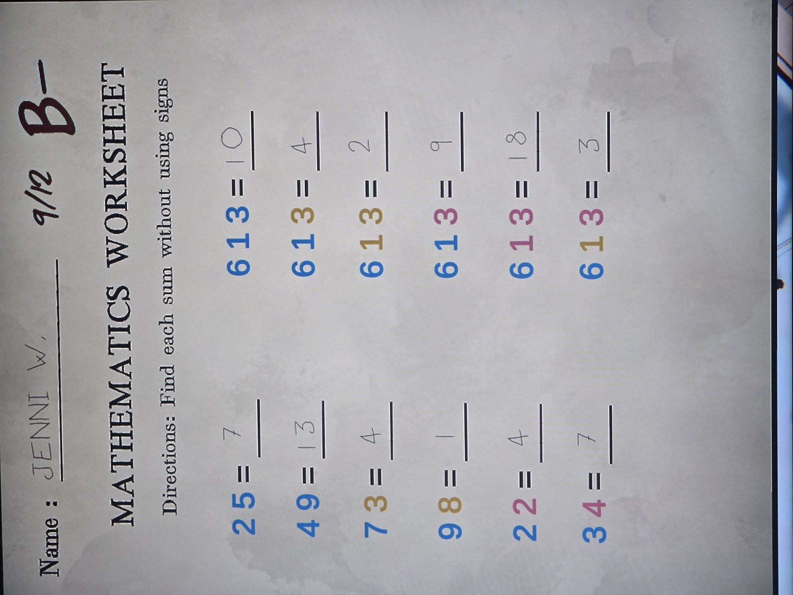
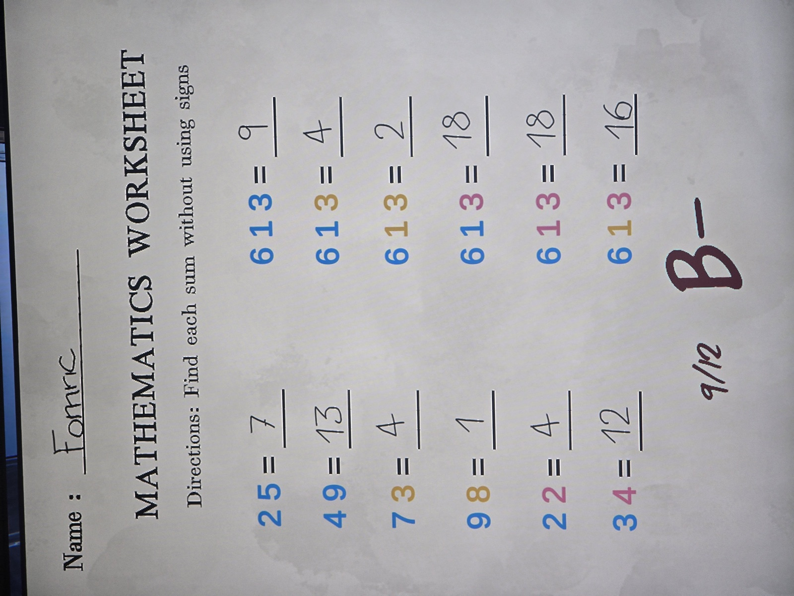
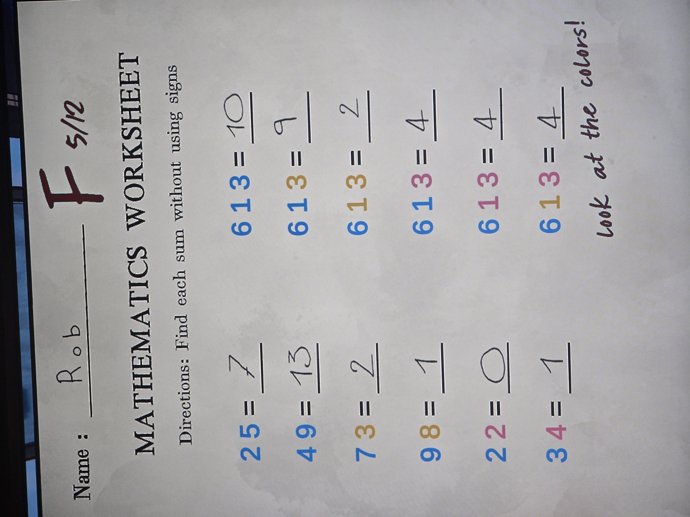

Проверенные листы по математике (тот же лист, что [math-worksheet](../math-worksheet/ru.md)): Дженни У. (9/12, B-), Фомрик? (9/12, B-), Роб (5/12, F, «Посмотри на цвета!»).
Правильные ответы (синий +, жёлтый −, розовый ×, слева направо): 7, 13, 4, 1, 4, 12 | 10, 4, 2, 21, 18, 15 — совпадают с уже записанными. Ошибки учеников это подтверждают. Новой загадки нет.

## Photos / Фото

