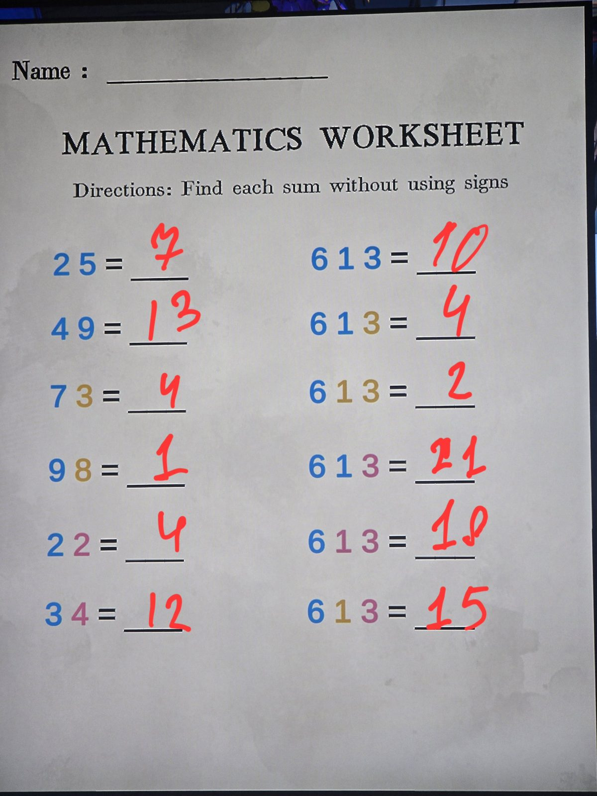

РАБОЧИЙ ЛИСТ ПО МАТЕМАТИКЕ — «Найдите сумму без знаков».
Цвет цифры = действие (как в дартсе в Billiard Room): голубой — сложение, жёлтый — вычитание, розовый — умножение, фиолетовый — деление.
Ответы: 7, 13, 4, 1, 4, 12 | 10, **4**, 2, 21, 18, 15. Это обучающий лист, скрытого сообщения нет.

## Photos / Фото

