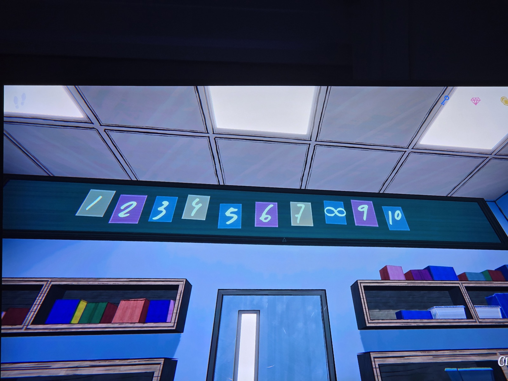

Карточки с числами над доской в Classroom (цвет карточки):
1 серая · 2 фиолетовая · 3 синяя · 4 серая · 5 синяя · 6 фиолетовая · 7 серая · **∞ вместо 8** (синяя) · 9 фиолетовая · 10 синяя.

*Заметка: ∞ на месте 8 — та же тема «8 = бесконечность», что в Gallery (RUMINATE, «room in eight»). Цвета как в дартсе: синий — сложение, фиолетовый — деление; серый — ?*

## Photos / Фото

