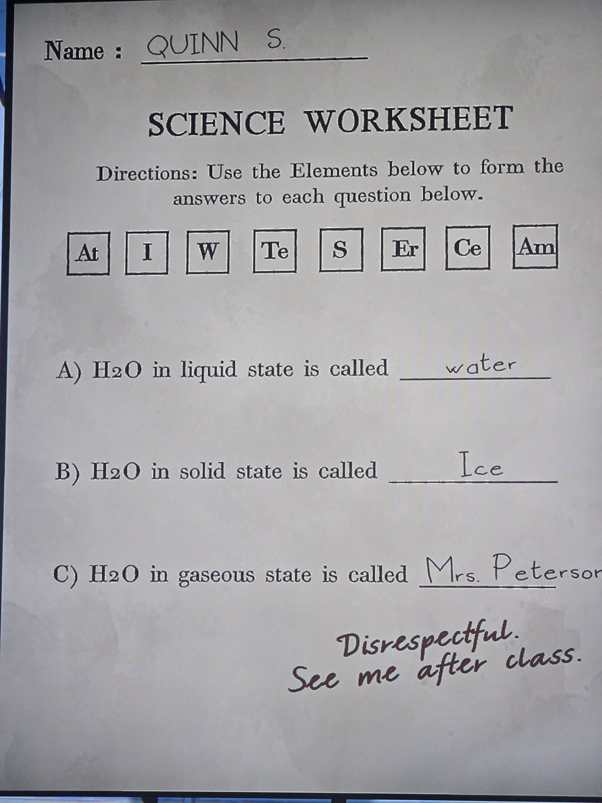

Лист по химии, ученик **Куинн С.** Задание: составить ответы из символов элементов At, I, W, Te, S, Er, Ce, Am.
А) жидкая вода — water (W+At+Er), Б) твёрдая — Ice (I+Ce), В) газообразная — «Mrs. Peterson» (шутка; правильно **STEAM** = S+Te+Am). Учитель: «Неуважительно. Зайди после урока».
*Заметка: та же механика, что в Laboratory (слова из символов элементов). Комната — предположительно Classroom.*

## Photos / Фото

