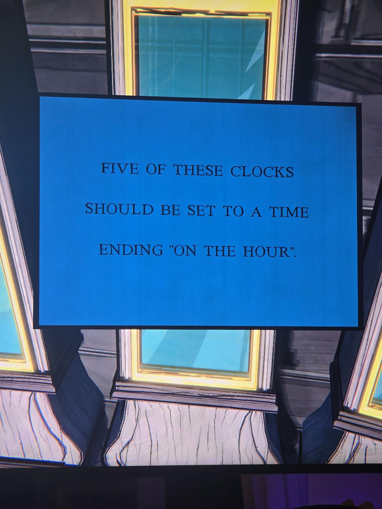
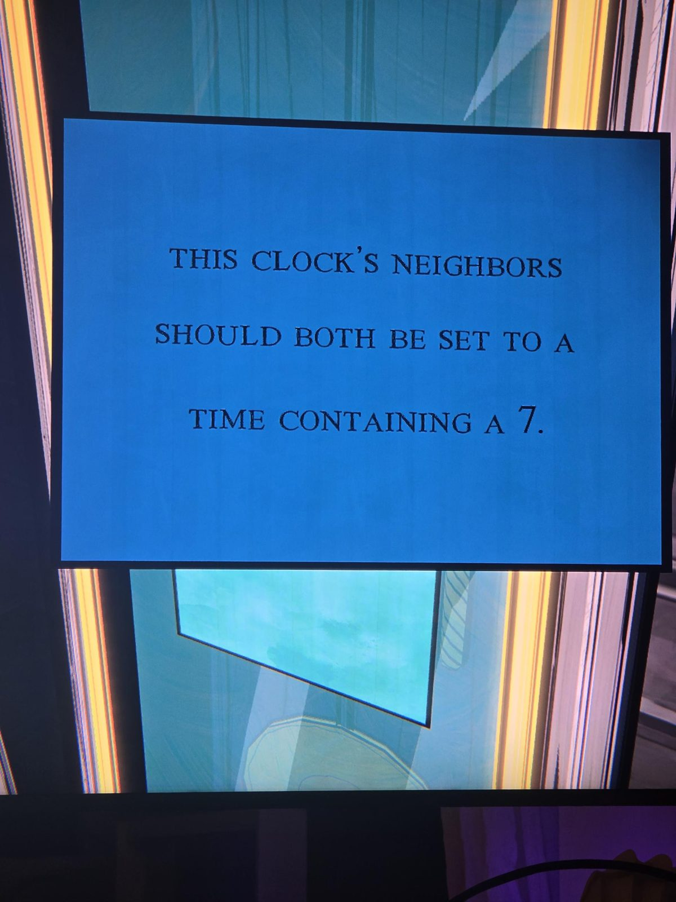
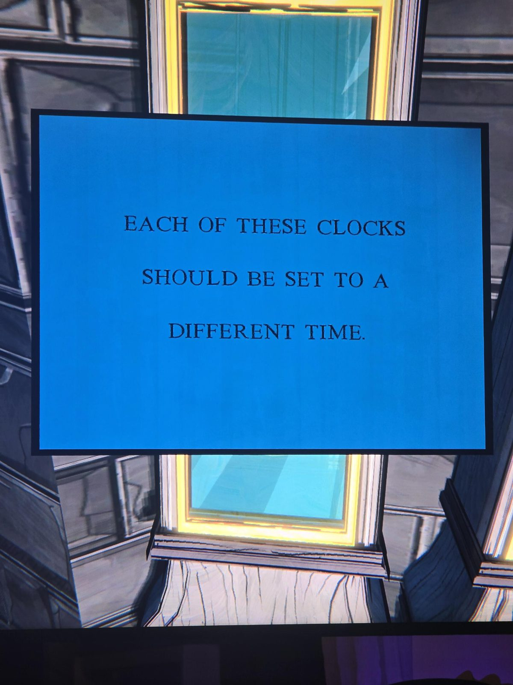
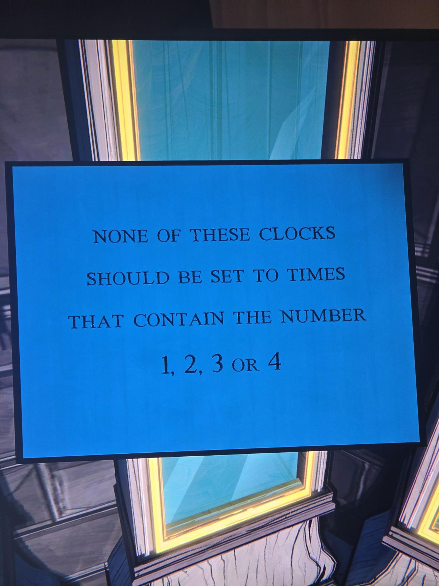
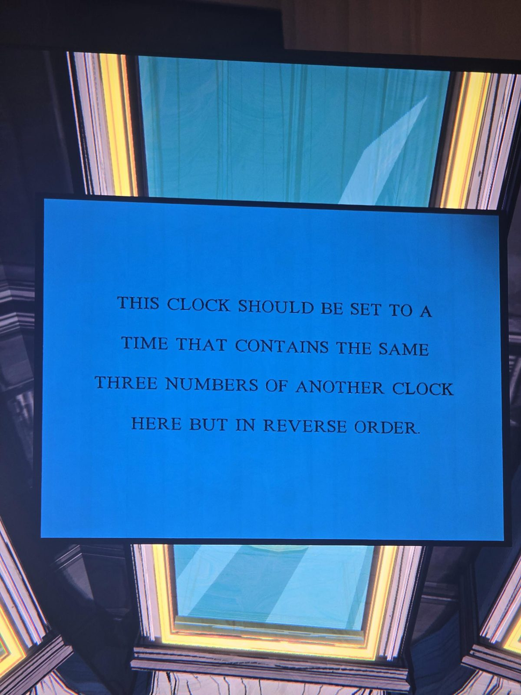
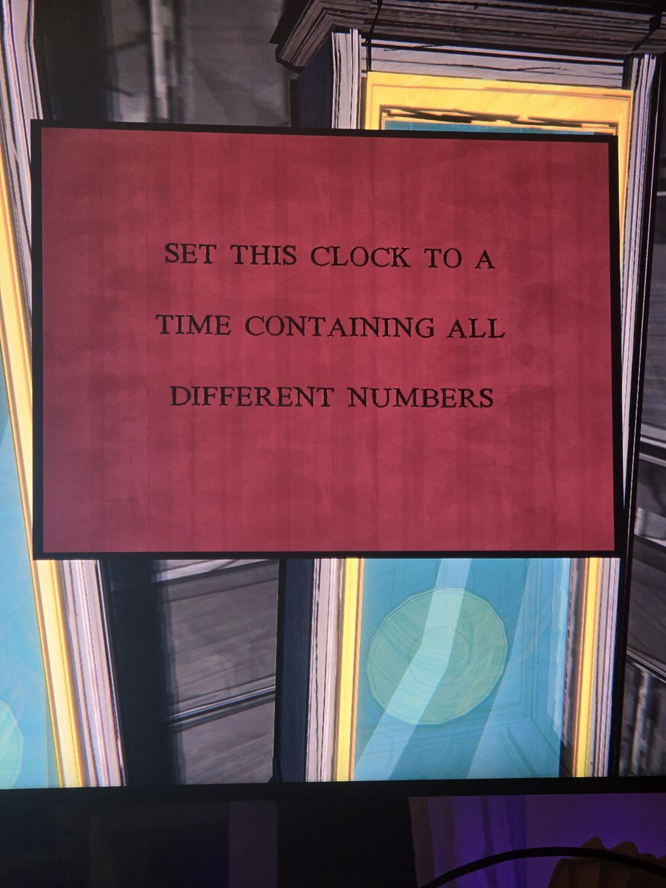
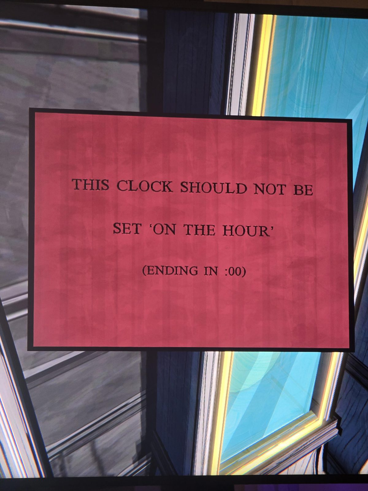
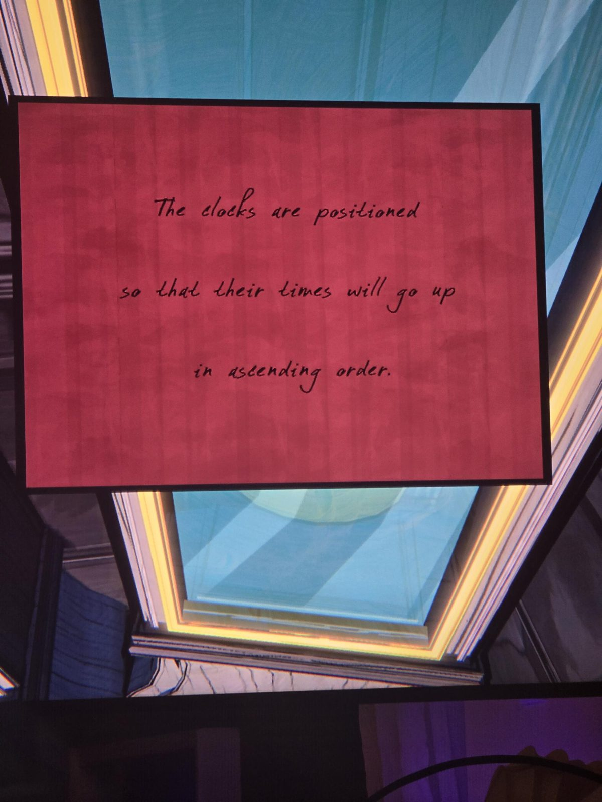

Голубые (правда):
- Пять часов должны показывать время на :00.
- Соседи этих часов должны показывать время с цифрой 7.
- Все часы показывают разное время.
- Ни одни часы не содержат цифр 1, 2, 3, 4.
- Эти часы — те же три цифры, что у других часов, в обратном порядке.
Красные печатные (ложь):
- «Все цифры разные» → на деле есть повторяющаяся цифра.
- «Не на :00» → на деле на :00.
Красная **рукописная** — оказалась подсказкой, а не ложью: время идёт **по возрастанию** слева направо.

## Photos / Фото

