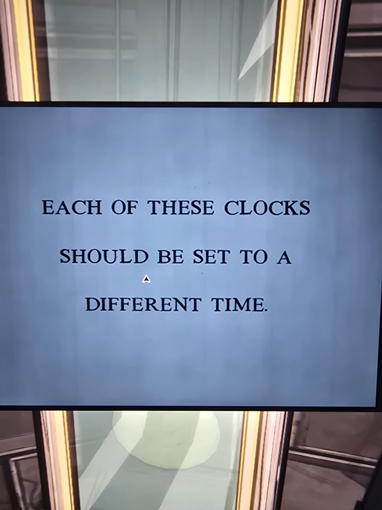
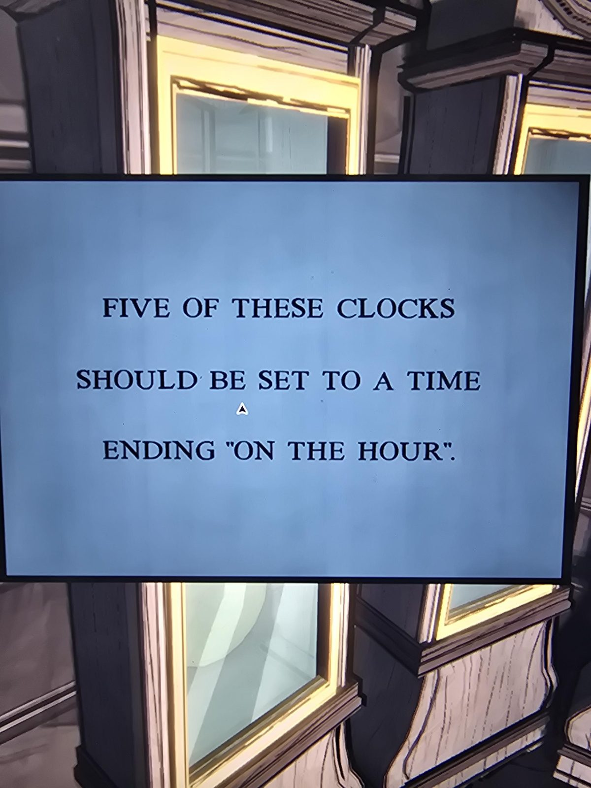
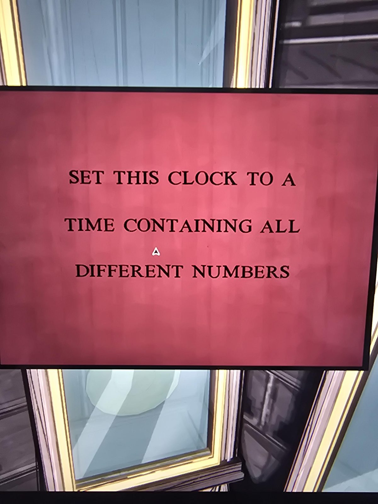
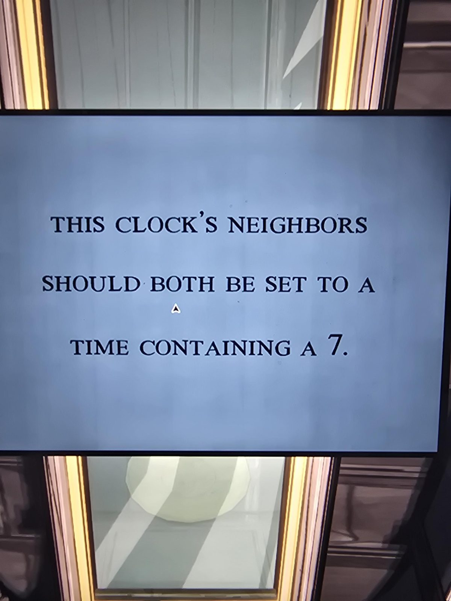
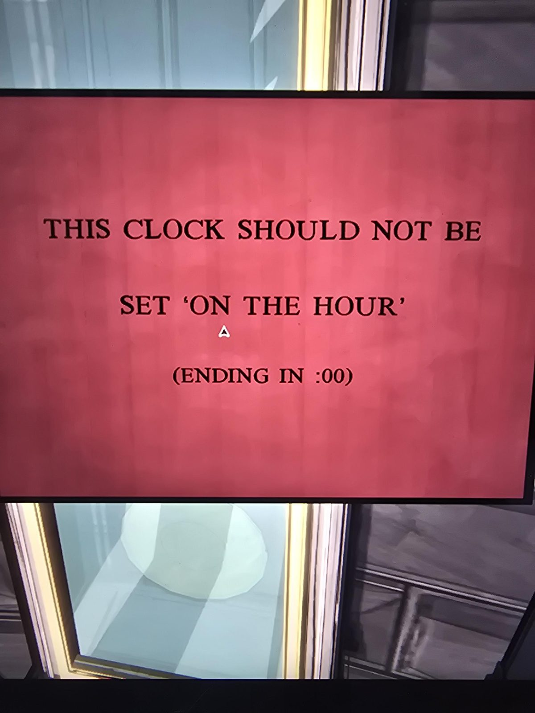
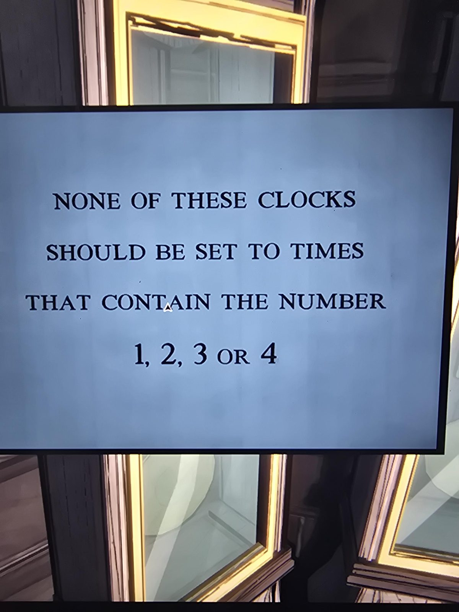
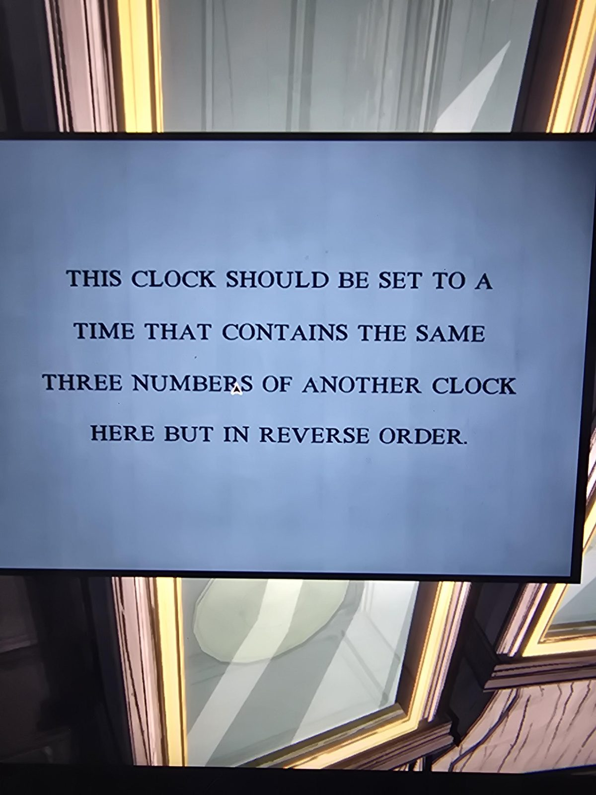
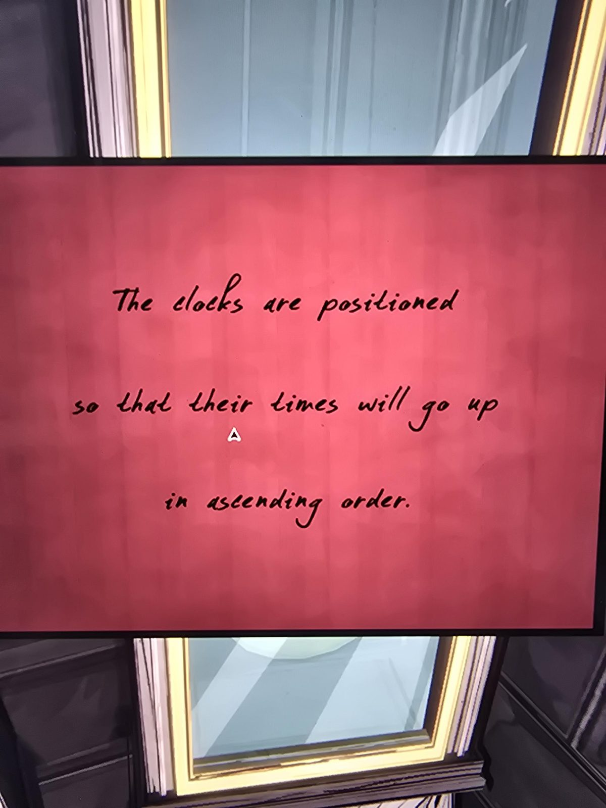

# Загадка с часами: 8 табличек (Clock Tower)
Clock Tower. Восемь часов в витринах, у каждых табличка. **Синие табличек — правда, красные — ложь, кроме красной рукописной** (правило из [записки в Security](../../../security/docs/blue-red-memos-note/ru.md)).

| № | Цвет | Табличка |
|---|---|---|
| 1 | синяя | Каждые из этих часов должны показывать **разное время**. |
| 2 | синяя | **Пять** из этих часов должны показывать время, заканчивающееся «**ровно в час**». |
| 3 | красная (ложь) | Установи эти часы на время, где **все цифры разные**. |
| 4 | синяя | **Соседи** этих часов оба должны показывать время с цифрой **7**. |
| 5 | красная (ложь) | Эти часы **не** должны стоять «ровно в час» (на :00). |
| 6 | синяя | Ни одни из этих часов не должны показывать время с цифрами **1, 2, 3 или 4**. |
| 7 | синяя | Эти часы показывают время с **теми же тремя цифрами**, что у других часов здесь, но **в обратном порядке**. |
| 8 | красная, **от руки** (правда) | Часы расставлены так, что их время **растёт по возрастанию**. |

Какая табличка на каких именно часах, не записано.

## Решение ✅ (со слов пользователя)
По порядку (по возрастанию): **5:00 · 5:08 · 5:57 · 6:00 · 7:00 · 8:00 · 8:05 · 9:00**

## Проверка (мой разбор по синим подсказкам, не из игры)
- Все 8 времён разные ✓; на ровный час (:00) приходятся 5:00, 6:00, 7:00, 8:00, 9:00 = **пять** ✓.
- Ни в одном нет цифр 1, 2, 3, 4 ✓.
- Соседи 6:00 (5:57 и 7:00) оба с семёркой ✓ (значит табличка 4 висит на часах 6:00).
- 5:08 и 8:05 — те же цифры в обратном порядке ✓ (табличка 7 на одних из них).
- Красные ложны: «все цифры разные» неверно для часов с повторами (5:57 или любые «:00»), «не на :00» неверно для часов ровно в час.

## Награда
Решение открыло **тайный проход** (по словам пользователя, в 13:30) и дало **Sanctum Key** для одной из дверей [Inner Sanctum](../../../the-underpass/inner-sanctum.md) ([ключ 3](../../../room-46/docs/inner-sanctum-keys-rhyme/ru.md)). См. [предмет](../../../../items/sanctum-key/ru.md).

## Photos / Фото
       
