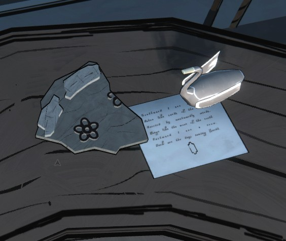

# Стих про лебедя и ворона (с фигурой под ним)
Clock Tower, на столе рядом с **каменным осколком** и **серебряной статуэткой лебедя** ([фото 2](02.jpg)). На осколке (серый камень с приподнятыми выступами) вырезан **цветок** (круг в центре и круглые лепестки вокруг) и ещё один маленький круг. Это подсказка для [Inner Sanctum](../../../the-underpass/inner-sanctum.md).

Clock Tower (из той же пачки снимков; место конкретно «Clock Tower»). Рукописный лист; под стихом нарисована **вытянутая фигура с выступами**.

«На юге я вижу лебедя, пепельного, как пески берега, несомого западными ветрами, мятежного, как луна севера. На востоке я вижу ворона; тёмные грядут дни (*coming fourth*, возможно игра слов с «forth/fourth»).»

## Заметка
- Фигура внизу = **ядро Orinda Aries** из [Realm & Rune](../../../library/books/realm-and-rune/ru.md): та же вытянутая форма с выступами (по виду на фото).
- Лебедь (герб Эпсенов) и луна ср. [гербы в Room 46](../../../room-46/docs/family-crests/ru.md). Расшифровка не сделана .
- Страны света (юг, запад, север, восток) могут указывать на расположение королевств на карте; догадка.
- **Первые буквы строк** (Southward, Ashen, Carried, Rogue, Eastward, Dark) складываются в слово **SACRED**. Предположительно это «sacred hour»: [время тайного прохода 13:30](../clock-puzzle-notes/ru.md).
- На карте [Ettsphere](../../../classroom/docs/grade-4-map-ettsphere/ru.md) к северу от Orinda Aries лежит Arch Aries, к югу **Eraja**, к западу Nuance. «На юге я вижу лебедя» (лебедь: герб Эпсенов), значит стих и осколок, предположительно, относятся к **Eraja**.
- Предположительно, цветок на осколке = тип общества **Poetic** (королевство Eraja; ядро: песочные часы).
- «Пепельный» (ashen), предположительно, серый цвет. Серого цвета-цели среди [коробок Mora Jai](../../../../puzzles/mora-jai/README.md) нет (цели: жёлтый, белый, фиолетовый, чёрный, зелёный, оранжевый, красный, розовый), и серого нет среди 8 цветов каймы в [Realm & Rune](../../../library/books/realm-and-rune/ru.md).

## Photos / Фото
 
