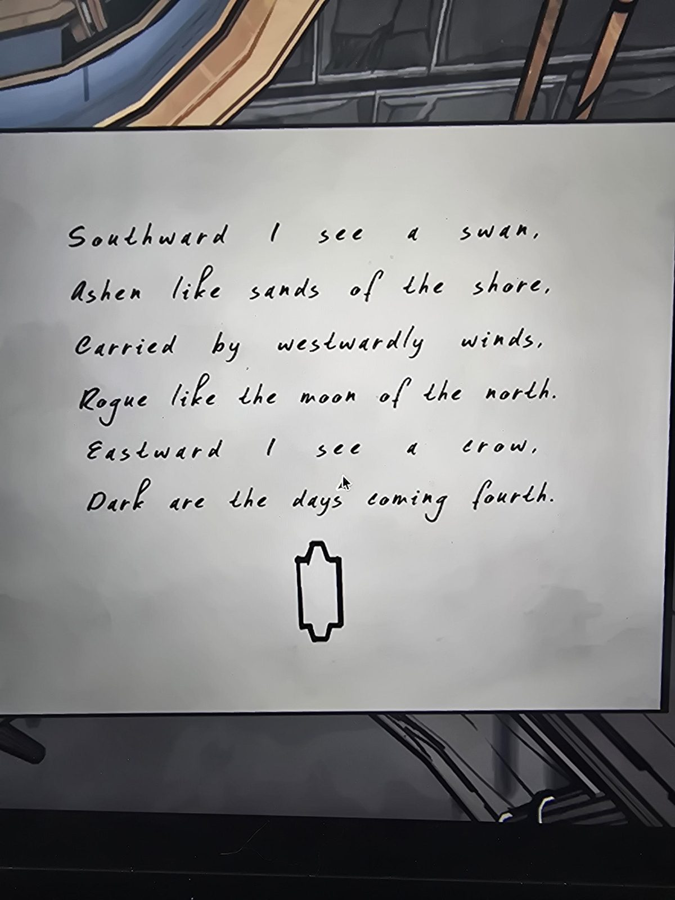

# Стих про лебедя и ворона (с фигурой под ним)
Clock Tower (из той же пачки снимков; место конкретно со слов пользователя «Clock Tower»). Рукописный лист; под стихом нарисована **вытянутая фигура с выступами**.

«На юге я вижу лебедя, пепельного, как пески берега, несомого западными ветрами, мятежного, как луна севера. На востоке я вижу ворона; тёмные грядут дни (*coming fourth*, возможно игра слов с «forth/fourth»).»

## Заметка
- Фигура внизу = **ядро Orinda Aries** из [Realm & Rune](../../../library/books/realm-and-rune/ru.md): та же вытянутая форма с выступами (по виду на фото).
- Лебедь (герб Эпсенов) и луна ср. [гербы в Room 46](../../../room-46/docs/family-crests/ru.md). Расшифровка не сделана (**не проверено**).
- Страны света (юг, запад, север, восток) могут указывать на расположение королевств на карте; догадка.

## Photos / Фото

