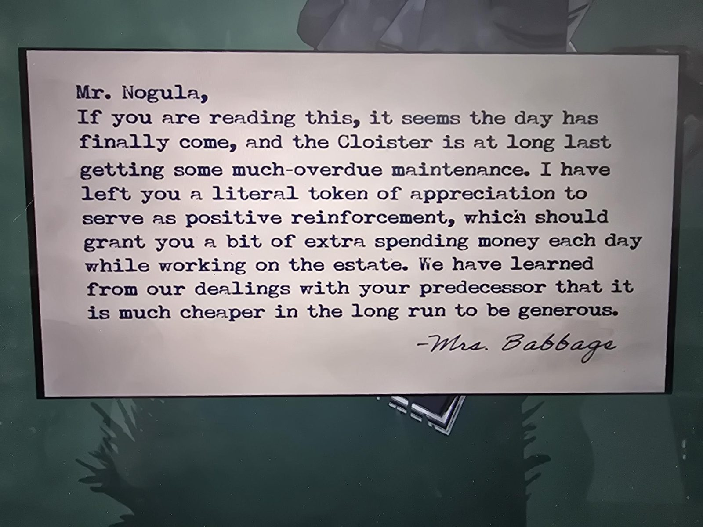

# Записка миссис Бэббидж мистеру Ногуле
Cloister. Напечатанная записка с рукописной подписью.

Мистер Ногула,
если вы это читаете, похоже, день наконец настал, и Cloister получает давно назревший ремонт. Я оставила вам буквальный **жетон признательности** в качестве положительного подкрепления; он должен давать вам немного дополнительных карманных денег каждый день, пока вы работаете в поместье. Из общения с вашим предшественником мы поняли, что в долгосрочной перспективе гораздо дешевле быть щедрыми.
— миссис Бэббидж

## Заметка
- Ногула: [журнал садовника](../../../apple-orchard/docs/gardeners-logbook/ru.md). Жетон: [Allowance Token](../../../../items/allowance-token/ru.md).

## Photos / Фото

