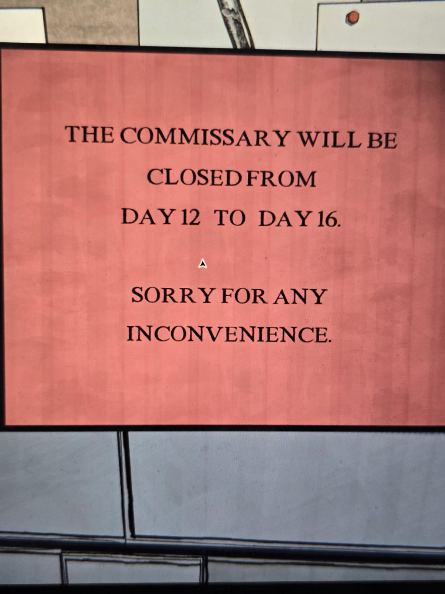

# Табличка: Commissary закрыт с 12 по 16 день
Красная (розово-красный фон) напечатанная табличка на доске в Commissary: **ложь**.

МАГАЗИН (COMMISSARY) БУДЕТ ЗАКРЫТ **С 12-ГО ПО 16-Й ДЕНЬ**.

ПРИНОСИМ ИЗВИНЕНИЯ ЗА НЕУДОБСТВА.

## Заметка
- «День» — это игровые дни.
- На той же доске есть жёлтый стикер с надписью «WIT…» (обрезан).

## Photos / Фото

