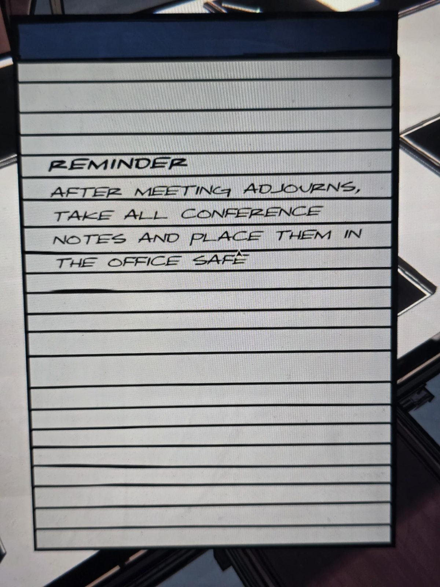

# Записка-напоминание: заметки в сейф Office
Блокнот в Conference Room (белые листы, синяя полоска сверху).

НАПОМИНАНИЕ

ПОСЛЕ ОКОНЧАНИЯ СОВЕЩАНИЯ ЗАБРАТЬ ВСЕ ЗАМЕТКИ С КОНФЕРЕНЦИИ И ПОЛОЖИТЬ ИХ **В СЕЙФ В OFFICE**.

## Заметка
- В Office есть сейф, и в нём могут быть заметки с совещания.

## Photos / Фото

