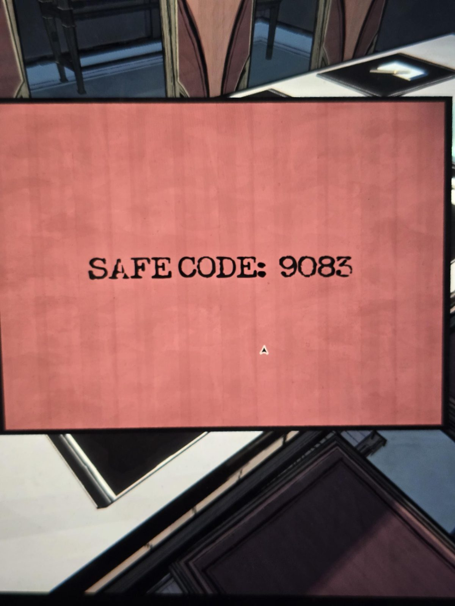

# Красная карточка: «код сейфа 9083»
Розово-красная карточка в Conference Room.

КОД СЕЙФА: 9083

## Заметка
- Карточка **красная и напечатанная**: по правилу из [Security](../../../security/solutions.md) это **ложь**. Настоящий код сейфа Office: **0303**.
- Какой сейф имеется в виду, не сказано. Рядом лежит записка про сейф в Office.

## Photos / Фото

