Photo prints in the Darkroom (red safelight). Order = photo order.
01 — Butler (Hartley?) holding an envelope, next to a smiling man with a cup.
02 — Close-up of the butler.
03 — Herbert with a SYNKA Co. camera.
04 — Orchard: tree with a heart carved in the trunk, white picket fence/gate.
05 — Close-up of Herbert.
06 — Two maids (one with a broom, one with a feather duster).
07 — Woman in glasses at a desk (Mrs. Babbage?).
08 — Orchard print under the magnifying glass: heart carved on the tree reads "11-28".
09, 10 — The two maids again (second, sharper print).
11 — Print of the bespectacled man (butler?) at a table with candles, holding a card; under the magnifying glass the card reads: "[Gr]een memos found in Hartley's room are always false."

## Photos / Фото
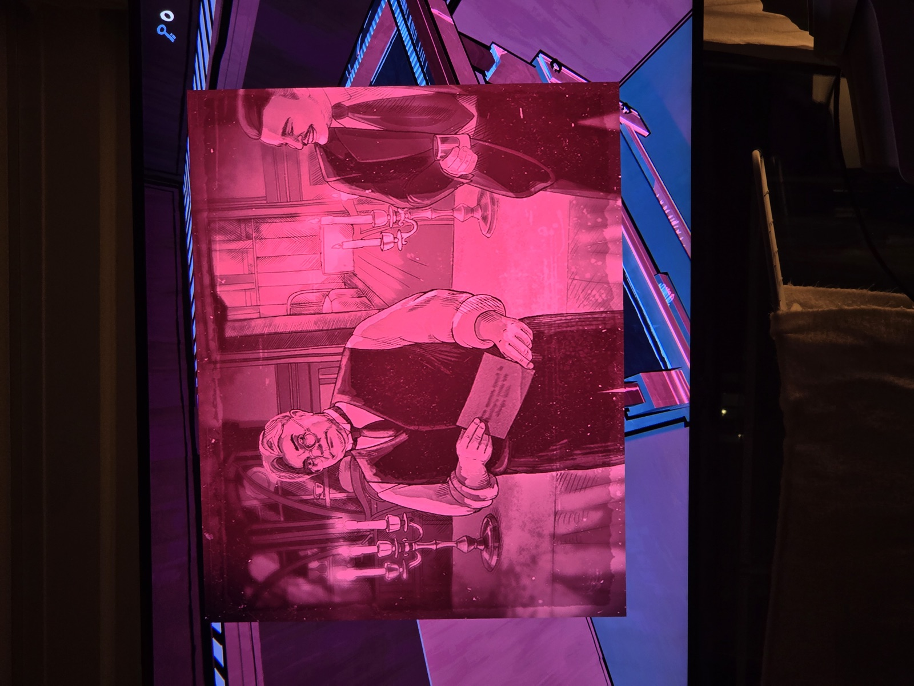
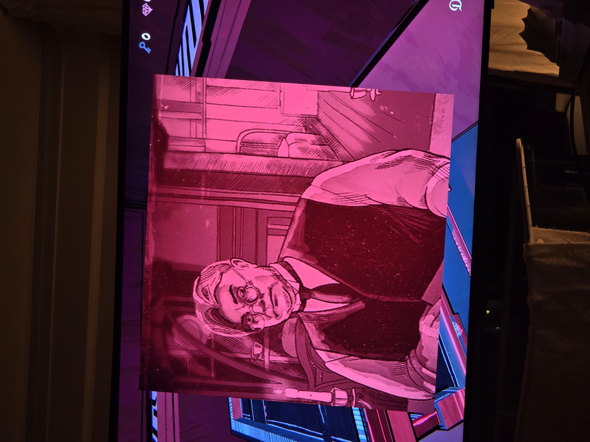
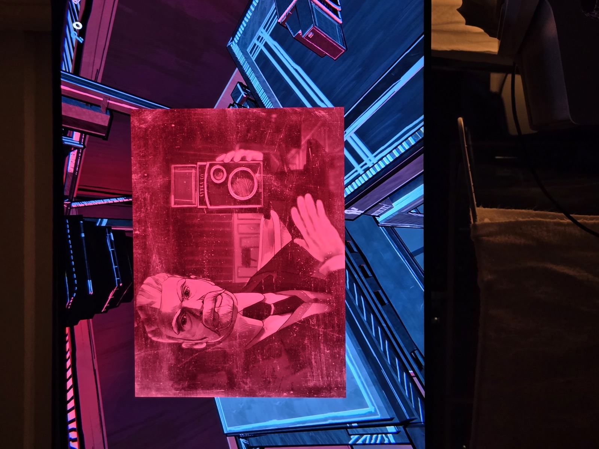
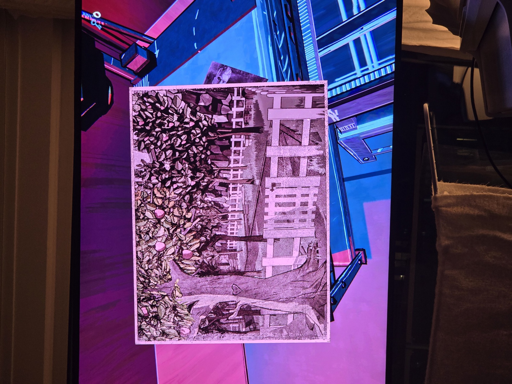
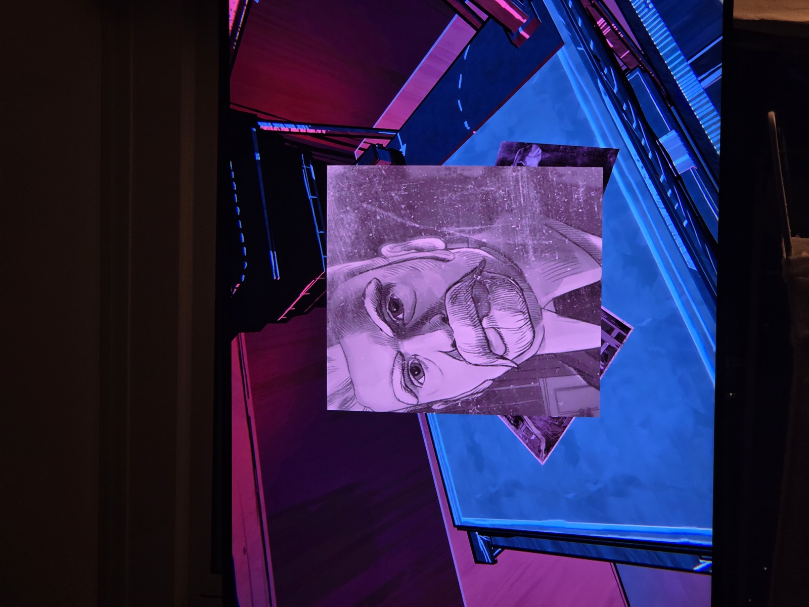
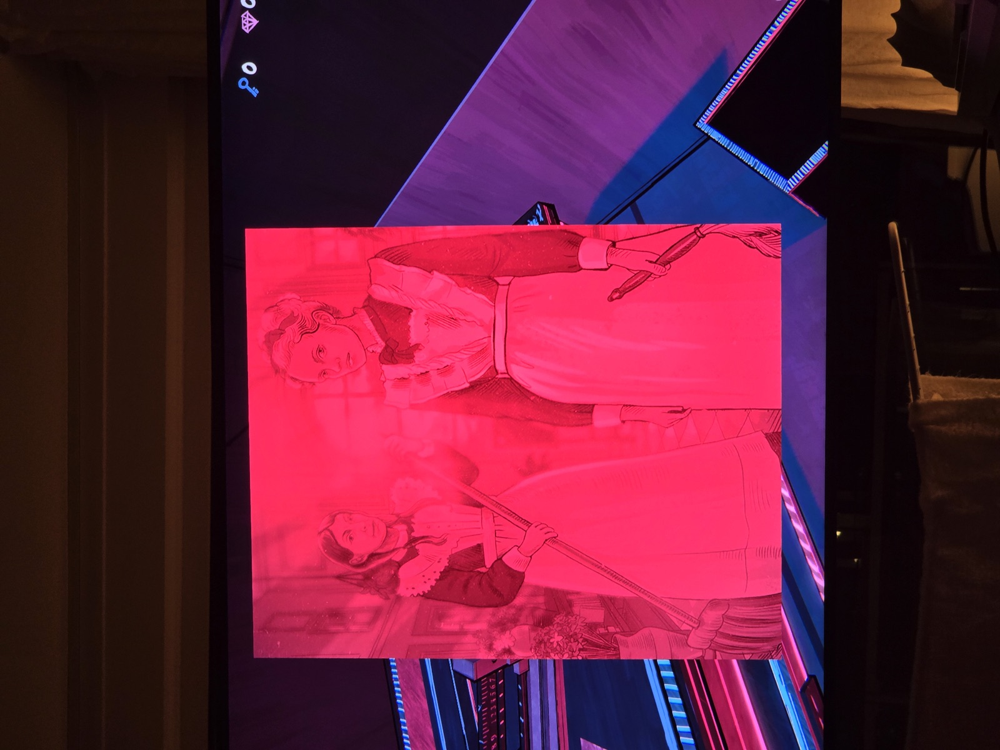
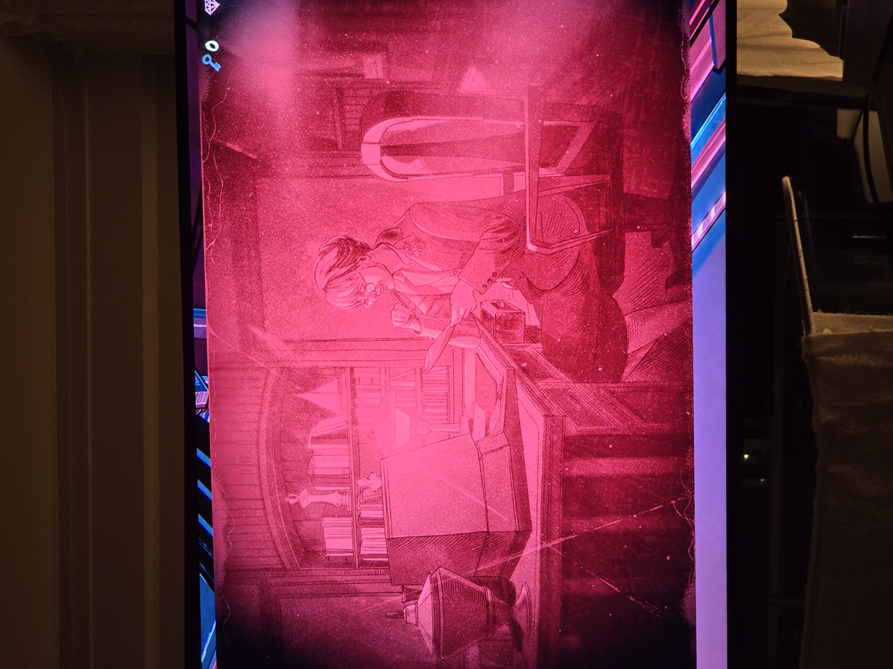
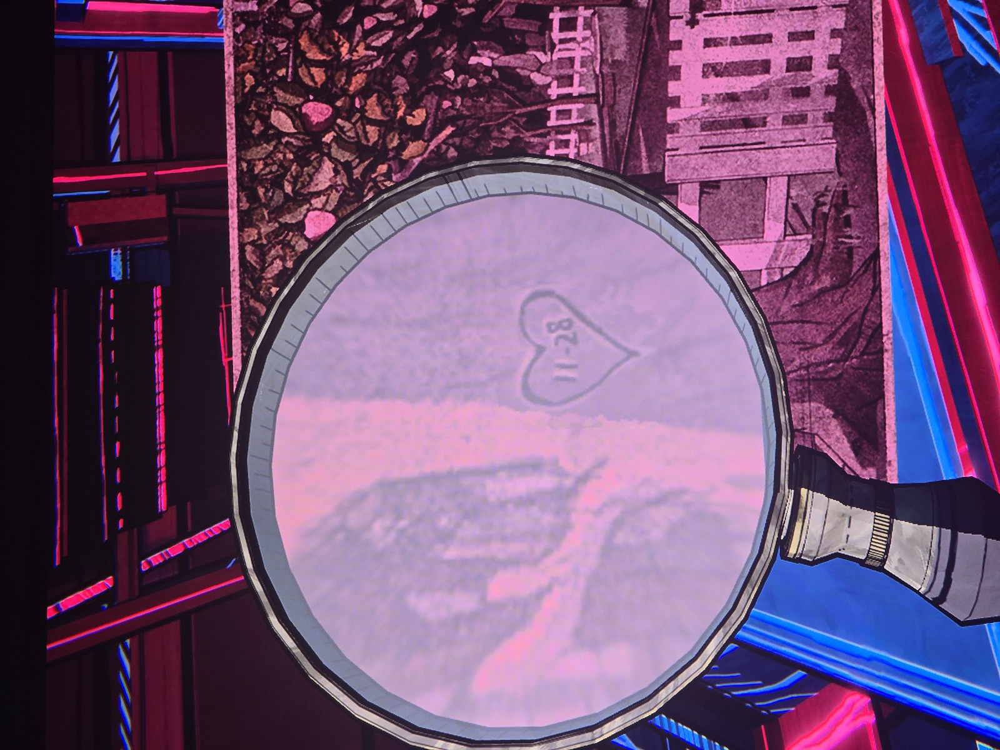
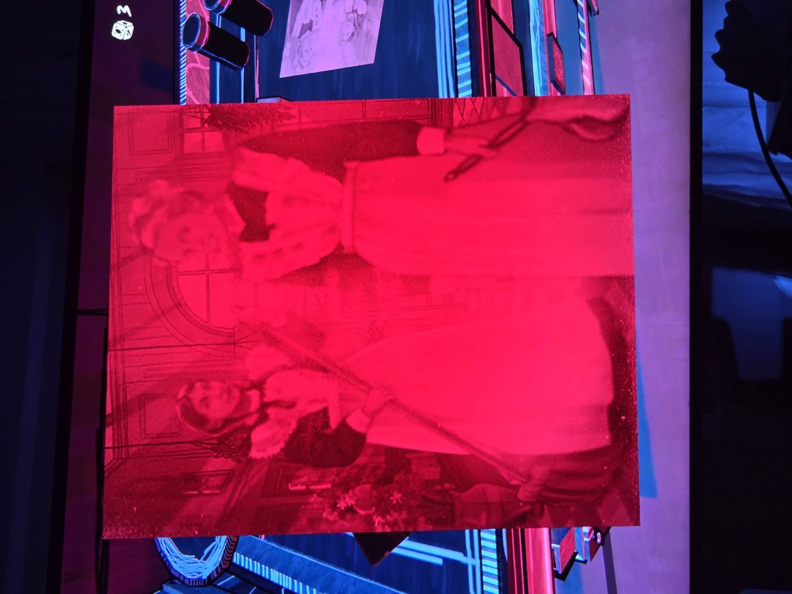
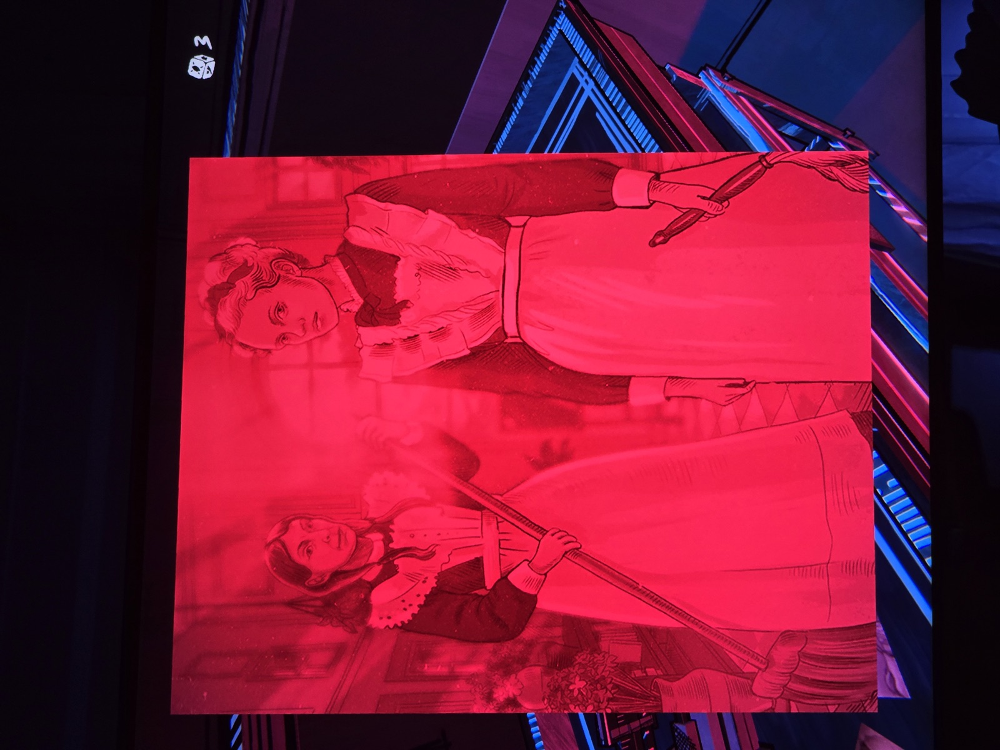
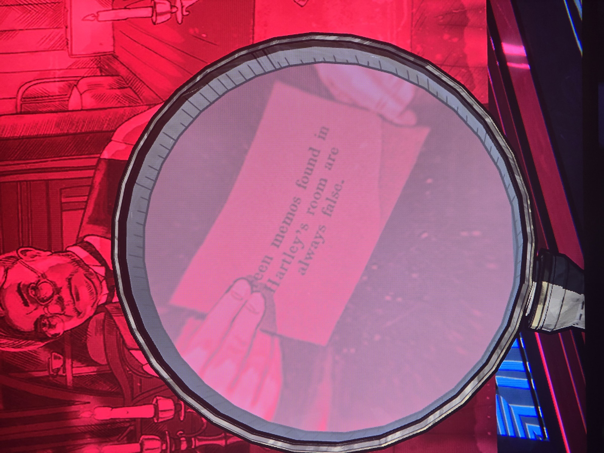
