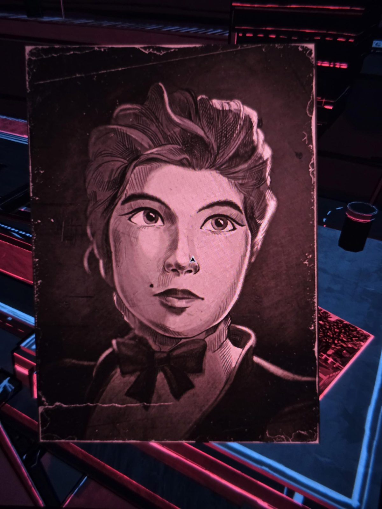
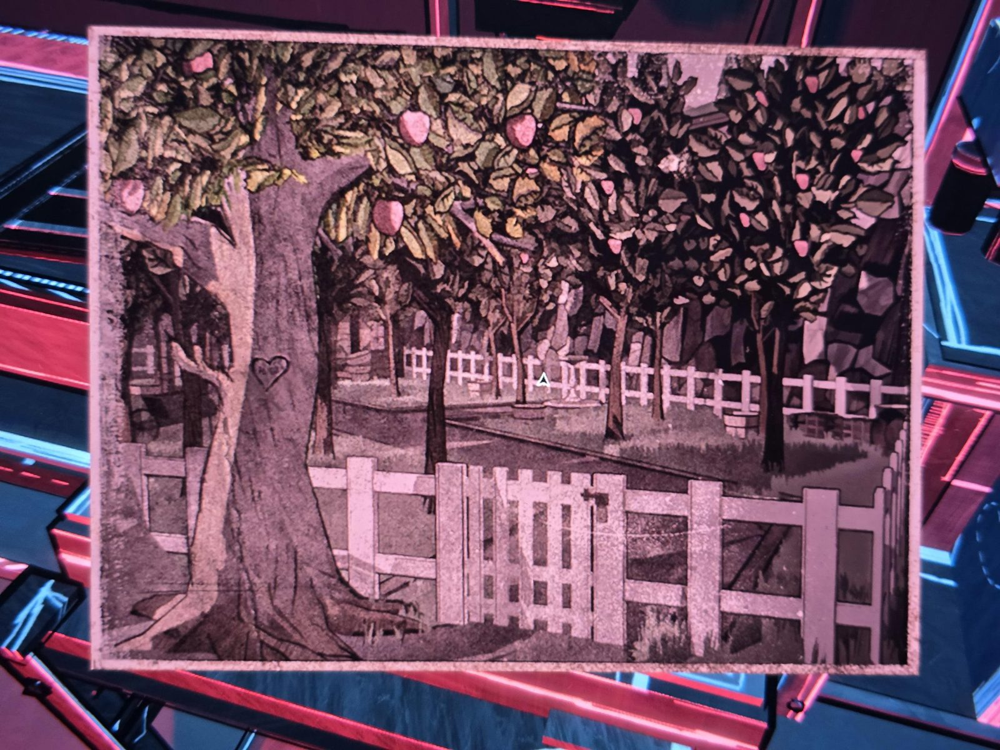
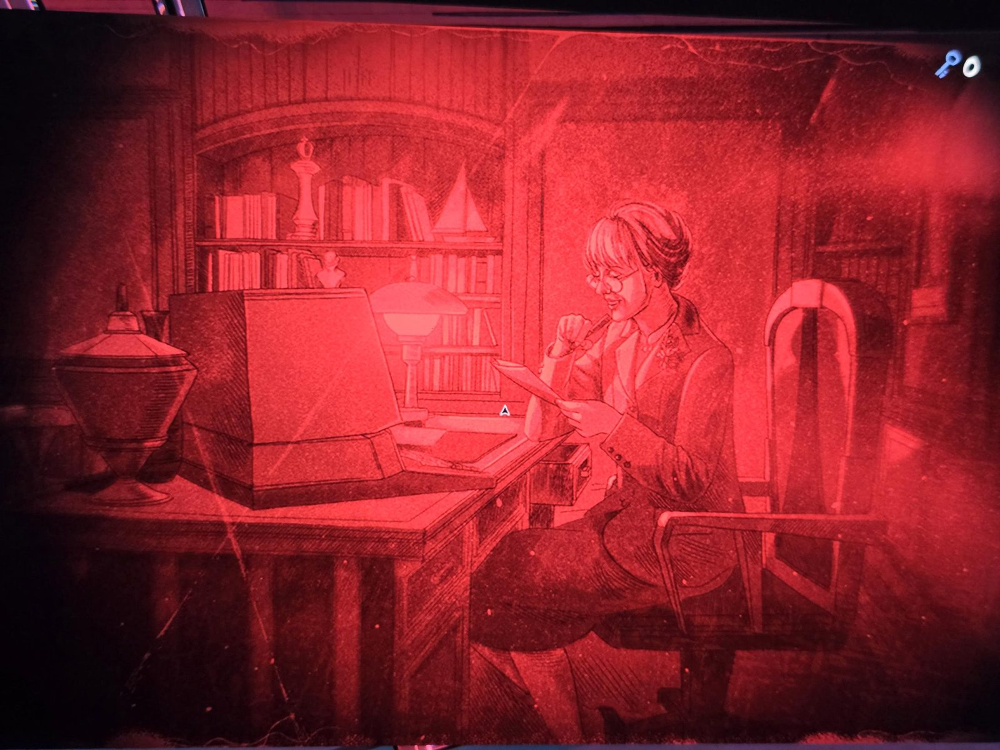
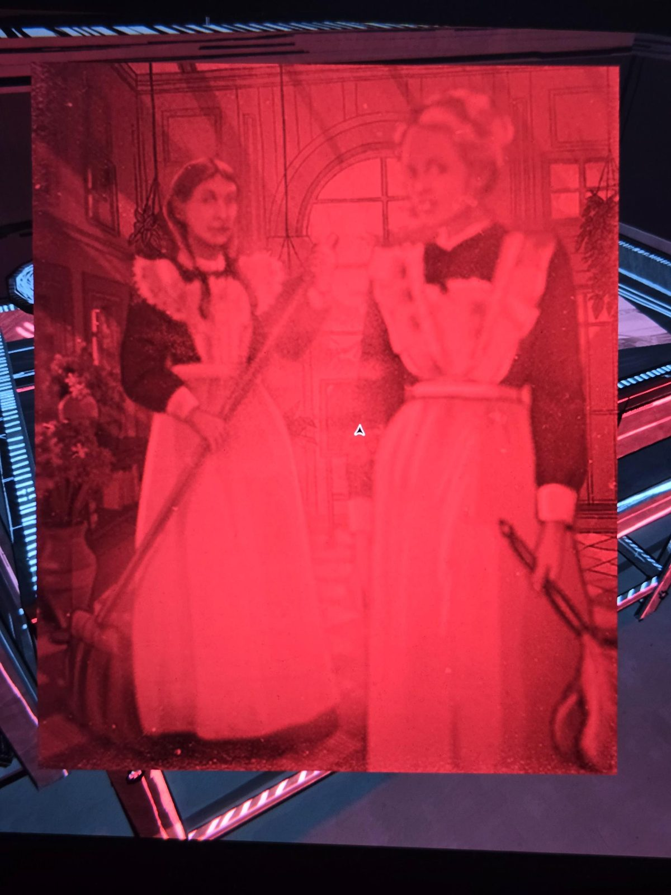
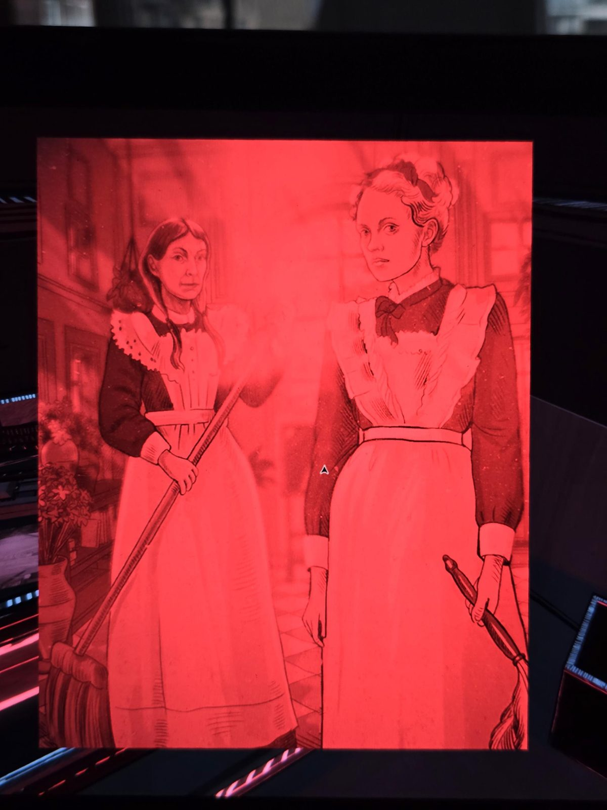
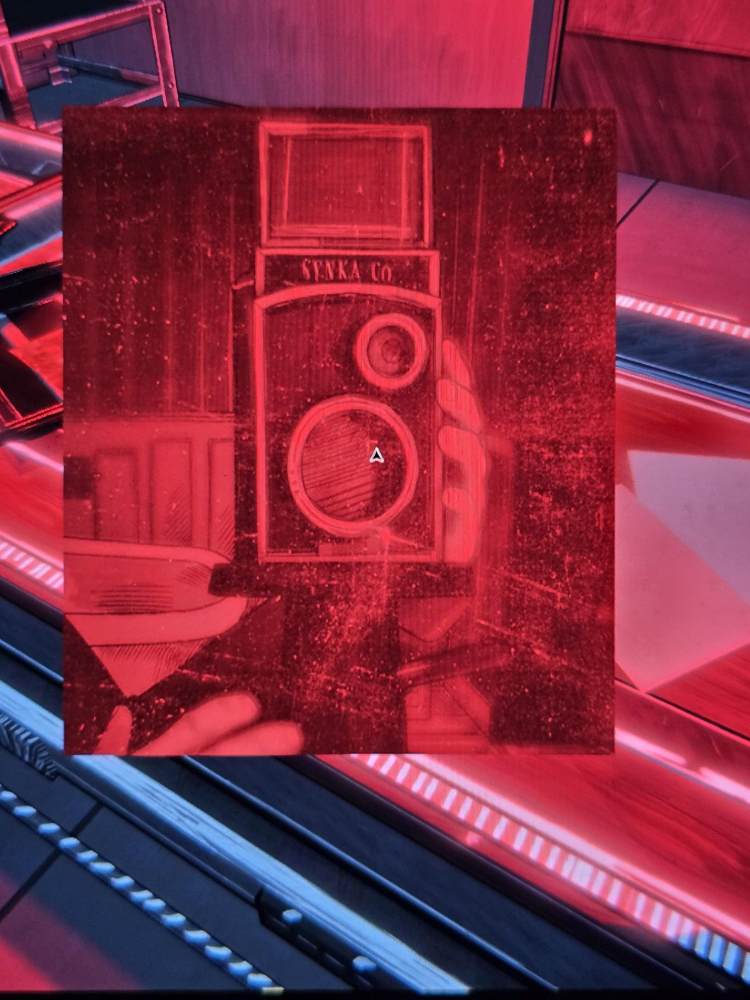
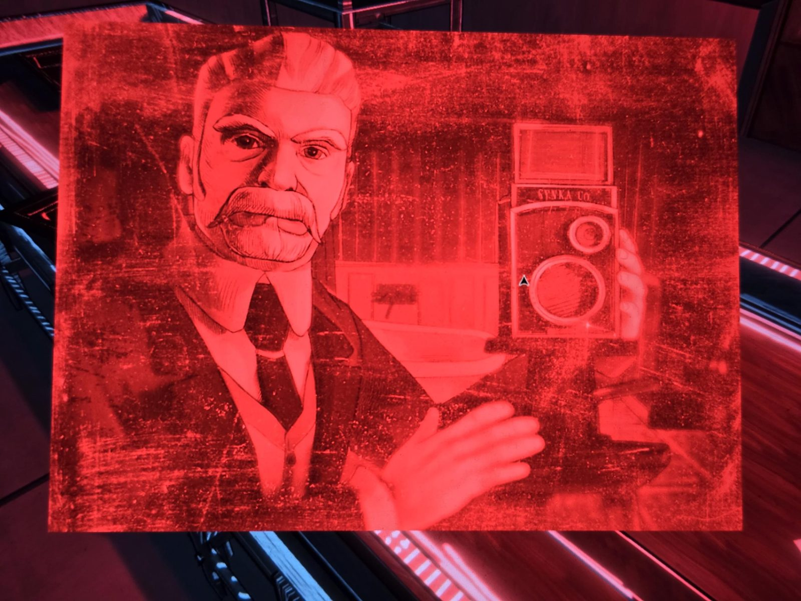
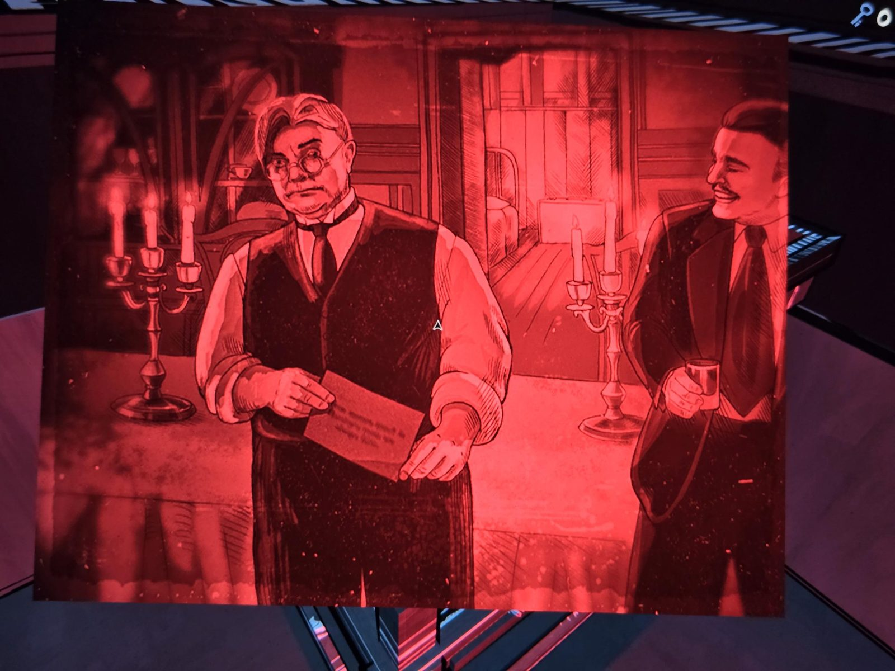
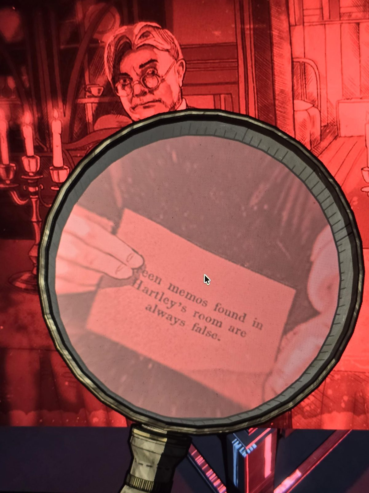
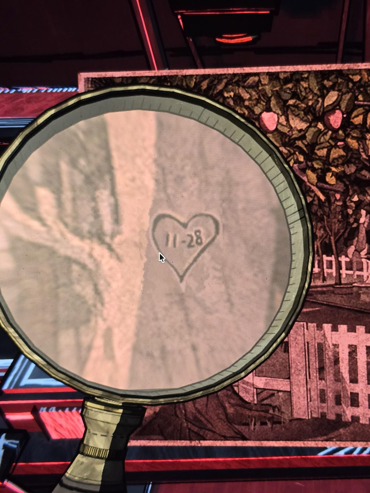

*(Photographic prints in the darkroom, under red safelight. No captions unless noted.)*

1. Close-up portrait of a young woman with hair pinned up, a mole near her mouth, high collar with a bow.
2. Apple orchard behind a white picket fence; a heart with initials is carved into the large tree trunk on the left (initials too small to read — needs magnifying glass).
3. Older woman with glasses reading a letter at a desk with a computer terminal; on the shelf behind her a chess king and a pyramid ornament.
4. Two maids (older woman with long braids holding a mop; younger blonde maid holding a feather duster) — focus on the background.
5. The same two maids — focus on the foreground.
6. Hand holding a twin-lens camera marked **SYNKA Co.**
7. Elderly man with white hair and a large moustache, holding up the SYNKA Co. camera (self-portrait).
8. Stout man with glasses in a waistcoat holding an envelope with text on it (needs magnifying glass); a smiling moustached man with a glass behind him; candelabras.

*Magnified (photo 9 — envelope in print 8):* …een memos found in Hartley's room are always false.

*Magnified (photo 10 — heart on the tree in print 2):* 11-28

## Photos / Фото

