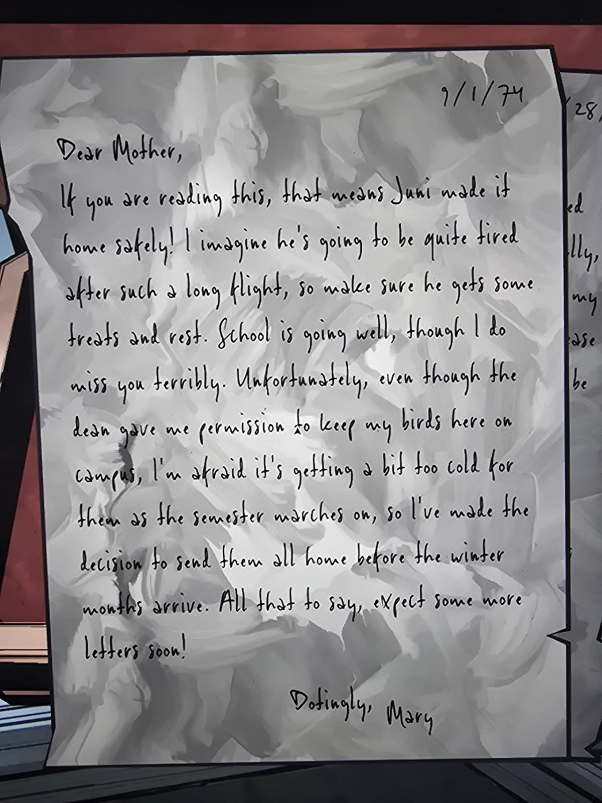

# Letter from Mary to Mother, 9/1/74

9/1/74

Dear Mother,

If you are reading this, that means Juni made it home safely! I imagine he's going to be quite tired after such a long flight, so make sure he gets some treats and rest. School is going well, though I do miss you terribly. Unfortunately, even though the dean gave me permission to keep my birds here on campus, I'm afraid it's getting a bit too cold for them as the semester marches on, so I've made the decision to send them all home before the winter months arrive. All that to say, expect some more letters soon!

Dotingly,
Mary

## Photos / Фото

