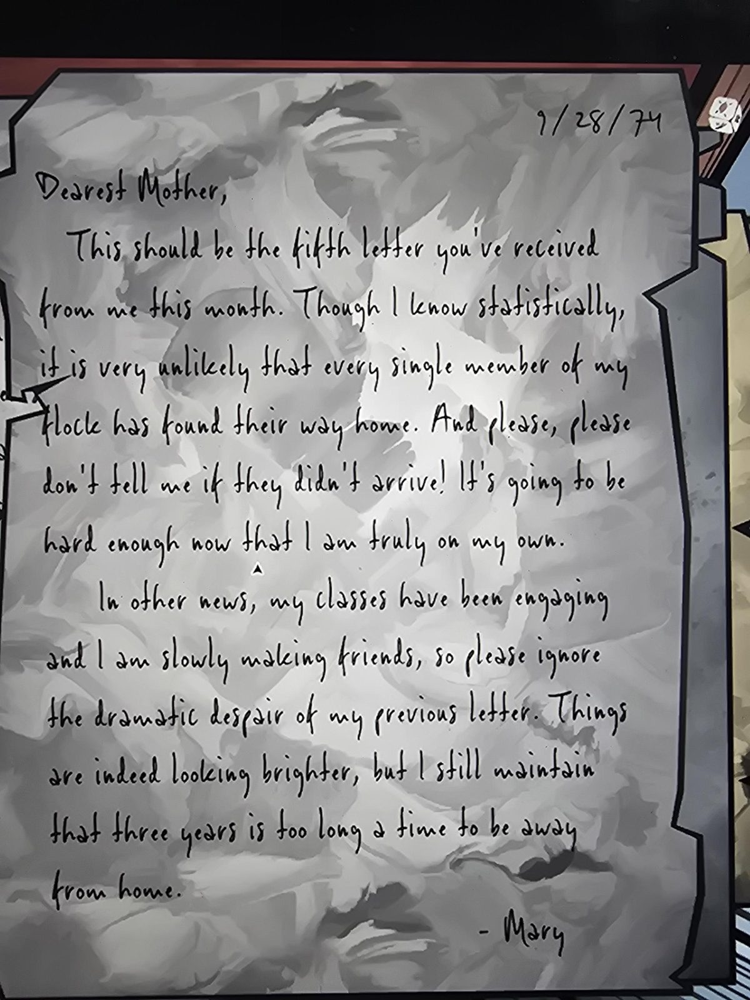

# Письмо Мэри матери, 28.09.74
Dovecote.

«Дорогая мама, это должно быть пятое письмо от меня за этот месяц. Я понимаю, что статистически маловероятно, чтобы каждый из моей стаи добрался домой. И, пожалуйста, не говори мне, если кто-то не прилетел! И так тяжело теперь, когда я совсем одна. А пока: занятия увлекательные, я понемногу завожу друзей, так что не обращай внимания на драматическое отчаяние в прошлом письме. Всё действительно налаживается, но я по-прежнему считаю, что три года вдали от дома — слишком долго. — Мэри»

## Photos / Фото

