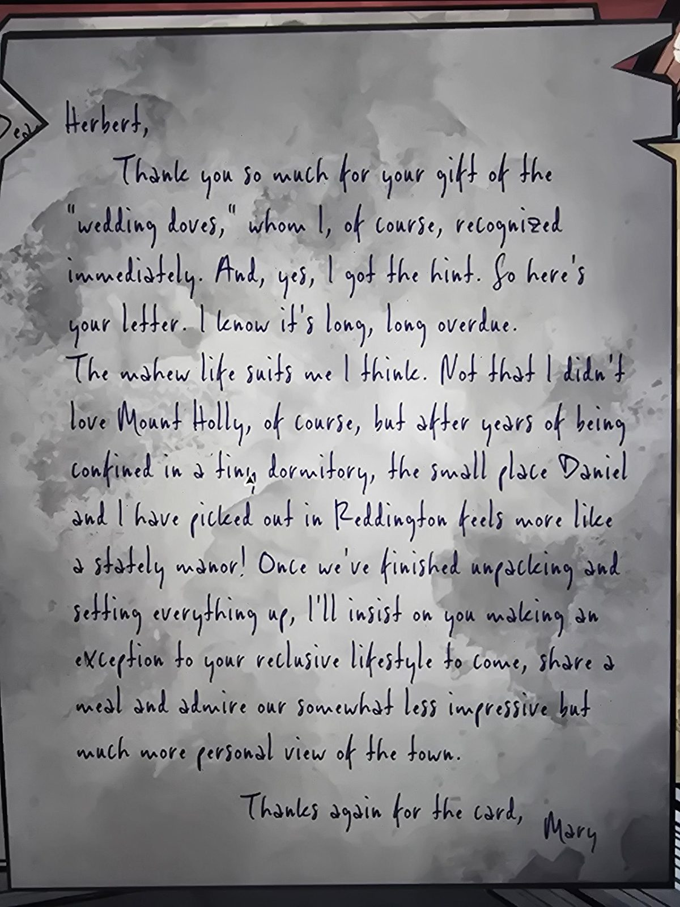

# Письмо Мэри Герберту
Dovecote.

«Герберт, огромное спасибо за подарок, «свадебных голубей»; я, конечно, сразу их узнала. И да, я поняла намёк, вот твоё письмо, знаю, оно давно просрочено. Семейная жизнь, кажется, мне подходит. Не то чтобы я не любила Mount Holly, но после лет в крошечной общежитской комнате маленькое жильё, которое мы с **Дэниелом** выбрали в **Реддингтоне**, кажется почти величественным поместьем! Когда распакуемся и всё устроим, я настою, чтобы ты сделал исключение из своего затворнического образа жизни, пришёл поесть и полюбоваться нашим менее впечатляющим, но куда более личным видом на город. Ещё раз спасибо за открытку, Мэри»

## Заметка
- Слово перед «life» читается плохо (возможно, «married»); перевод по смыслу.

## Photos / Фото

