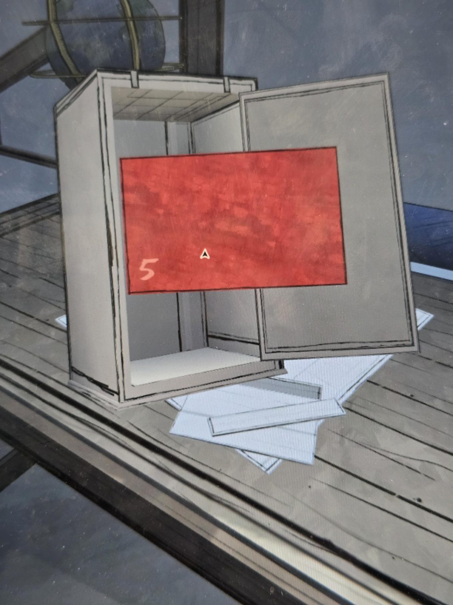
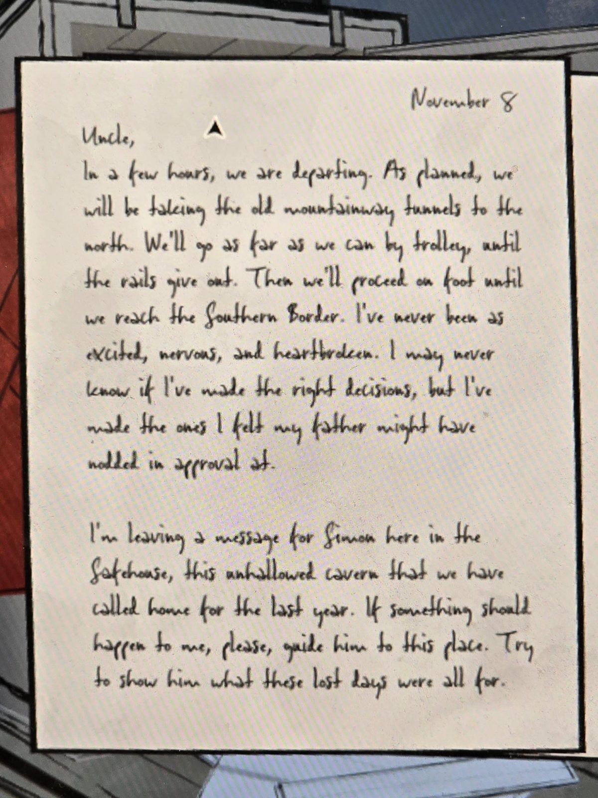
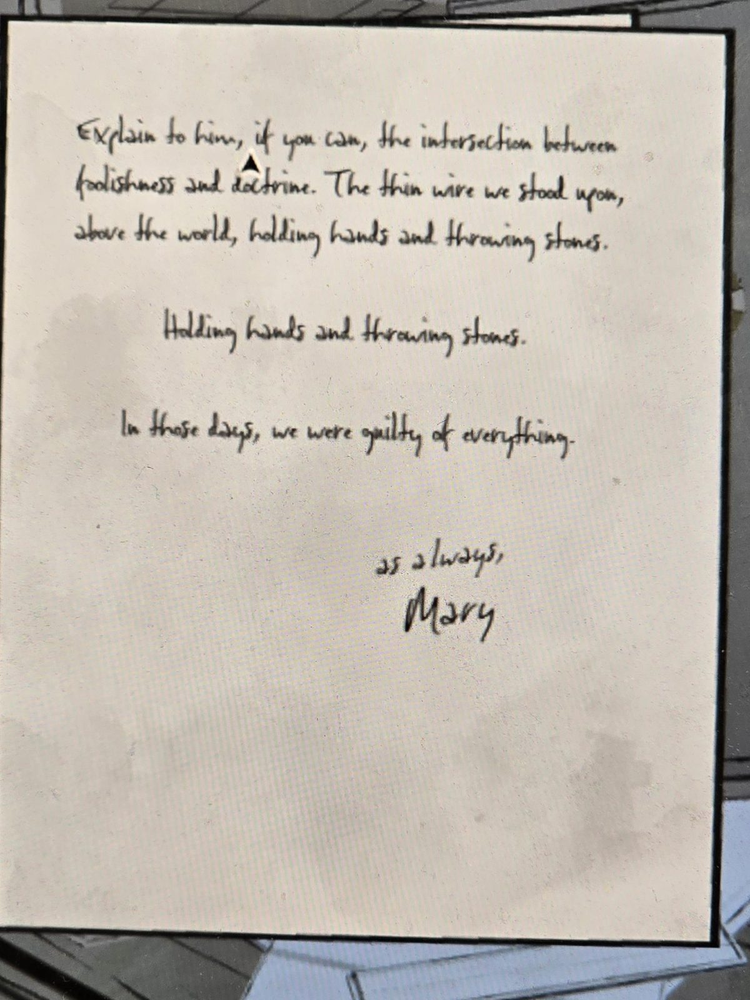

# Красное письмо №5: Мэри — дяде
Drafting Studio, маленький сейф на столе (код 1108). В сейфе красный конверт с номером **5**. Письмо от руки.

## Страница 1
8 ноября

«Дядя,
через несколько часов мы отправляемся. Как и планировали, мы пойдём по старым горным тоннелям на север. Мы поедем на вагонетке, сколько сможем, пока не кончатся рельсы. Потом пойдём пешком, пока не доберёмся до Южной границы. Я никогда не была настолько взволнована, встревожена и убита горем. Возможно, я никогда не узнаю, правильные ли решения я приняла, но я приняла те, которым, как мне казалось, мой отец мог бы одобрительно кивнуть.

Я оставляю здесь, в Safehouse, в этой неосвящённой пещере, которую мы называли домом весь последний год, послание для Саймона. Если со мной что-то случится, прошу, приведи его сюда. Постарайся показать ему, ради чего были все эти потерянные дни.»

## Страница 2
«Объясни ему, если сможешь, пересечение глупости и доктрины. Тонкую проволоку, на которой мы стояли над миром, держась за руки и бросая камни.

Держась за руки и бросая камни.

В те дни мы были виновны во всём.

Как всегда,
Мэри»

## Заметка
- Safehouse: [Safehouse](../../../abandoned-mine/safehouse/solutions.md), письмо Мэри там: [документ](../../../abandoned-mine/safehouse/docs/mary-letter-six-months/ru.md).
- Серия: [красные письма](../../../../documents/red-letters/README.md).

## Photos / Фото

