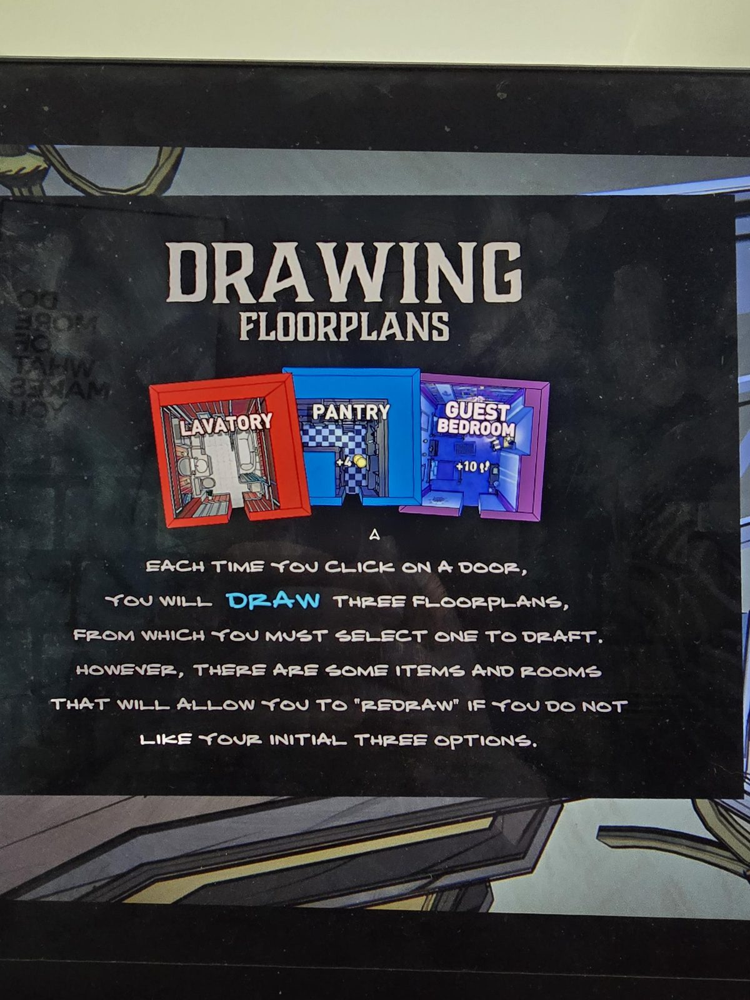

**DRAWING FLOORPLANS**

*(Examples: LAVATORY, PANTRY +4 coins, GUEST BEDROOM +10 steps)*

EACH TIME YOU CLICK ON A DOOR, YOU WILL **DRAW** THREE FLOORPLANS, FROM WHICH YOU MUST SELECT ONE TO DRAFT. HOWEVER, THERE ARE SOME ITEMS AND ROOMS THAT WILL ALLOW YOU TO "REDRAW" IF YOU DO NOT LIKE YOUR INITIAL THREE OPTIONS.

## Photos / Фото

