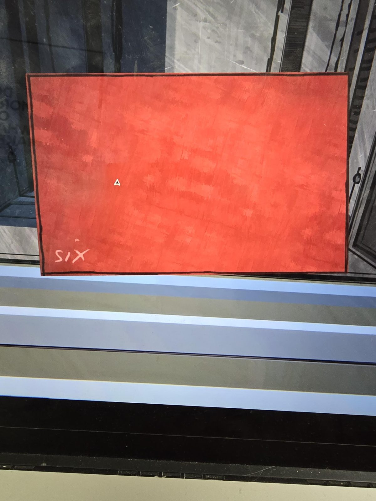
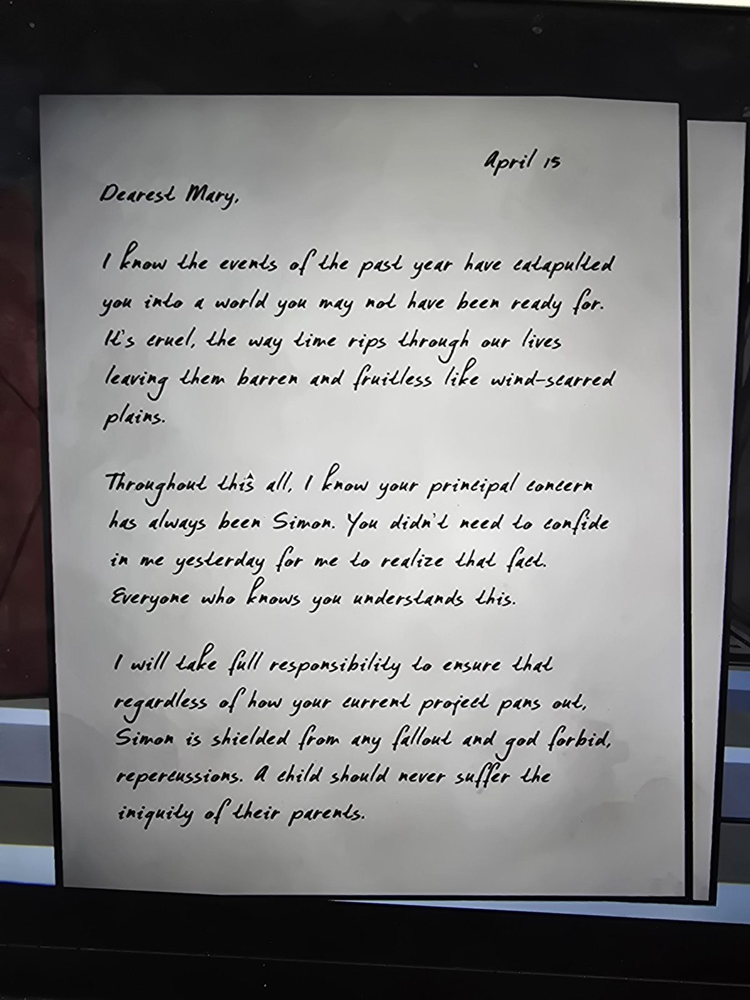
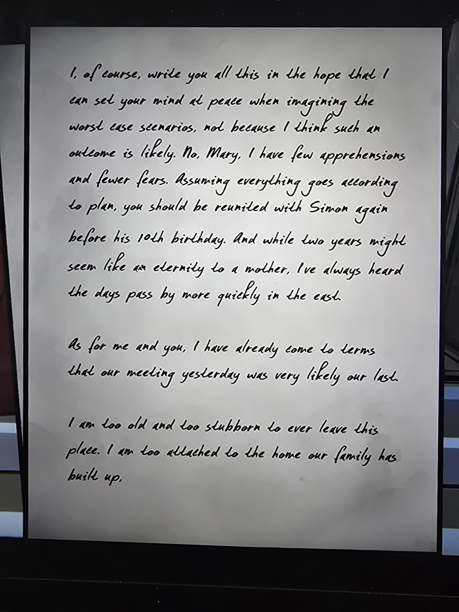
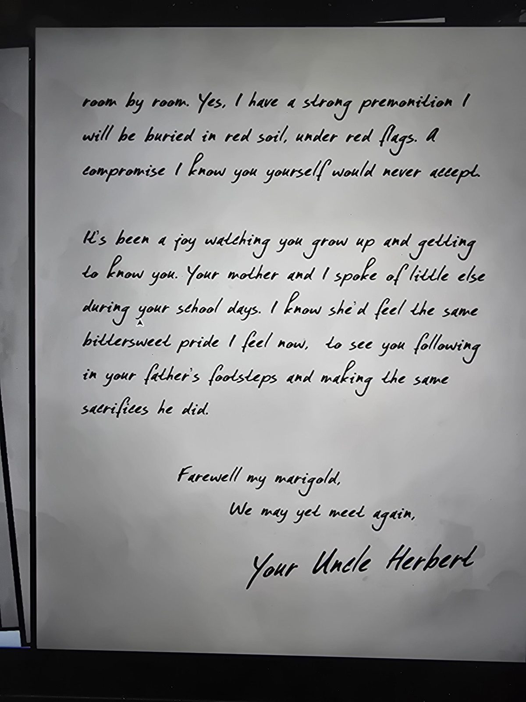

*Red envelope/card, handwritten in the corner:* SIX

---

April 15

Dearest Mary,

I know the events of the past year have catapulted you into a world you may not have been ready for. It's cruel, the way time rips through our lives leaving them barren and fruitless like wind-scarred plains.

Throughout this all, I know your principal concern has always been Simon. You didn't need to confide in me yesterday for me to realize that fact. Everyone who knows you understands this.

I will take full responsibility to ensure that regardless of how your current project pans out, Simon is shielded from any fallout and god forbid, repercussions. A child should never suffer the iniquity of their parents.

---

I, of course, write you all this in the hope that I can set your mind at peace when imagining the worst case scenarios, not because I think such an outcome is likely. No, Mary, I have few apprehensions and fewer fears. Assuming everything goes according to plan, you should be reunited with Simon again before his 10th birthday. And while two years might seem like an eternity to a mother, I've always heard the days pass by more quickly in the east.

As for me and you, I have already come to terms that our meeting yesterday was very likely our last.

I am too old and too stubborn to ever leave this place. I am too attached to the home our family has built up,

---

room by room. Yes, I have a strong premonition I will be buried in red soil, under red flags. A compromise I know you yourself would never accept.

It's been a joy watching you grow up and getting to know you. Your mother and I spoke of little else during your school days. I know she'd feel the same bittersweet pride I feel now, to see you following in your father's footsteps and making the same sacrifices he did.

Farewell my marigold,
We may yet meet again,

*Your Uncle Herbert*

## Photos / Фото

