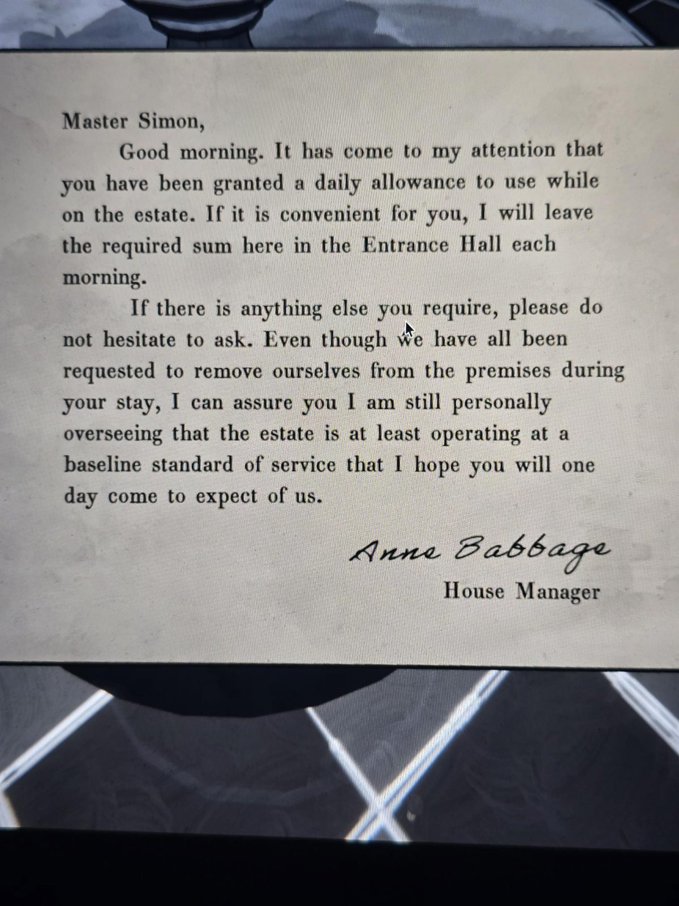

# Записка Энн Бэббидж: ежедневное содержание
Записка в Entrance Hall.

Мастер Саймон,

доброе утро. Мне сообщили, что вам назначено **ежедневное содержание** на время пребывания в поместье. Если вам удобно, я буду каждое утро оставлять нужную сумму **здесь, в Entrance Hall**.

Если вам понадобится что-то ещё, не стесняйтесь просить. Хотя нас всех попросили покинуть поместье на время вашего пребывания, уверяю вас, я лично слежу за тем, чтобы поместье работало хотя бы на базовом уровне обслуживания, которого, надеюсь, вы однажды станете от нас ожидать.

*Энн Бэббидж*
Управляющая домом

## Заметка
- Объясняет монеты, которые каждое утро лежат в Entrance Hall.
- Полное имя управляющей: **Anne Babbage**. Значит, «Энн» из [журнала садовника](../../../apple-orchard/docs/gardeners-logbook/ru.md) — это она.
- «Однажды станете ожидать» — намёк, что Саймон станет хозяином.

## Photos / Фото

