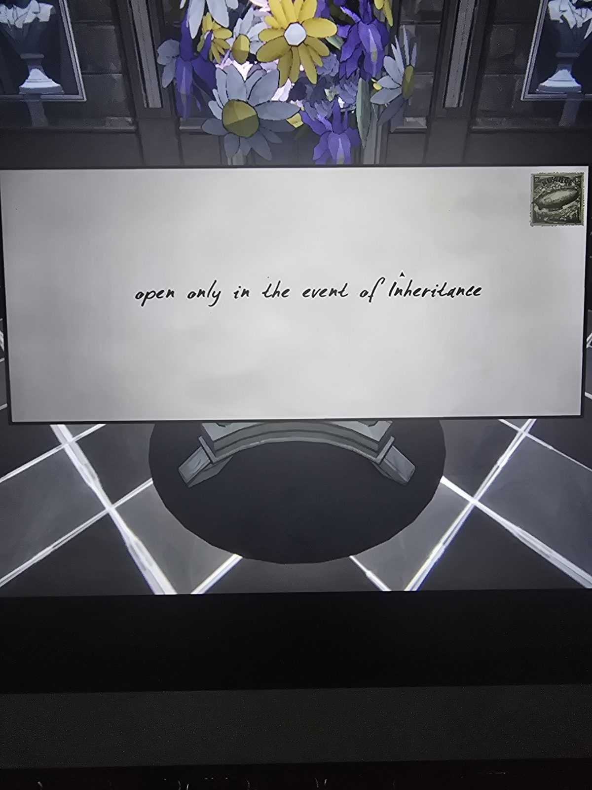
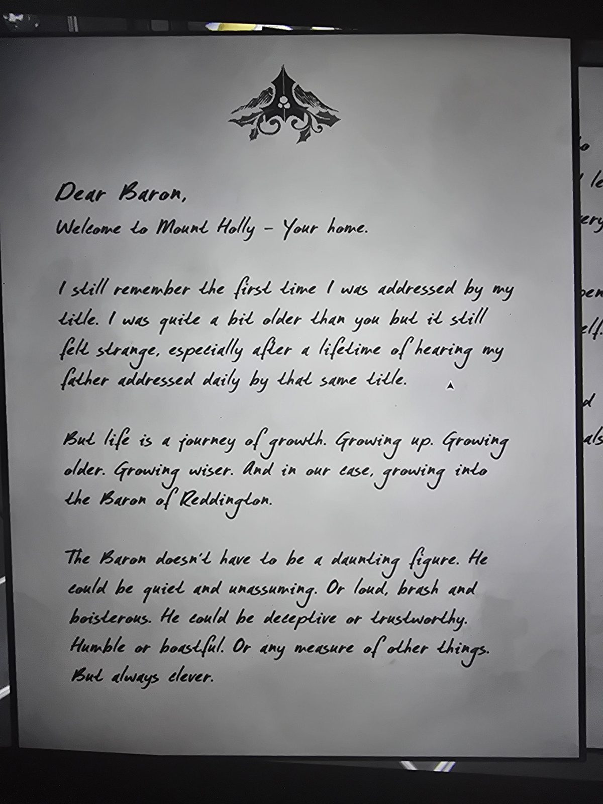
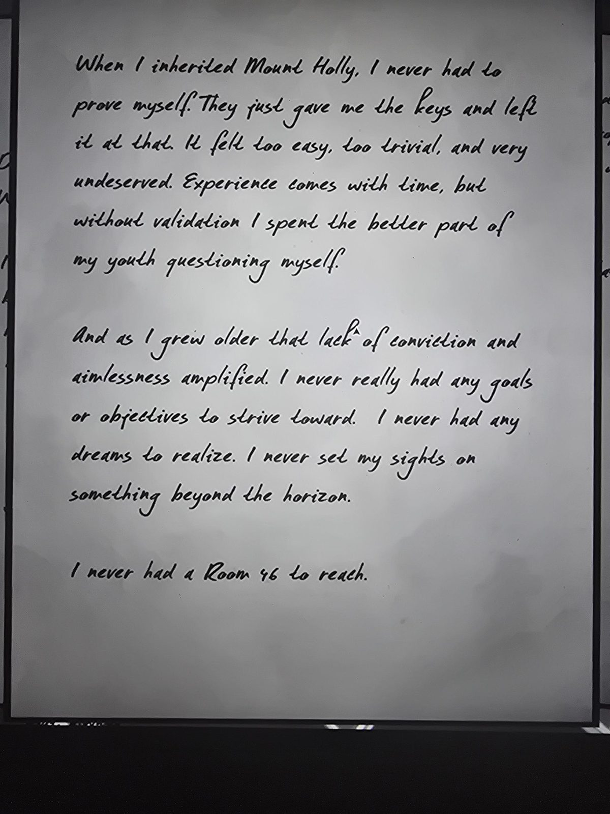
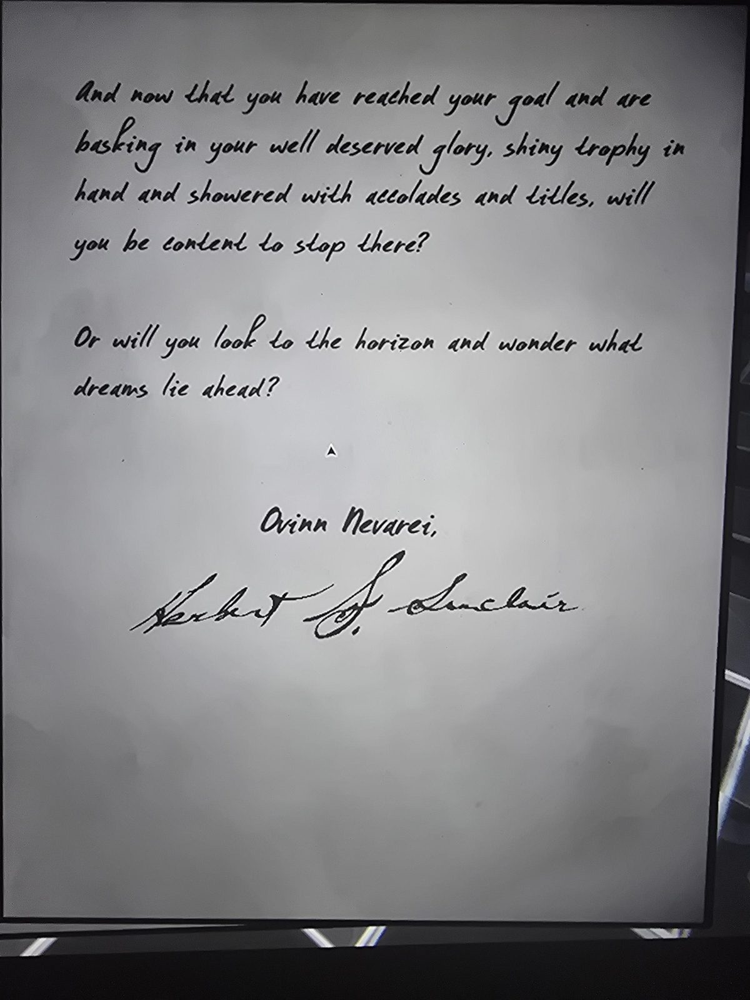

*Envelope (airship stamp in the corner):*
open only in the event of Inheritance

---

*(holly crest)*

Dear Baron,
Welcome to Mount Holly – Your home.

I still remember the first time I was addressed by my title. I was quite a bit older than you but it still felt strange, especially after a lifetime of hearing my father addressed daily by that same title.

But life is a journey of growth. Growing up. Growing older. Growing wiser. And in our case, growing into the Baron of Reddington.

The Baron doesn't have to be a daunting figure. He could be quiet and unassuming. Or loud, brash and boisterous. He could be deceptive or trustworthy. Humble or boastful. Or any measure of other things. But always clever.

---

When I inherited Mount Holly, I never had to prove myself. They just gave me the keys and left it at that. It felt too easy, too trivial, and very undeserved. Experience comes with time, but without validation I spent the better part of my youth questioning myself.

And as I grew older that lack of conviction and aimlessness amplified. I never really had any goals or objectives to strive toward. I never had any dreams to realize. I never set my sights on something beyond the horizon.

I never had a Room 46 to reach.

---

And now that you have reached your goal and are basking in your well deserved glory, shiny trophy in hand and showered with accolades and titles, will you be content to stop there?

Or will you look to the horizon and wonder what dreams lie ahead?

Ovinn Nevarei,

*(signature)* Herbert S. Sinclair

## Photos

