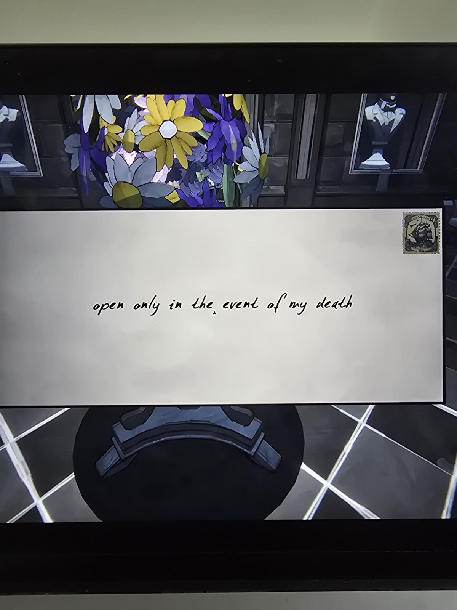
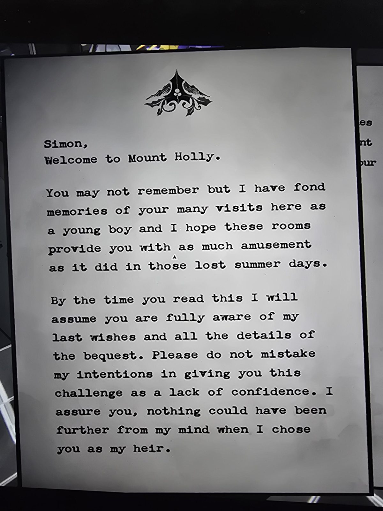
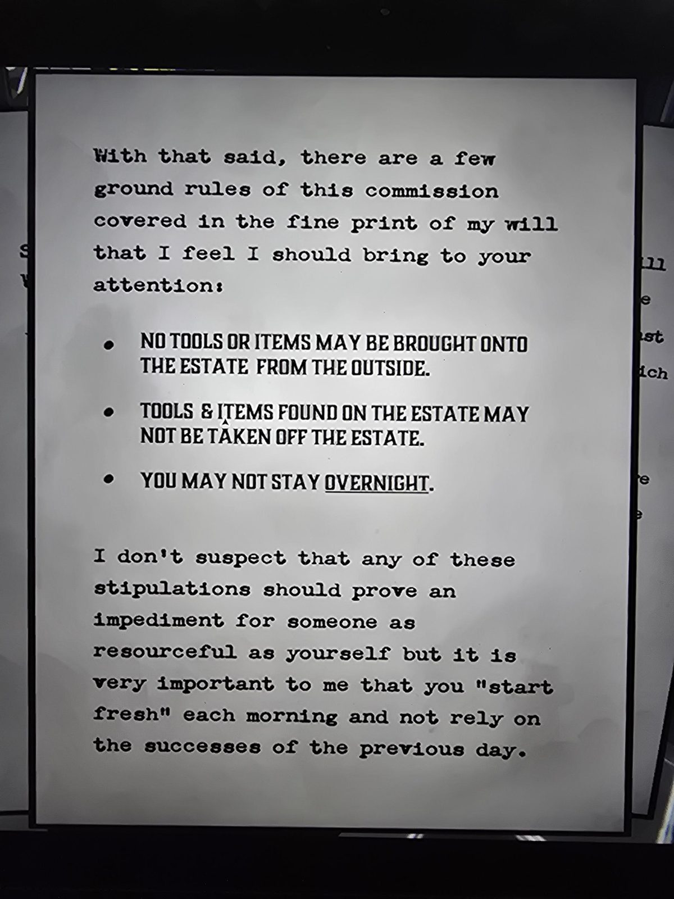
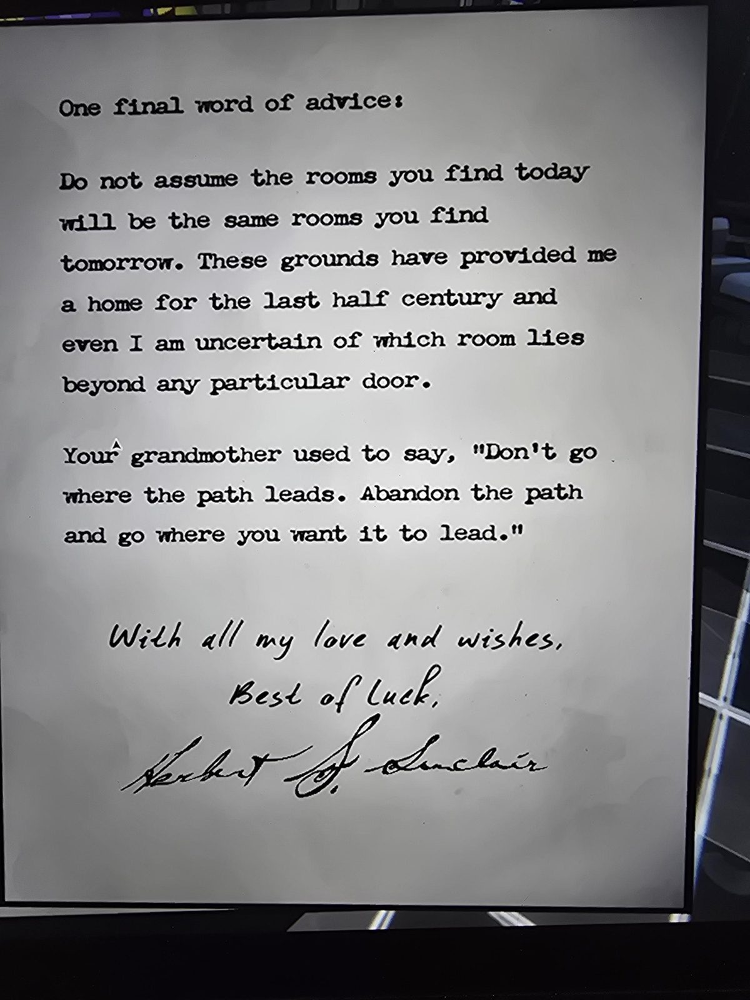

# Письмо Герберта: «Добро пожаловать в Маунт-Холли»
Лежит на круглом столике в Entrance Hall. Конверт с маркой (корабль) и надписью от руки.

*Конверт:* вскрыть только в случае моей смерти

---

Саймон,
добро пожаловать в Маунт-Холли.

Ты, может, и не помнишь, но у меня остались тёплые воспоминания о твоих частых приездах сюда мальчишкой. Надеюсь, эти комнаты развлекут тебя так же, как в те потерянные летние дни.

Когда ты будешь читать это, ты, полагаю, уже знаешь мою последнюю волю и все условия завещания. Не думай, что, поставив перед тобой это испытание, я в тебе сомневаюсь. Уверяю, ничего подобного у меня и в мыслях не было, когда я выбрал тебя наследником.

---

И всё же в мелком шрифте завещания есть несколько основных правил этого поручения, о которых, думаю, стоит тебе напомнить:

- **Никакие инструменты и предметы нельзя приносить в поместье снаружи.**
- **Инструменты и предметы, найденные в поместье, нельзя уносить за его пределы.**
- **Оставаться на ночь нельзя.**

Не думаю, что эти условия станут помехой для такого находчивого человека, как ты. Но для меня очень важно, чтобы каждое утро ты «начинал с чистого листа» и не полагался на вчерашние успехи.

---

Последний совет:

Не думай, что комнаты, которые ты найдёшь сегодня, будут теми же, что ты найдёшь завтра. Это место было мне домом полвека, и даже я не знаю наверняка, какая комната окажется за той или иной дверью.

Твоя бабушка говорила: «Не иди туда, куда ведёт тропа. Сойди с тропы и иди туда, куда хочешь, чтобы она вела».

*С любовью и наилучшими пожеланиями,*
*удачи,*
*Герберт С. Синклер*

## Заметка
- Правила игры в сюжетной обёртке: каждый день начинается заново, предметы не переносятся, планировка комнат каждый день разная.
- Персонажи: **Саймон** (наследник, герой) и **Герберт С. Синклер** (двоюродный дед, автор завещания). Поместье называется **Mount Holly**, на гербе остролист (holly).
- Слова бабушки: подсказка к общему подходу (строить путь самому).

## Photos / Фото

