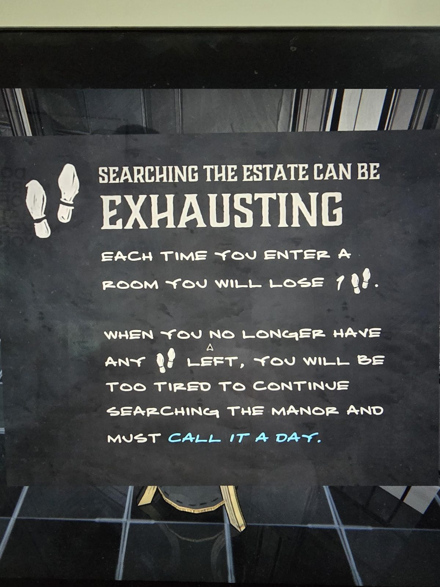

# Табличка-обучение: шаги
Табличка на подставке в Entrance Hall.

ОБЫСКИВАТЬ ПОМЕСТЬЕ **УТОМИТЕЛЬНО**

КАЖДЫЙ РАЗ, ВХОДЯ В КОМНАТУ, ТЫ ТЕРЯЕШЬ 1 👣 (шаг).

КОГДА 👣 ЗАКОНЧАТСЯ, ТЫ СЛИШКОМ УСТАНЕШЬ, ЧТОБЫ ПРОДОЛЖАТЬ ОБЫСК, И ПРИДЁТСЯ ЗАКОНЧИТЬ ДЕНЬ (CALL IT A DAY).

## Заметка
- В начале дня **50 шагов** (счётчик в левом верхнем углу экрана).

## Photos / Фото

