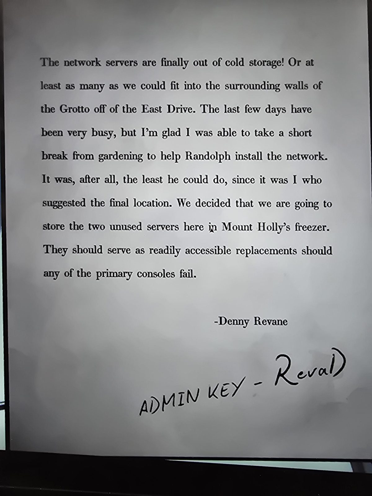

# Записка Денни Ревейна: серверы в морозильнике
Freezer. Печатная записка, подпись **Denny Revane**; внизу чёрными чернилами от руки: «**ADMIN KEY - RevaD**».

«Сетевые серверы наконец-то вынесены из холодного хранения! Или, по крайней мере, столько, сколько удалось уместить в окружающие стены **Грота у Восточной дороги** (East Drive). Последние дни были очень загружены, но я рад, что смог ненадолго оторваться от садоводства и помочь Рэндольфу установить сеть. Это было меньшее, что он мог сделать, ведь именно **я предложил окончательное место**. Мы решили хранить два неиспользуемых сервера здесь, в **морозильнике Маунт-Холли**. Они послужат легкодоступной заменой, если какая-нибудь из основных консолей выйдет из строя. — Денни Ревейн»

## Заметка
- **Админ-ключ RevaD** собран по правилу из [записки Рэндольфа мистеру Руоте](../../../servants-quarters/docs/ruota-admin-key-note/ru.md): первые четыре буквы фамилии (Reva) и первая буква имени (D), первый и пятый символы заглавные.
- «Грот» = [Blackbridge Grotto](../../../blackbridge-grotto/solutions.md), где серверы и терминалы сети.
- Письмо шефа о морозильнике: [письма 1987 в Laboratory](../../../laboratory/docs/terminal-emails-1987/ru.md).

## Photos / Фото

