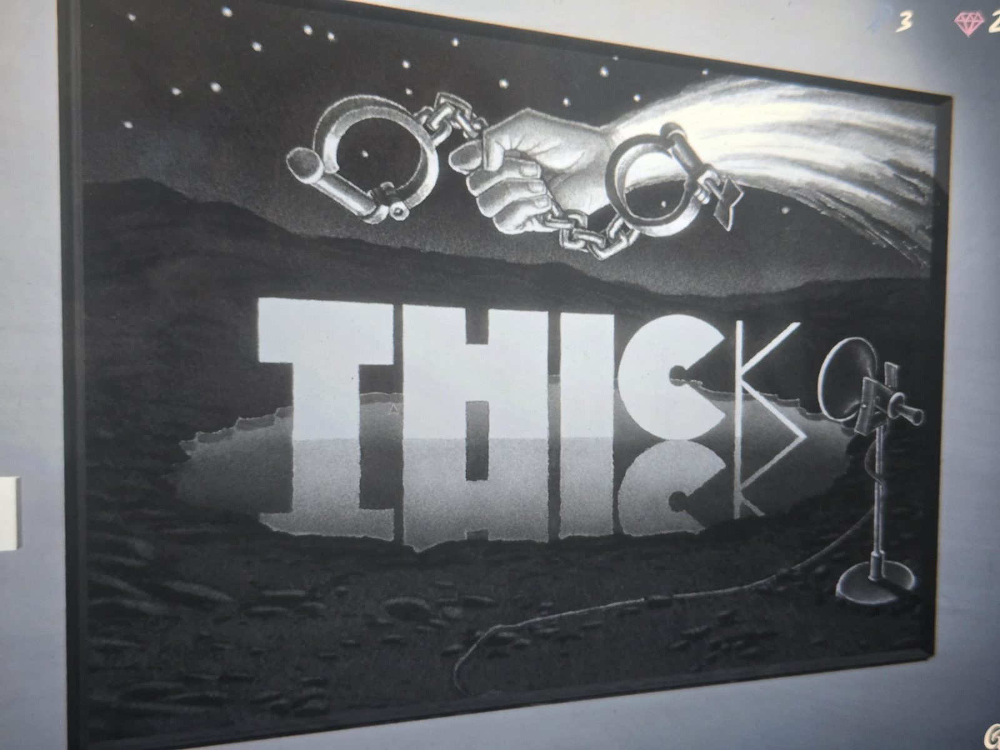
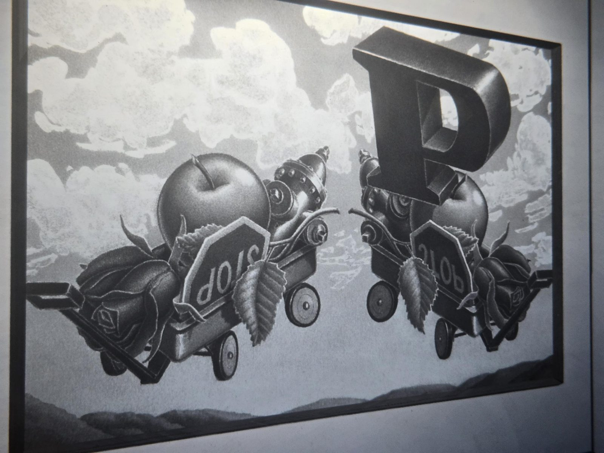
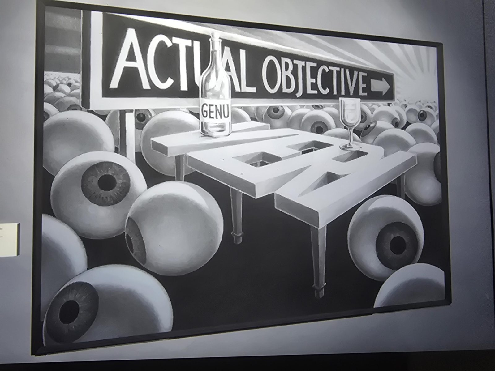
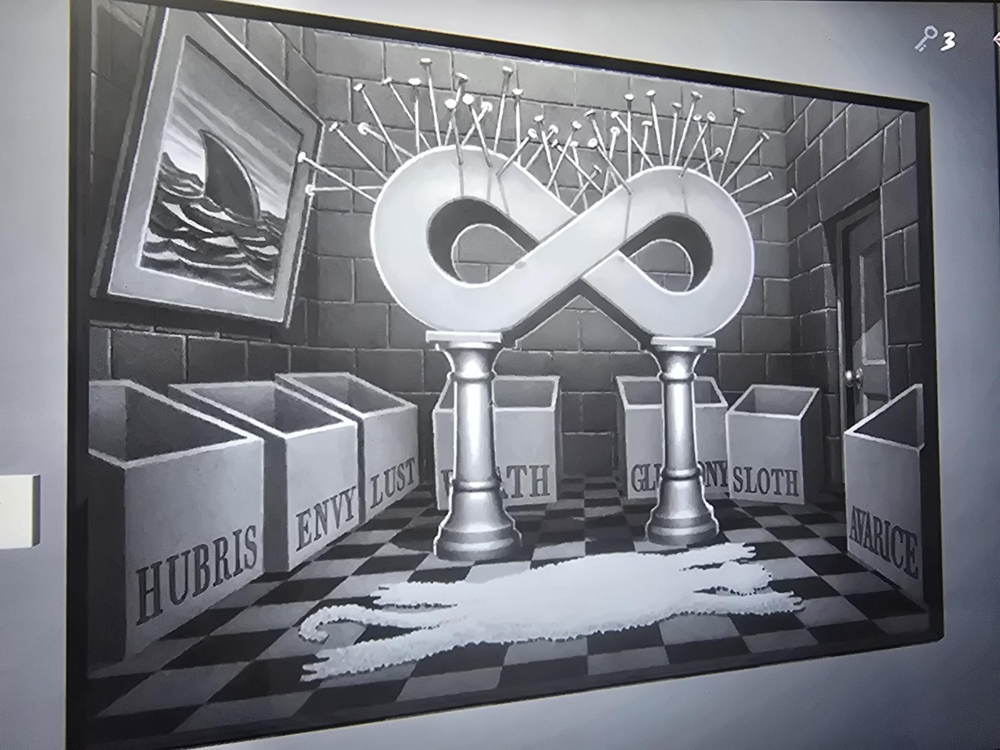

# Картины-головоломки Gallery
Gallery. Четыре картины; для каждой нужно ввести слово-название. Вводить **по порядку**. Правильные ответы дают **ключ от Room 8** (со слов пользователя).

| № | Картина | Ответ | Расшифровка (со слов пользователя) |
|---|---|---|---|
| 1 | наручники, надпись THIC + руна K, микрофон | **THINK** | «thin» + «k» → think |
| 2 | две тележки, одна перевёрнута, большая буква P | **PONDER** | «P» + «on» + «red» наоборот («der»): P on red reversed |
| 3 | знак «Actual Objective», бутылка «GENU», много глаз | **REALIZE** | «real eyes» |
| 4 | знак бесконечности (∞ = «8») в комнате, коробки с грехами | **RUMINATING** | «room in eight» |

Описание картин:
1. Рука с наручниками на фоне ночного неба; крупные буквы THIC + похожий на руну K, отражение в воде; микрофон справа.
2. Две игрушечные тележки (яблоко, пожарный гидрант, роза, знак STOP, лист); правая зеркальная, слово STOP перевёрнуто; сверху огромная P.
3. Указатель «ACTUAL OBJECTIVE →»; бутылка с надписью «GENU»; стол в форме букв; море глазных яблок.
4. Белая ∞ на двух колоннах, утыканная гвоздями; картина с плавником акулы; ковёр в форме шкуры; коробки HUBRIS, ENVY, LUST, WRATH, GLUTTONY, SLOTH, AVARICE; дверь.

## Заметка
- Ответы и расшифровки даны пользователем и проверены в игре (ключ получен).
- Ключ открывает **Room 8**. Ср. трофей «Trophy 8: solve the puzzle in Room 8 on Rank 8» ([трофеи](../../../entrance-hall/docs/trophies-of-mt-holly/ru.md)).

## Photos / Фото

