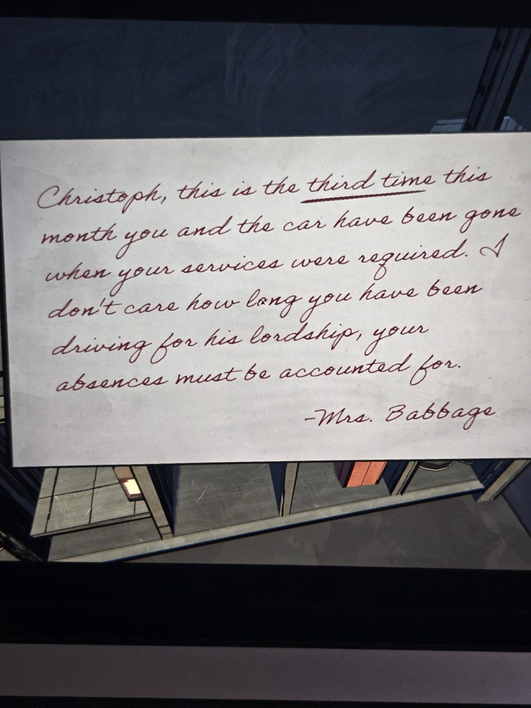

# Записка миссис Бэббидж шофёру Кристофу
Записка в Garage, написана **красными чернилами**.

Кристоф, это уже **третий раз** за месяц, когда тебя и машины не было на месте, когда требовались твои услуги. Мне всё равно, сколько лет ты возишь его светлость: твои отлучки должны быть объяснены.

— Миссис Бэббидж

## Заметка
- Персонаж: **Кристоф**, шофёр Герберта, отлучается вместе с машиной.

## Photos / Фото

