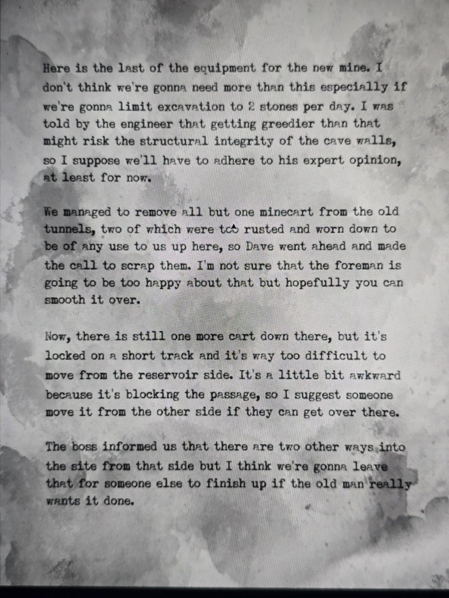

# Письмо об оборудовании для новой шахты
Машинописный лист в Gemstone Cavern. Без подписи.

Вот последняя часть оборудования для новой шахты. Думаю, больше нам не понадобится, особенно если ограничим добычу **2 камнями в день**. Инженер сказал, что если жадничать сильнее, можно повредить несущие стены пещеры, так что, полагаю, придётся следовать его экспертному мнению, по крайней мере пока.

Нам удалось вывезти из **старых туннелей** все вагонетки, кроме одной; две из них были слишком ржавыми и изношенными, чтобы пригодиться здесь наверху, так что Дэйв решил их списать. Не уверен, что **бригадир** (foreman) будет этим доволен, но надеюсь, ты сможешь всё уладить.

Так вот, внизу осталась ещё **одна вагонетка**, но она заперта на коротком пути, и сдвинуть её **со стороны резервуара** слишком трудно. Неловко вышло, потому что она **загораживает проход**, так что предлагаю кому-нибудь сдвинуть её **с другой стороны**, если туда удастся попасть.

Босс сообщил, что с той стороны есть ещё **два входа** на объект, но, думаю, это мы оставим кому-нибудь другому, если старик действительно хочет довести дело до конца.

## Заметка
- В Gemstone Cavern, видимо, можно добывать **не больше 2 камней (gems) в день**.
- В старых туннелях (подземелье) есть вагонетка, перекрывающая проход: со стороны **резервуара** её не сдвинуть, нужно зайти **с другой стороны**. С той стороны есть ещё **два входа**.
- Упомянуты: **Дэйв**, **бригадир** (foreman), «босс», «старик» (Герберт?).

## Photos / Фото

