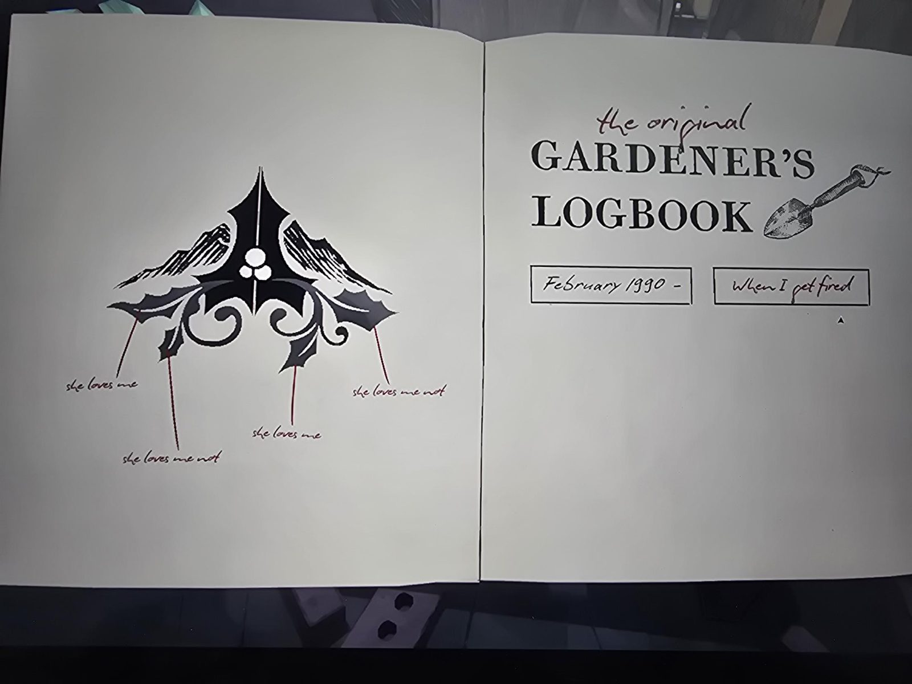
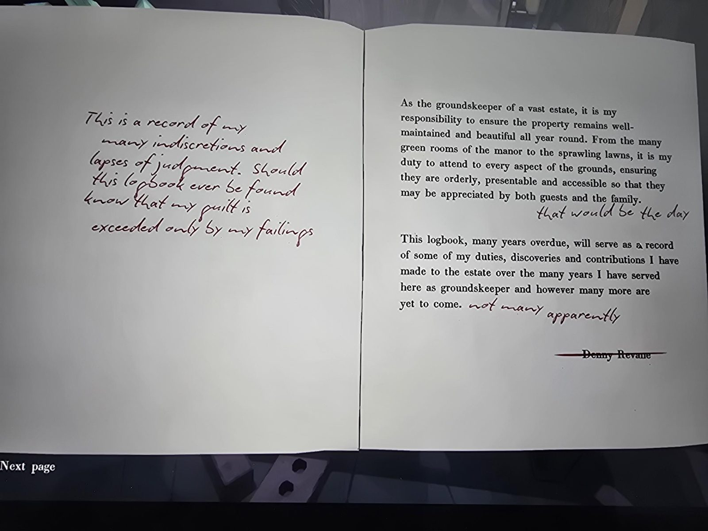
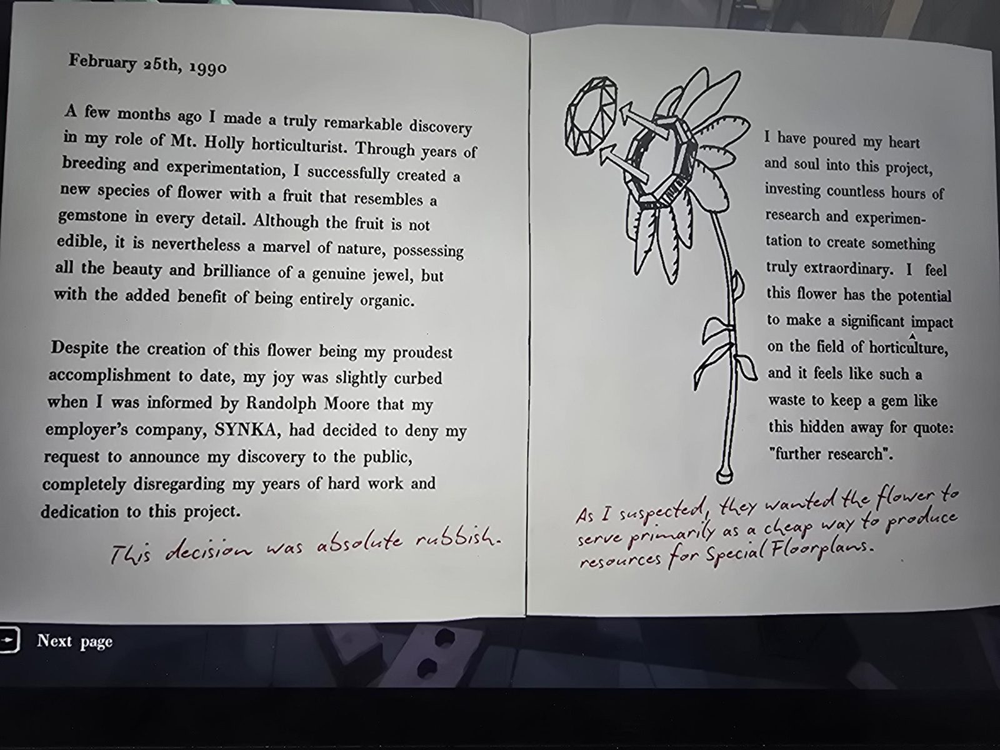
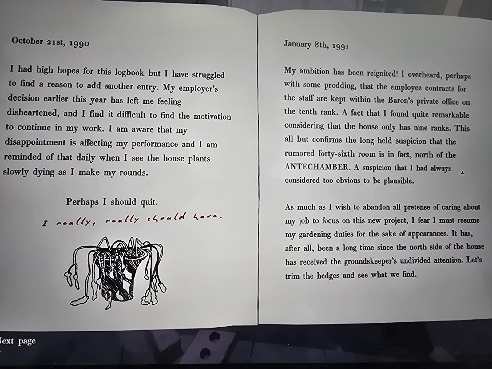
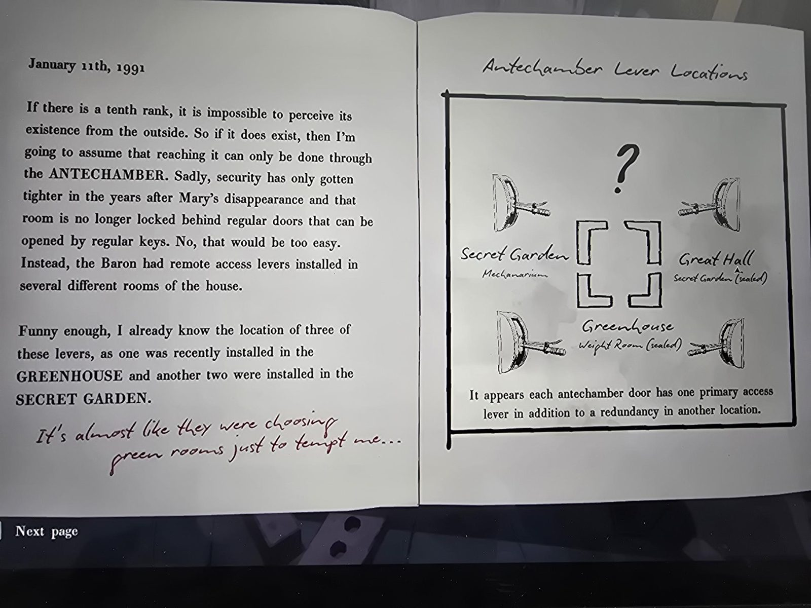
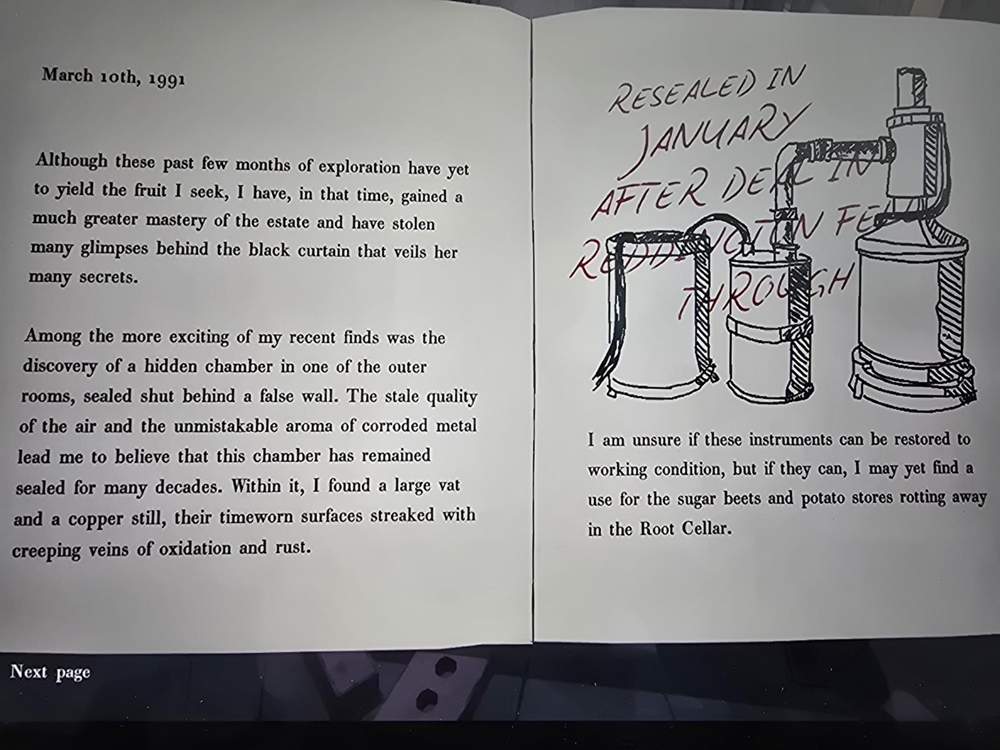
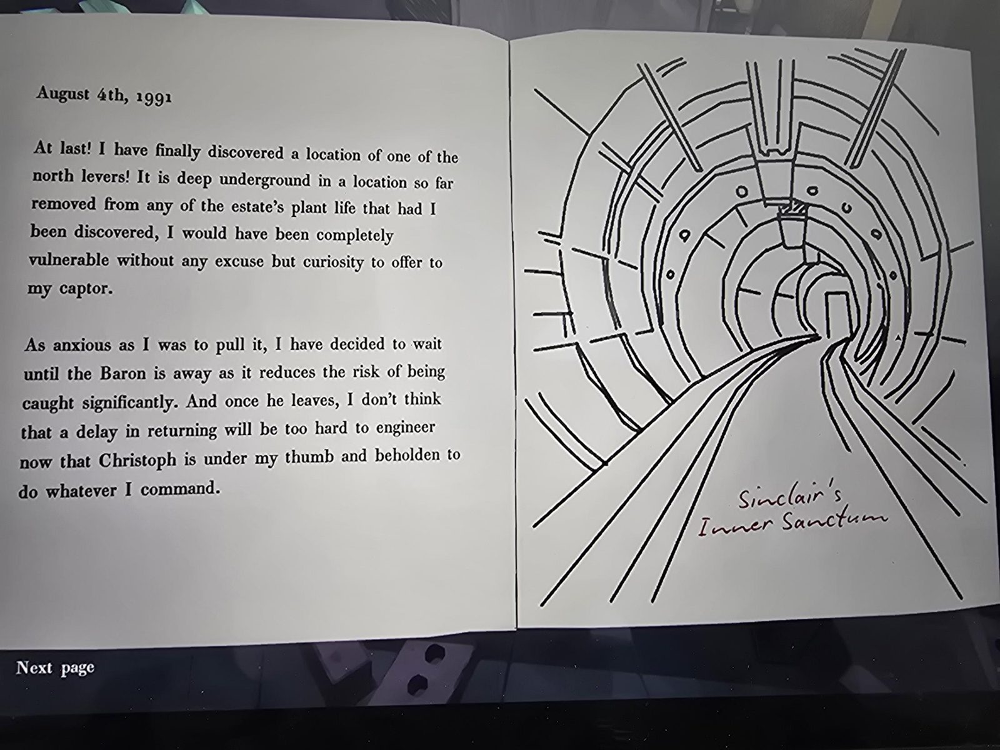
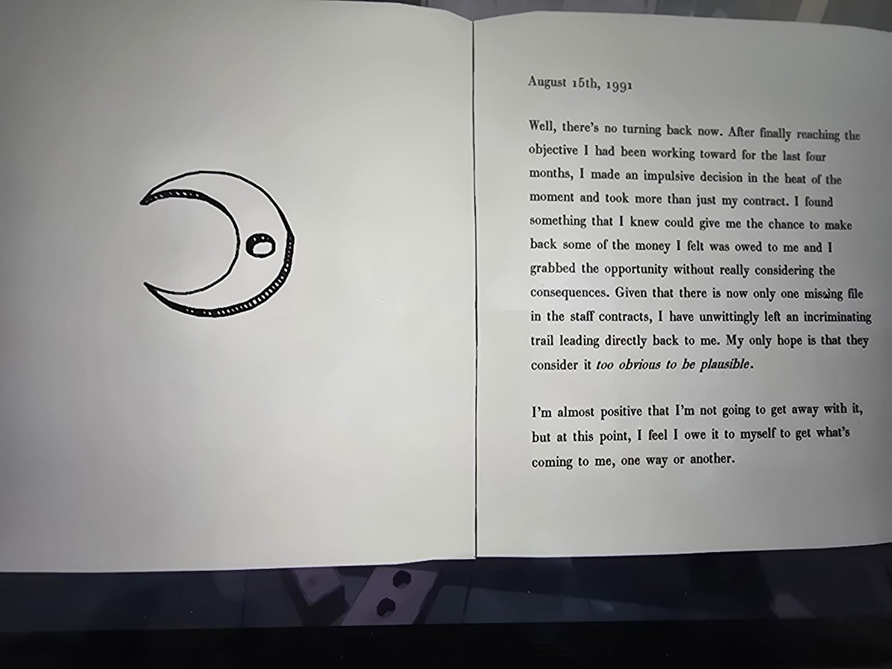

# Оригинальный журнал садовника (Greenhouse)
Greenhouse, за разбитой стеной. Автор: **Денни Ревейн** (подпись зачёркнута). Печатный текст дополнен рукописными пометками тёмно-красными чернилами; они отмечены **[от руки]**.

## Страница 1
Слева: чёрная эмблема из остролиста с горами; от четырёх листьев идут красные линии с подписями [от руки]: «she loves me» (любит), «she loves me not» (не любит), «she loves me», «she loves me not».
Справа: [от руки] **«the original»** (оригинальный) над печатным **GARDENER'S LOGBOOK** («Журнал садовника»), рисунок садовой лопатки. В рамках [от руки]: «Февраль 1990 –» и «Когда меня уволят».

## Страница 2
[от руки] «Это запись моих многочисленных нескромностей и промахов. Если этот журнал когда-нибудь найдут, знайте: моя вина превосходится только моими недостатками.»

Печатный текст: «Как садовник обширного поместья, я отвечаю за то, чтобы владение оставалось ухоженным и красивым круглый год. От многих зелёных комнат особняка до раскинувшихся газонов: моя обязанность заботиться обо всех сторонах территории, чтобы они были в порядке, презентабельны и доступны, и чтобы ими могли любоваться и гости, и семья.» [от руки] «вот это был бы день».

«Этот журнал, запоздавший на много лет, будет записью некоторых моих обязанностей, открытий и вкладов в поместье за многие годы моей службы здесь садовником, и сколько бы их ещё ни было впереди.» [от руки] «немного, судя по всему».

Подпись: ~~Denny Revane~~ (зачёркнута).

## Страница 3: 25 февраля 1990
«Несколько месяцев назад я сделал поистине замечательное открытие в роли садовода-селекционера Mt. Holly. За годы скрещиваний и опытов мне удалось вывести новый вид цветка с плодом, во всех деталях похожим на драгоценный камень. Плод несъедобен, но всё же чудо природы: вся красота и сияние настоящего самоцвета, да ещё и полностью органический.

Несмотря на то что создание этого цветка — моё главное достижение на сегодня, радость была слегка омрачена, когда Рэндольф Мур сообщил мне, что компания моего работодателя, SYNKA, решила отклонить мою просьбу объявить об открытии публике, полностью пренебрегая годами моего труда и преданности проекту.» [от руки] «Это решение было полной чепухой.»

(Рисунок: цветок с плодом-самоцветом, стрелки от камня к плоду.)
«Я вложил в этот проект сердце и душу, потратил бесчисленные часы на исследования и опыты, чтобы создать нечто поистине необыкновенное. Я чувствую, что этот цветок может заметно повлиять на садоводство, и такая трата: держать такой самоцвет в тени ради, цитирую, “дальнейших исследований”.»
[от руки] «Как я и подозревал, цветок им нужен был прежде всего как дешёвый способ добывать ресурсы для Special Floorplans (особых планов этажей).»

## Страница 4: 21 октября 1990
«Я возлагал на этот журнал большие надежды, но мне было трудно найти повод для новой записи. Решение работодателя в начале года оставило меня подавленным, и мне трудно найти мотивацию продолжать работу. Я понимаю, что разочарование сказывается на моей работе, и мне напоминают об этом ежедневно, когда я вижу, как комнатные растения медленно гибнут, пока я обхожу дом.

Может, мне стоит уволиться.»
[от руки] «Очень, очень надо было.»
(Рисунок: увядший горшечный цветок.)

## Страница 4: 8 января 1991
«Моё честолюбие снова разгорелось! Я подслушал (возможно, с некоторым нажимом), что трудовые договоры персонала хранятся в личном кабинете барона на **десятом ранге**. Меня это удивило, ведь у дома только девять рангов. Это почти подтверждает давнее подозрение, что слухами окружённая **сорок шестая комната** на самом деле **к северу от ANTECHAMBER**. Подозрение, которое я всегда считал слишком очевидным, чтобы быть правдоподобным.

Как бы мне ни хотелось отбросить всякое притворство заботы о работе и сосредоточиться на новом проекте, боюсь, придётся вернуться к обязанностям садовника ради приличия. Ведь прошло много времени с тех пор, как северная сторона дома получала всё внимание садовника. Давайте подстрижём живую изгородь и посмотрим, что найдём.»

## Страница 5: 11 января 1991
«Если десятый ранг существует, снаружи его существование заметить невозможно. Поэтому, если он есть, я буду исходить из того, что попасть туда можно только через ANTECHAMBER. К сожалению, после исчезновения Мэри охрана только ужесточилась, и эта комната больше не заперта за обычными дверями, открываемыми обычными ключами. Нет, это было бы слишком просто. Вместо этого барон велел установить **удалённые рычаги доступа** в нескольких разных комнатах дома.

Забавно, но я уже знаю расположение трёх из этих рычагов: один недавно установили в **GREENHOUSE**, ещё два — в **SECRET GARDEN**.»
[от руки] «Как будто они нарочно выбирали зелёные комнаты, чтобы искушать меня…»

**Схема «Antechamber Lever Locations»** [от руки]: четыре рычага вокруг четырёх Г-образных углов, сверху «?». Подписи (в каждой: основной / резервный): Secret Garden / **Mechanarium**; Great Hall / **Secret Garden (sealed)**; Greenhouse / **Weight Room (sealed)**.
Подпись под схемой: «Похоже, у каждой двери Antechamber есть один основной рычаг доступа и дублирующий в другом месте.»

## Страница 6: 10 марта 1991
«Хотя эти последние месяцы разведки пока не принесли желаемого плода, за это время я намного лучше освоил поместье и украдкой заглянул за чёрный занавес, скрывающий её многие тайны.

Одной из самых волнующих находок был потайной отсек в одной из внешних комнат, замурованный за ложной стеной. Затхлость воздуха и безошибочный запах разъеденного металла заставляют меня думать, что отсек был закрыт много десятилетий. Внутри я нашёл большой чан и медный перегонный куб, их потёртые поверхности покрыты ползучими прожилками окисления и ржавчины.»
(Рисунок: чан, малая бочка и медный перегонный куб, соединённые трубами.) [от руки поверх рисунка] **«RESEALED IN JANUARY AFTER DEAL IN REDDINGTON FELL THROUGH»** («Снова замурован в январе после того, как сделка в Реддингтоне сорвалась»).
«Не уверен, что эти приборы можно привести в рабочее состояние, но если можно, я ещё найду применение сахарной свёкле и картофелю, гниющим в Root Cellar.»

## Страница 7: 4 августа 1991
«Наконец-то! Я нашёл расположение одного из **северных рычагов**! Он глубоко под землёй, в месте так далеко от всякой растительности поместья, что, будь я обнаружен, я был бы совершенно беззащитен и мне нечего было бы предложить своему пленителю, кроме любопытства.

Как бы я ни рвался его потянуть, я решил дождаться, когда барон уедет: так намного меньше риск попасться. А когда он уедет, не думаю, что будет слишком сложно устроить задержку с возвращением, раз **Кристоф** у меня под каблуком и обязан делать всё, что я прикажу.»
(Рисунок: тоннель с рельсами.) [от руки] **«Sinclair's Inner Sanctum»** (Inner Sanctum Синклера).

## Страница 8: 15 августа 1991
(Слева: рисунок полумесяца с круглым отверстием.)
«Что ж, пути назад нет. Достигнув цели, к которой я шёл последние четыре месяца, я принял импульсивное решение в разгаре момента и взял больше, чем просто свой договор. Я нашёл кое-что, что, как я знал, даст мне шанс вернуть часть денег, которые, как я считал, мне должны, и ухватился за возможность, не подумав о последствиях. Раз в договорах персонала теперь не хватает только одного файла, я невольно оставил улику, ведущую прямо ко мне. Единственная надежда, что сочтут это *слишком очевидным, чтобы быть правдоподобным*.

Я почти уверен, что мне это с рук не сойдёт, но сейчас я чувствую, что должен себе получить то, что мне причитается, так или иначе.»

## Заметки
- Рычаги Antechamber по схеме: у Secret Garden резервный Mechanarium; у Great Hall резервный Secret Garden (sealed); у Greenhouse резервный [Weight Room](../../../weight-room/solutions.md) (sealed). См. [Antechamber](../../../antechamber/solutions.md).
- Ср. новый журнал: [Журнал садовника Ногулы](../../../apple-orchard/docs/gardeners-logbook/ru.md); Денни: [записка про возврат почты](../../../mail-room/docs/denny-revane-return-note/ru.md).
- Чан и перегонный куб со стр. 6: [Trading Post](../../../trading-post/solutions.md) (за разбитой стеной).
- Вырезанные буквы на столе рядом: [фото](../../photos/cut-out-letters.jpg).

## Photos / Фото
   
   
