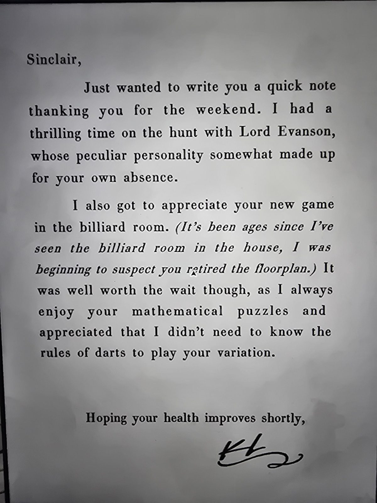

# Записка с благодарностью (про бильярдную)
Записка Синклеру от гостя. Лежит в Guest Bedroom.

Синклер,

хотел черкнуть пару строк и поблагодарить тебя за выходные. Я отлично провёл время на охоте с **лордом Эвансоном**, чей своеобразный характер отчасти возместил твоё отсутствие.

А ещё я наконец оценил твою новую игру в **бильярдной**. *(Я так давно не видел бильярдную в доме, что начал подозревать, будто ты убрал её из планировки.)* Ожидание того стоило: я всегда люблю твои **математические головоломки** и оценил, что для твоего варианта не нужно знать правил дартса.

Надеюсь, ты скоро поправишься,
*(подпись неразборчива, похоже на инициалы «K.L.»)*

## Заметка
- Подсказка к Billiard Room: там загадка-мишень для дартса, но решается она **арифметикой**, а не правилами дартса.
- «Убрал из планировки»: комнаты в доме появляются не каждый день, это обыгрывается в сюжете.
- Герберт к тому времени болел и не смог быть на охоте.
- Персонажи: **лорд Эвансон** (гость, охотник); автор записки неизвестен.

## Photos / Фото

