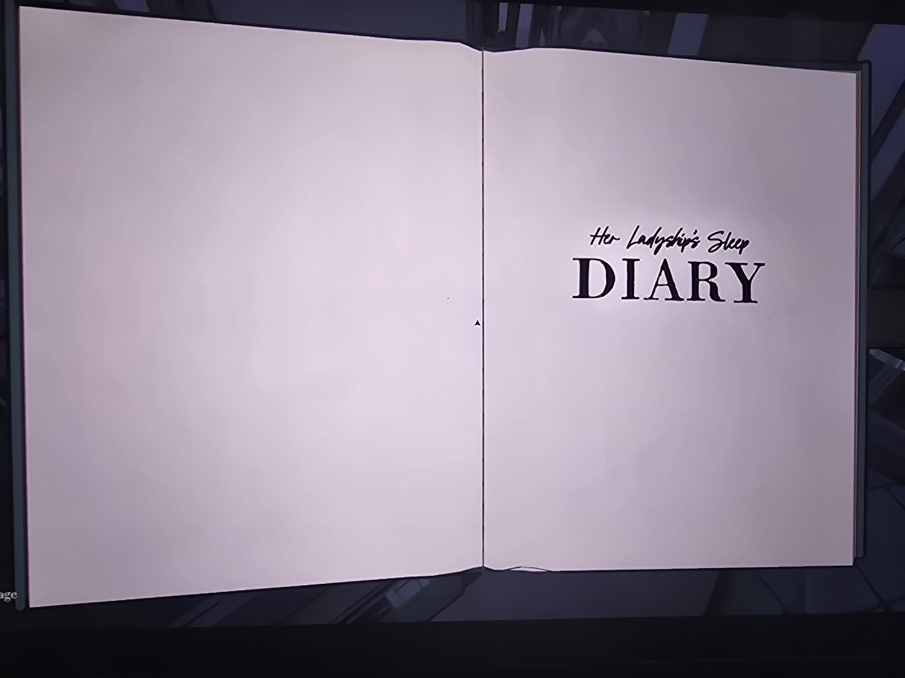
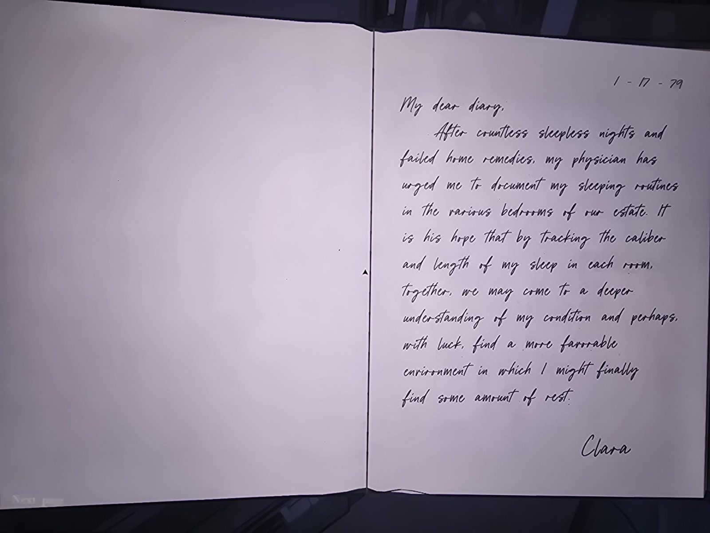
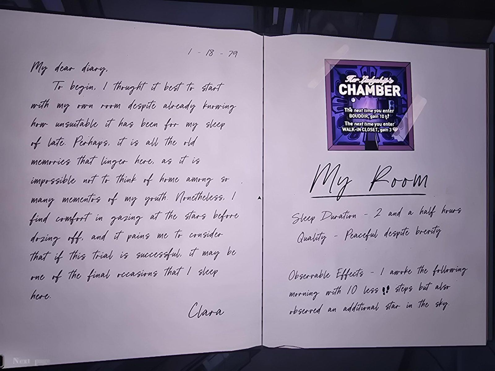
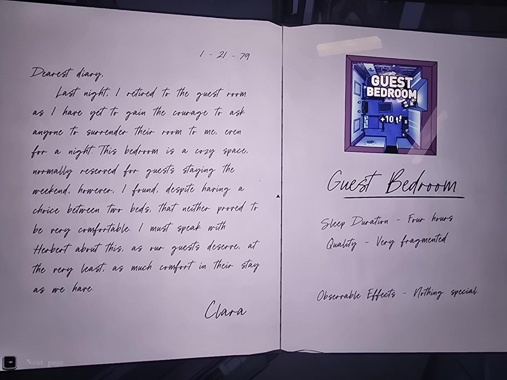
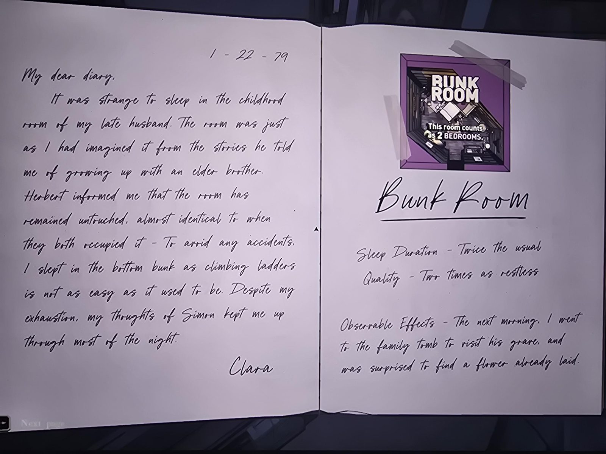
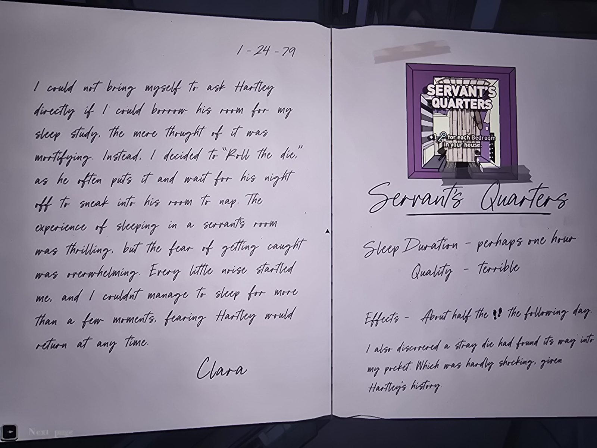
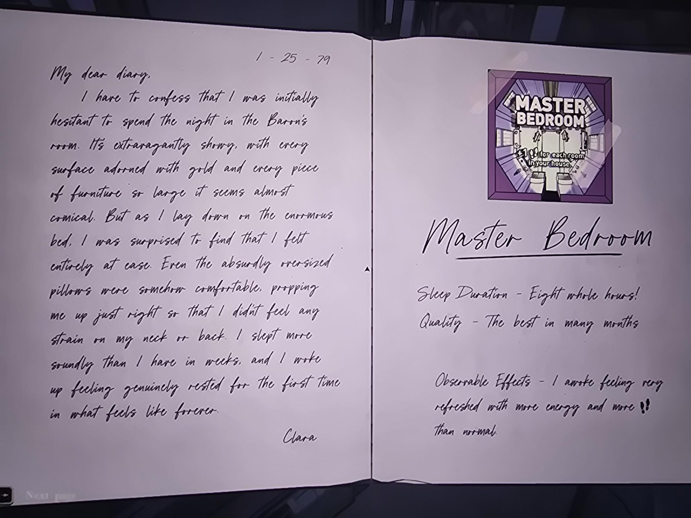
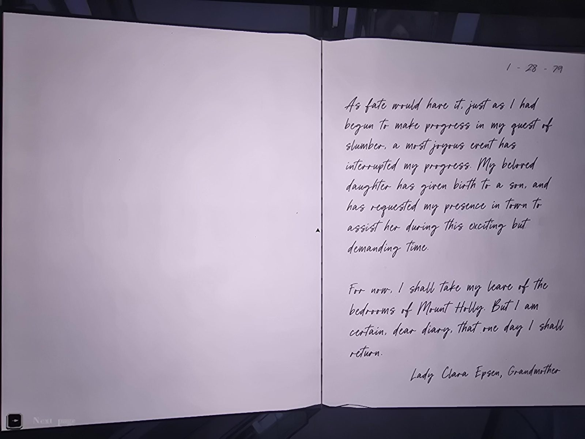
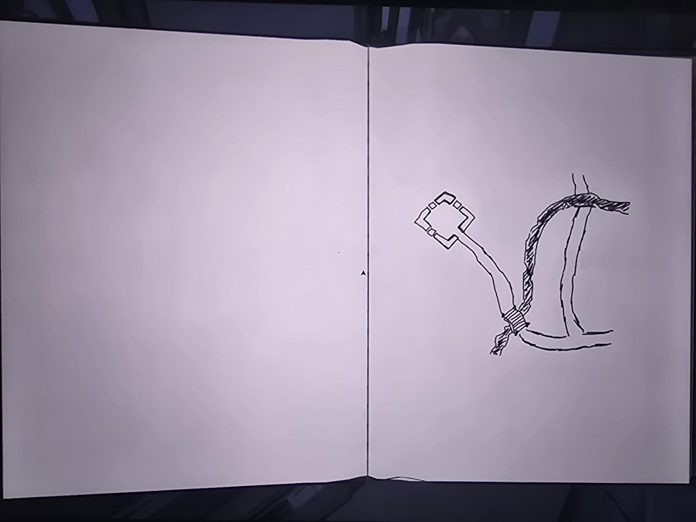

# Her Ladyship's Sleep Diary

*(page 1: title page)* Her Ladyship's Sleep DIARY

---

**1-17-79**

My dear diary,

After countless sleepless nights and failed home remedies, my physician has urged me to document my sleeping routines in the various bedrooms of our estate. It is his hope that by tracking the caliber and length of my sleep in each room, together, we may come to a deeper understanding of my condition and perhaps, with luck, find a more favorable environment in which I might finally find some amount of rest.

Clara

---

**1-18-79**

My dear diary,

To begin, I thought it best to start with my own room despite already knowing how unsuitable it has been for my sleep of late. Perhaps, it is all the old memories that linger here, as it is impossible not to think of home among so many mementos of my youth. Nonetheless, I find comfort in gazing at the stars before dozing off, and it pains me to consider that if this trial is successful, it may be one of the final occasions that I sleep here.

Clara

**My Room** *(taped card: HER LADYSHIP'S CHAMBER. The next time you enter BOUDOIR, gain 10 steps. The next time you enter WALK-IN CLOSET, gain 3 gems.)*

Sleep Duration - 2 and a half hours
Quality - Peaceful despite brevity

Observable Effects - I awoke the following morning with 10 less steps but also observed an additional star in the sky.

---

**1-21-79**

Dearest diary,

Last night, I retired to the guest room as I have yet to gain the courage to ask anyone to surrender their room to me, even for a night. This bedroom is a cozy space, normally reserved for guests staying the weekend, however, I found, despite having a choice between two beds, that neither proved to be very comfortable. I must speak with Herbert about this, as our guests deserve, at the very least, as much comfort in their stay as we have.

Clara

**Guest Bedroom** *(taped card: GUEST BEDROOM, +10 steps)*

Sleep Duration - Four hours
Quality - Very fragmented

Observable Effects - Nothing special.

---

**1-22-79**

My dear diary,

It was strange to sleep in the childhood room of my late husband. The room was just as I had imagined it from the stories he told me of growing up with an elder brother. Herbert informed me that the room has remained untouched, almost identical to when they both occupied it - To avoid any accidents, I slept in the bottom bunk as climbing ladders is not as easy as it used to be. Despite my exhaustion, my thoughts of Simon kept me up through most of the night.

Clara

**Bunk Room** *(taped card: BUNK ROOM. This room counts as 2 BEDROOMS.)*

Sleep Duration - Twice the usual
Quality - Two times as restless

Observable Effects - The next morning, I went to the family tomb to visit his grave, and was surprised to find a flower already laid.

---

**1-24-79**

I could not bring myself to ask Hartley directly if I could borrow his room for my sleep study, the mere thought of it was mortifying. Instead, I decided to "Roll the die," as he often puts it and wait for his night off to sneak into his room to nap. The experience of sleeping in a servant's room was thrilling, but the fear of getting caught was overwhelming. Every little noise startled me, and I couldn't manage to sleep for more than a few moments, fearing Hartley would return at any time.

Clara

**Servant's Quarters** *(taped card: SERVANT'S QUARTERS. +1 key for each Bedroom in your house.)*

Sleep Duration - perhaps one hour
Quality - terrible

Effects - About half the steps the following day.

I also discovered a stray die had found its way into my pocket. Which was hardly shocking, given Hartley's history.

---

**1-25-79**

My dear diary,

I have to confess that I was initially hesitant to spend the night in the Baron's room. Its extravagantly showy, with every surface adorned with gold and every piece of furniture so large it seems almost comical. But as I lay down on the enormous bed, I was surprised to find that I felt entirely at ease. Even the absurdly oversized pillows were somehow comfortable, propping me up just right so that I didn't feel any strain on my neck or back. I slept more soundly than I have in weeks, and I woke up feeling genuinely rested for the first time in what feels like forever.

Clara

**Master Bedroom** *(taped card: MASTER BEDROOM. +1 step for each room in your house.)*

Sleep Duration - Eight whole hours!
Quality - The best in many months

Observable Effects - I awoke feeling very refreshed with more energy and more steps than normal.

---

**1-28-79**

As fate would have it, just as I had begun to make progress in my quest of slumber, a most joyous event has interrupted my progress. My beloved daughter has given birth to a son, and has requested my presence in town to assist her during this exciting but demanding time.

For now, I shall take my leave of the bedrooms of Mount Holly. But I am certain, dear diary, that one day I shall return.

Lady Clara Epsen, Grandmother

---

*(last page: a hand-drawn sketch, no text: a crescent-shaped river and a path leading from it to a small square structure.)*

## Photos / Фото
        
